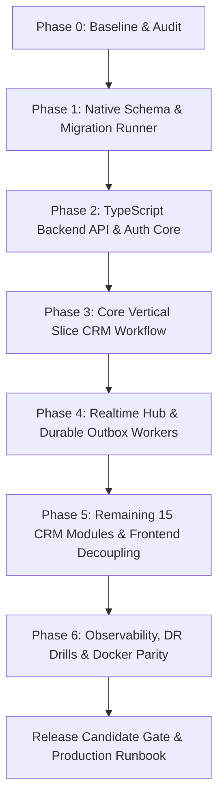

> **HISTORICAL — NOT CURRENT.** It is the original phasing plan; the approved plan is docs/audit/2026-10-14/07_REMEDIATION_ROADMAP.md. Current status lives in docs/audit/2026-10-14/ (audit and roadmap), PROJECT_LOG.md and the code. Do not treat statuses or PASS marks below as verified.

# ANIBROS CRM — MASTER DIRECTIVE IMPLEMENTATION PLAN

## 1. Phasing & Dependency Graph

---

## 2. Phase Breakdown and Milestones

### Phase 0: Baseline & Audit Gate (Completed)
- **Status:** PASS
- **Deliverables:**
  - Preserved Master Engineering Directive in `docs/MASTER_ENGINEERING_DIRECTIVE.md` (SHA-256 verified).
  - Generated `docs/SUPABASE_REMOVAL_MATRIX.md` (29 frontend files, 29 migrations, 4 edge functions).
  - Created `docs/MASTER_REQUIREMENTS_LEDGER.md` (155 atomic requirements).
  - Created `docs/SOURCE_COVERAGE_REPORT.md`, `docs/REQUIREMENT_CONFLICTS_AND_DECISIONS.md`, and `docs/REQUIREMENT_TRACEABILITY_MATRIX.md`.
  - Audited local baseline: 51 Vitest unit tests pass, TypeScript compiles clean, Vite production build succeeds.

### Phase 1: Native PostgreSQL Schema & Standalone Migration Runner
- **Dependencies:** Phase 0 complete.
- **Scope:**
  - Create `migrations/` directory with clean, standalone PostgreSQL migrations:
    - `001_core_schema.sql`: defines `public.users` table (`id`, `email`, `password_hash`, `email_verified`, `created_at`, `updated_at`) and organisations/tenants without any references to `auth.users`.
    - `002_crm_tables.sql`: contacts, leads (with `lead_score`), pipelines, stages, properties, projects, viewings, activities, tasks.
    - `003_queues_and_diagnostics.sql`: `webhook_inbox`, `outbox_events`, `marketing_attribution`, `system_telemetry`.
    - `004_rls_and_security.sql`: native RLS policies using `app.current_user_id()` and `app.current_tenant_id()`.
  - Create lightweight TypeScript migration runner `server/src/db/migrate.ts` utilizing `pg`.
  - Test migration execution against fresh local PostgreSQL 16 container.
- **Acceptance Criteria:** Empty database bootstraps to latest version with 0 errors.

### Phase 2: Dedicated TypeScript API Server & Authentication Core
- **Dependencies:** Phase 1 complete.
- **Scope:**
  - Scaffold `server/` with TypeScript, Fastify/Express, and `pg` connection pool.
  - Implement Argon2id password hashing and session token generator.
  - Implement server-managed cookie session middleware (`HttpOnly; SameSite=Lax; Secure`).
  - Implement CSRF token validation and rate limiting.
  - Implement auth endpoints:
    - `POST /api/auth/signup`
    - `POST /api/auth/login`
    - `GET /api/auth/session`
    - `POST /api/auth/logout`
    - `POST /api/auth/forgot-password`
    - `POST /api/auth/reset-password`
- **Acceptance Criteria:** Automated integration tests pass for signup, login, session validation, and logout.

### Phase 3: Core Vertical Slice CRM Workflow
- **Dependencies:** Phase 2 complete.
- **Scope:**
  - Implement service & repository layer for Leads, Pipeline Stages, Activities, and Viewings.
  - Endpoints:
    - `GET /api/leads` (search, pagination, filters, tenant-scoped)
    - `POST /api/leads` (deduplication, activity creation)
    - `POST /api/leads/:id/stage-transition` (transactional transition + audit log)
    - `POST /api/viewings` (concurrent booking prevention with `FOR UPDATE`)
  - Create `src/lib/api-client.ts` on frontend and connect `LeadsPage.tsx` and `PipelinePage.tsx`.
- **Acceptance Criteria:** End-to-end lead creation, search, stage transition, and viewing booking pass without any Supabase dependency.

### Phase 4: Native WebSocket Realtime Service & Durable Background Worker
- **Dependencies:** Phase 3 complete.
- **Scope:**
  - Implement authorized WebSocket hub (`server/src/realtime/hub.ts`) verifying session cookies and tenant channel authorization.
  - Implement durable outbox processor (`server/src/workers/outbox-processor.ts`) polling `outbox_events` via `FOR UPDATE SKIP LOCKED`.
  - Implement webhook receiver (`POST /api/webhooks/:provider`) with HMAC verification and durable inbox storage.
  - Implement webhook processor worker creating leads from inbox entries.
- **Acceptance Criteria:** Cross-tenant WebSocket message leakage test fails safely; webhook ingestion and outbox worker deliver with backoff and retry.

### Phase 5: Complete Remaining CRM Modules & Full Decoupling
- **Dependencies:** Phase 4 complete.
- **Scope:**
  - Port remaining frontend pages: Contacts, Properties, Projects, Tasks, Attribution, Integrations, Custom Fields, Automation Rules, Operations Center, Notifications, Settings.
  - Replace all remaining `supabase.*` calls with `apiClient.*`.
  - Remove `@supabase/supabase-js` from `package.json`.
- **Acceptance Criteria:** `npm run typecheck`, `npm run build`, and browser smoke tests pass with 0 `@supabase/supabase-js` references.

### Phase 6: Observability, Backup/DR Drills & Local Docker Parity
- **Dependencies:** Phase 5 complete.
- **Scope:**
  - Structured JSON logging with Pino, PII redaction, and correlation IDs.
  - Health probe endpoints (`/health/live`, `/health/ready`).
  - Docker Compose configuration (`docker-compose.yml`) running frontend, API, worker, and PostgreSQL on private network.
  - Backup and restore drill executed and documented in `docs/BACKUP_AND_DISASTER_RECOVERY.md`.
- **Acceptance Criteria:** Clean `docker-compose up` runs entire stack locally with 100% functionality and reproducible data restore.
