# ANIBROS CRM — COMPLETE ALL-IN-ONE AI HANDOFF

This is the single-file version of the handoff package. Read START HERE, current context, plan, project log, and coding-agent prompt first. The original architecture plan is included as a historical appendix.

---

# Start Here — Anibros CRM Handoff

This package carries the project from Bolt into Antigravity with Gemini/Claude.

## Use this package

1. Copy the files/folders from this package into the **root of the downloaded Anibros CRM repository**. If files with these names already exist, compare before replacing. Preserve any useful local changes and merge rather than blindly overwrite.
2. Give the coding agent `AI_AGENT_MASTER_PROMPT.md` and tell it to read `MASTER_CONTEXT.md`, `plan.md`, `PROJECT_LOG.md`, and `ARCHITECTURE_BASELINE_ORIGINAL.md` first.
3. From the repository root run:
   ```bash
   python scripts/update_ai_context.py
   ```
4. Tell the agent to read `AI_CONTEXT_BUNDLE.md`, inspect the actual code/database, update statuses based on evidence, then start implementation.
5. Keep using the same repo-root `plan.md` and `PROJECT_LOG.md` after every significant task. Re-run the Python script before handing work to another model/session.

## Files

- `MASTER_CONTEXT.md` — main project context, user requirements, architecture, prior work, auth issue history, live-sync requirements, observability design and current risks.
- `AI_AGENT_MASTER_PROMPT.md` — copy/paste instructions for Antigravity/Gemini/Claude.
- `plan.md` — new prioritized implementation roadmap with concrete acceptance tests.
- `PROJECT_LOG.md` — evidence-based historical snapshot and appendable project log.
- `ARCHITECTURE_BASELINE_ORIGINAL.md` — original detailed architecture document preserved as historical reference; some status/roadmap text is stale.
- `scripts/update_ai_context.py` — safe context inventory generator. It writes `AI_CONTEXT_BUNDLE.md` only and does not alter source or environment settings.
- `AI_HANDOFF_ALL_IN_ONE.md` — single large Markdown file combining the context, plan, log, master prompt, and original architecture reference.

## First thing to tell the coding agent

“Do not assume the backend works because old documentation says it exists. Inspect this downloaded repo and connected Supabase project. Verify feature wiring. Make live lead synchronization the first product priority, and keep the Operations Center/security work in the same plan. Update the project log and plan continuously. Never make unsupported claims or touch live provider settings without approval.”


---

# SECTION: MASTER PROJECT CONTEXT

# ANIBROS CRM — MASTER PROJECT CONTEXT & HANDOFF

**Purpose:** This document is the canonical handoff for Gemini, Claude, Antigravity, or any other coding agent continuing the Anibros CRM after the project was downloaded from Bolt. Read it before changing code.  
**Context snapshot date:** 12 October 2026 (India Standard Time).  
**Important evidence rule:** This document combines prior project documents, user requirements, and statements reported by Bolt. It is not a substitute for inspecting the downloaded repository and connected Supabase project. Treat any state described as “Bolt reported” as unverified until independently checked against source code, migrations, database, and runtime.

---

## 0. THE MISSION — DO NOT LOSE THIS

Build **Anibros CRM**, a 2026-grade, professionally engineered, multi-tenant real-estate CRM and marketing operations platform. The ambition is “FAANG-level” engineering quality: secure by default, modular, reliable, observable, testable, scalable, auditable, maintainable, and usable by both technical and non-technical staff. Do not interpret this as a claim that current code is already at that standard. It is the quality target and acceptance bar.

The platform begins as an internal system for Anibros Design to manage multiple real-estate clients, but its architecture should support a commercial SaaS product later. It must not become a collection of attractive pages backed by disconnected or mocked data. Every feature advertised in the UI must have a real, secure, correctly scoped end-to-end implementation, or be clearly marked as not implemented.

### The user's key requirements, in plain language

1. **Complete project context must survive across AI sessions.** The coding agent must create and maintain `plan.md`, `PROJECT_LOG.md`, architecture documentation, and a Python script that regenerates a concise context bundle from the project every time work resumes. Do not rely on chat history or model memory.
2. **Leads must be live.** New leads should appear within seconds without manual page refresh. Lead details and status changes must stay current too, not only the dashboard count. Supabase Realtime should be the preferred mechanism if correctly configured and secured; implement a safe fallback (bounded polling with backoff/reconnect) if Realtime is unavailable. A report filter of 7/30/90 days must never mean the live Leads inbox only fetches seven days of data unless the user explicitly applies such a filter.
3. **Live updates must work end to end.** When a website, Google Ads, Meta Lead Ads, or other enabled source generates a lead, the event must be received securely, durably recorded, processed/idempotently normalized, linked to a contact and attribution, committed to the correct tenant, and then appear in the CRM within the latency target. Realtime only broadcasts data after it exists; it does not replace backend ingestion or processing.
4. **Real backend, not just frontend.** The downloaded app may have pages, forms, and UI that are not properly connected to backend functions/database state or do not synchronize. Treat every page/API/function as unverified until traced through the real database and tested. A component existing in the source tree is not proof a feature works.
5. **Unified logs, monitoring, and audit.** Every important action and critical failure should be traceable. Build a user-friendly Operations Center with real telemetry, clear causes, impact, actions, and technical detail/correlation IDs. Maintain operational logs, security/audit events, webhook inbox/outbox history, health/dependency status, incident history, queue/job status, retries, dead letters, and safe recovery actions.
6. **Multi-tenant isolation is non-negotiable.** Every tenant-owned read, write, export, Realtime subscription, report, file, queue event, diagnostic, and integration credential must be properly scoped and authorized. The browser-supplied tenant ID is never proof of authorization.
7. **Do not stop after audits.** Audit, fix, test, document, then continue the next highest-priority implementation item. Make incremental progress rather than repeatedly re-explaining the architecture.
8. **Keep documentation factual.** Distinguish `PASS`, `FAIL`, `PARTIAL`, `BLOCKED`, and `NOT VERIFIED`. Never call a build pass evidence that runtime, integrations, auth, or security works.
9. **Work carefully around live systems.** Do not change live ad campaigns, production credentials, or existing production webhook endpoints/destinations without explicit approval. Never ask the user to put secrets in chat. Do not log raw secrets.
10. **Cost constraint.** Prefer the current React/Supabase stack and free/open-source or already available tooling until real needs justify cost. Do not introduce paid vendors or infrastructure silently. Explain trade-offs and recurring costs before adding services.

---

## 1. PRODUCT VISION AND USERS

### Product vision

A multi-tenant real-estate CRM and marketing operations system that centralizes lead capture, contact management, real-estate inventory, property matching, pipeline/deal processes, viewings, tasks, attribution, communications, conversion feedback, operations monitoring, and auditability.

The differentiator is **reliable, traceable lead-to-deal workflows**, not feature count:
- Every external lead has a known source and stable provider identity.
- Every important lead mutation is authorized, atomic where appropriate, and audited.
- Every pipeline transition is server validated against an allowed state machine.
- Every integration connection status is based on real checks and observed deliveries, not a badge set by the UI.
- Every inbound webhook and outbound conversion event is durably tracked, deduplicated, retryable, and recoverable.
- Every business data view updates when the underlying data changes.
- Operational failures explain what happened, why, what was affected, and the next safe action.

### Intended customers and stages

- **Internal:** Anibros Design staff operate CRM for client accounts.
- **Pilot:** Selected real estate businesses use tenant-isolated workspaces.
- **SaaS:** Real-estate agencies, developers, brokers, and related businesses can be onboarded and billed.

### Main personas

- Sales agent: quick access to assigned/authorized leads, follow-up tasks, viewing calendar, activities, contact history, and messaging.
- Sales manager: pipeline, assignment, stale leads, SLA and agent performance.
- Marketing manager: lead-source/campaign attribution, quality/conversion outcomes, integration health, conversion feedback.
- Tenant admin/owner: members, roles, tenant configuration, integrations, custom fields, audit/operations access.
- Anibros/agency operator: scoped cross-tenant operations and delegated oversight, not unrestricted access to every customer's individual records.
- Platform operator: platform-wide health, incident response, provisioning and controlled administration.
- Auditor/read-only user: authorized immutable audit visibility.

---

## 2. REPOSITORY AND TOOLING CONTEXT

### Expected/previously reported technology stack

- React 18, TypeScript, Vite.
- Tailwind CSS 3 with custom design-system tokens (primary/accent/success/warning/error/surface colour ramps).
- Supabase: PostgreSQL, Auth, RLS, Edge Functions, Realtime (Realtime must be verified in actual configuration and code).
- React Router DOM 7, Zustand 5, `clsx`, `tailwind-merge`, `date-fns`, `lucide-react`.
- Vite path alias `@/` → `src/`.
- Edge Functions use Deno/TypeScript.
- PostgreSQL RPCs/functions for atomic workflows and trusted server-side decisions.
- Existing table-backed webhook inbox/outbox; a scheduled worker/fallback was proposed via `pg_cron`, with Edge Functions for processing. Exact current deployment and scheduling must be inspected.

**Source of truth is the downloaded repository plus its connected Supabase project.** The above stack is copied from a previous Bolt project log and may not match every file in the downloaded snapshot. Verify `package.json`, lock file, migrations, `supabase/functions`, route structure, git status, and environment configuration before assuming.

### User's working environment

- Project was built in Bolt, but the user ran out of Bolt credits and downloaded the project.
- Current coding environment is **Antigravity** using Gemini and/or Claude.
- User expects strong continuity across model/tool changes.
- The user is specifically worried Gemini may lose or misunderstand context; be very explicit, structured, repetitive around critical constraints, and keep files updated with a Python context-bundle script.

### Repository rules

- Never rewrite from scratch merely because inherited code is messy.
- Do a baseline audit and preserve working functionality.
- Before migrations, inspect existing policies/grants/triggers/RPCs/consumers and write a forward-only migration with rollback/mitigation notes.
- Never blindly apply migration files to a production database. Compare local migrations against the actual remote migration state first.
- Never copy `.env` secrets into documentation/context files. Include variable names only, redact values.
- If a real API/provider credential is missing, implement a safe mock/fixture path for deterministic tests, but label real provider E2E as `BLOCKED`.
- Keep the user informed with meaningful progress; do not report generic updates without concrete work.

---

## 3. CURRENT STATUS SNAPSHOT — EVIDENCE MUST BE RECHECKED

The items below are a consolidated state from previous project logs and Bolt messages. They describe reported state, **not independently re-verified state in the newly downloaded folder**.

### 3.1 Reported core database and backend work

Bolt's earlier project log recorded 12 migrations applied:
1. `001_organisation_tenant_hierarchy` — organisations, tenants, branches, organisation memberships, tenant memberships, RLS, helper functions including platform/agency role checks and tenant-ID lookup.
2. `002_crm_domain_tables` — pipelines/stages/transitions, contacts, leads, lead stage history, marketing attribution, projects, properties, property availability history, activities, tasks, viewings, audit logs, webhook inbox, outbox events; tenant IDs and RLS policies.
3. `003_seed_pipeline_and_transition_function` — `transition_lead_stage()` with allowed transition validation and related history/audit/activity work; `seed_default_pipeline()` with 13 real-estate pipeline stages and 30+ permitted transitions.
4. `004_fix_security_advisor_warnings` — fixed search paths for helpers.
5. `005_fix_function_grants` — revoked public execute access on `SECURITY DEFINER` functions and granted explicit access.
6. `006_auto_onboarding_function` — `create_default_tenant()` creates organisation, tenant, memberships, and default pipeline for new accounts.
7. `007_lead_scoring_function` — rule-based lead score from source, budget, timeline, engagement.
8. `008_integrations_consent_customfields_automation_subscriptions` — integrations, webhook endpoints, communication consent, custom fields, automation rules/executions, subscription plans and subscriptions.
9. `009_user_invitation_function` — `invite_user_to_tenant()` with role checks and audit intent.
10. `010_role_based_permission_enforcement` — role-aware database write permissions across numerous tables; configuration restricted to appropriate roles.
11. `011_database_integrity_composite_fks` — composite tenant/id uniqueness and foreign keys to stop cross-tenant child references; indexes.
12. `012_stuck_job_recovery` — reset stuck webhook and outbox processing records after a threshold.

Later Bolt messages referred to **18 migrations before migration 019**, then said **migration 019 was already applied successfully**. Exact names/content for migrations 013–018 and migration 019 have not been supplied in the chat. Do not invent their names. Inspect the downloaded `supabase/migrations` directory and the remote database's migration table. Reconcile actual migration filenames, applied state, and content.

### 3.2 Reported deployed Edge Functions

A prior project log claimed four deployed/active functions:

1. `webhook-ingestion`: Google Ads and Meta Lead Ads webhook handler. Google payload key validation; Meta `X-Hub-Signature-256` HMAC-SHA256 over raw request body and GET verification challenge; resolves tenant from integration configuration, not user-supplied payload; stores inbox event with idempotency.
2. `process-webhooks`: normalizes inbound events, deduplicates contacts/leads by normalized email/phone, creates attribution, retries with backoff, dead-letters after max retries.
3. `process-outbox`: handles outbound conversion events; uses per-tenant credential references; reports for Google Enhanced Conversions for Leads and Meta Conversions API; fails closed if missing config.
4. `integration-status`: checks configuration/connectivity without deliberately sending live conversion events; sanitizes errors.

**Critical caveat:** this is a claim in an earlier log. Inspect local function source and remote deployment. Do not assume they are present, current, secure, reachable, or correctly wired in the downloaded repository. A frontend-only export may not contain deployed backend assets or deployment secrets even if Bolt previously deployed them.

### 3.3 Reported frontend modules/pages

Previously listed as built:
- Infrastructure: `src/lib/supabase.ts`, `src/lib/utils.ts`, `src/types/index.ts`, Zustand `src/stores/auth-store.ts`, tenant-scoped hooks `src/hooks/use-tenant-data.ts`.
- Shared UI: Button, Input/Textarea/Select, Card, Badge, Avatar, Spinner, EmptyState, Dialog, Table/DataTable.
- Auth: Sign in, Sign up, AuthProvider, ProtectedRoute, password recovery pages added later.
- Layout: app sidebar, top bar, tenant selector, search, notifications/profile.
- Dashboard: 8 metric cards (total/new/qualified/won leads, pipeline value, unassigned, stale, tasks due), recent leads.
- Leads list/detail: search, filters, create lead, CSV import/export; detail stage transition through RPC, activity timeline, tasks, assignment.
- Pipeline Kanban with drag/drop stage transitions.
- Contacts list.
- Properties list/detail; create/edit; type and availability filters.
- Projects.
- Tasks.
- Calendar/viewings.
- Reports with 7/30/90/365/all date filter, export, metrics, sources/stages/agent performance.
- Integration configuration UI.
- Webhook inbox diagnostics and replay/recovery UI.
- Outbox diagnostics and retries/recovery UI.
- Settings: tenant/member management/invites/audit log.
- Custom fields, automation rules, tenant configuration/branding/pipeline, subscription page.
- Explainable property matching engine.

Later in the chat, Bolt began additional work on:
- Dashboard stats via a server-side RPC, with tenant scoping and error handling.
- Better error handling for `LeadsPage` and `PropertiesPage` (previously they silently ignored fetch errors; search dependency was reportedly corrected).
- Marketing attribution analytics via a server-side RPC and a new frontend page/route/navigation item.
- Operations Center page/tabs and types after migration 019.

**These latest features are incomplete until actual files/routes are checked.** The last message from Bolt ended in the middle of adding the Operations Center to routing/navigation and adding a permission flag. Do not assume it finished.

### 3.4 Current known state around migration 019 / Operations Center

Bolt said migration 019 was applied successfully and verified this permissions picture:

| Table | SELECT (as reported) | INSERT (as reported) | UPDATE (as reported) | DELETE (as reported) |
|---|---|---|---|---|
| `audit_logs` | authenticated, tenant-scoped | authenticated, tenant-scoped | dropped | dropped |
| `webhook_inbox` | authenticated, tenant-scoped | dropped / trusted service-side only | dropped / trusted service-side only | dropped / trusted service-side only |
| `outbox_events` | authenticated, tenant-scoped | dropped / trusted service-side only | dropped / trusted service-side only | dropped / trusted service-side only |
| `operational_logs` | authenticated, tenant-scoped | no client insert policy reported | no client update policy reported | no client delete policy reported |
| `system_health` | authenticated, tenant-scoped | no client insert policy reported | no client update policy reported | no client delete policy reported |
| `incidents` | authenticated, tenant-scoped | no client insert policy reported | no client update policy reported | no client delete policy reported |

Reported intent: Edge Functions use the service-role key and can write to inbox/outbox while browser clients cannot forge processing state. This needs a critical real-code/security review because service-role bypasses RLS, and only trusted server-side code may possess it.

Known remaining work from the very latest Bolt transcript:
- Inspect all consumers of changed policies and grants.
- Replace diagnostics pages' direct inbox/outbox table writes with authorized RPCs for replay/recovery.
- Ensure replay RPCs independently validate caller identity, tenant, role, event state, and idempotency.
- Add TypeScript types for `operational_logs`, `system_health`, and `incidents`.
- Build Operations Center tabs/views.
- Add route, navigation item, permission flag.
- Ensure real logs/health/incidents get written and are not empty tables with a frontend shell.
- Test all legit inbound/outbound processing and recovery paths after migration.

### 3.5 Authentication / onboarding history and unresolved verification

The workspace screen previously showed:
> Workspace Setup Required — Your account is not associated with any workspace yet. You can retry the setup or sign out and contact your administrator.

Several changes were reported:
- Fixed truncated braces/file structure in `auth-store.ts`.
- Fixed an incorrect `loadTenantData` access from `AuthProvider` scope.
- Added recoverable setup error screen with Retry/Sign Out.
- Added `tenantLoading` and `onboardingError`.
- Addressed a race between `getSession()` and `onAuthStateChange(INITIAL_SESSION)`; skip duplicate initialization when the same user already loaded.
- Split memberships and tenants into separate queries rather than one joined query.
- Added `onboardingPromise` to await in-flight tenant provisioning.
- Signup page handles both immediate session and email-confirmation/no-session path.
- Added forgot/reset-password routes using `resetPasswordForEmail` and `updateUser`.

Then the investigation found **infinite RLS recursion** in both `tenant_memberships` and `organisation_memberships`: policies queried their own table again. The reported fix was to use `SECURITY DEFINER` helper functions `get_user_tenant_ids()` and new `get_user_org_ids()` instead of self-referencing subqueries. The functions were described as having fixed `search_path=public, auth`.

Bolt reported six database RLS tests passing:
1. User A reads own tenant memberships: 1 row.
2. User A cannot see User B's tenant: 0 rows.
3. User A cannot see User B's leads: 0 rows.
4. User B reads own tenant memberships: 1 row.
5. User A reads own organisation memberships: 1 row.
6. User A reads own tenant: 1 row.

Bolt also reported that `create_default_tenant()` returned an existing tenant ID idempotently, and each test user still had one tenant/membership, without duplicates.

**Actual browser runtime verification was explicitly not performed in earlier logs.** The user later showed screenshots of the authenticated dashboard, proving at least one authenticated session rendered the dashboard at that later point, but does not prove new-user signup, password recovery, refresh/session restoration, all roles, or every auth path. Re-run these tests in the downloaded app against the intended Supabase project.

### 3.6 Dashboard and attribution work in progress

- Bolt added a dashboard stats RPC to aggregate dashboard metrics server-side and reported it worked, with cross-tenant caller access rejected.
- User wants current/live data, not only date-ranged snapshots.
- Bolt fixed an ambiguous `utm_medium` column by intending to use qualified aliases in the attribution query.
- Attribution RPC returned valid empty results.
- Bolt attempted to insert temporary test leads/attribution records, reported calculations manually correct (3 attributed leads across Google Ads, Meta Lead Ads and manual; campaign/channel/stage breakdowns), then reported test data cleaned up.
- A frontend attribution dashboard page was then being created and the last state was “Now add the route and nav item.” Check whether route/nav were ever completed.
- Dashboard/Leads/Properties previously had silent error-handling weaknesses. Bolt reported improvements to LeadsPage and PropertiesPage and fixed search effect dependencies. Verify exact code and runtime.

### 3.7 User’s assessment about frontend/backend gap

The user explicitly worries that the downloaded project has a lot of frontend but weak/incomplete backend wiring and no reliable live synchronization. Treat this as a top-level risk. Do not argue from the fact that old logs list tables/functions/pages. Conduct a proof-based audit of every path: UI event → service/repository call → auth/RLS/RPC/Edge Function → database transaction → response/error → UI state update → Realtime propagation/refresh → audit/operational event.

---

## 4. LIVE LEADS AND TRUE DATA SYNCHRONIZATION — P0 REQUIREMENT

This is a non-negotiable acceptance requirement, not a future enhancement.

### User-visible behavior

- When a new lead is committed to the correct tenant database, every authorized active CRM view should reflect it within seconds, without a manual refresh.
- Lead list, dashboard counters, pipeline Kanban, lead details, contacts, tasks/activities affected by a change, reports and notification indicators should remain consistent.
- Edits to stage, assignment, value, priority, contact details, attribution, and other fields should propagate to other open sessions.
- Deletions/merges/archival should update correctly according to the product's soft-delete/archive policy.
- Switching tenant/workspace must stop old tenant subscriptions and subscribe to the new tenant safely.
- Reconnection, token refresh, browser sleep/wake, and network interruptions must recover without duplicate rows or stale data.
- Date filtering in Reports is separate from live synchronization. Leads should not silently stop loading older records just because the dashboard/report defaults to the last 7 days.

### Recommended technical approach

1. Use Supabase Realtime Postgres Changes or a carefully designed Broadcast flow for `leads` and other high-value tables, if supported and configured correctly. Verify table publication, RLS/realtime authorization, subscription filters, and connection limits.
2. On page load or tenant switch, fetch the authoritative initial snapshot. Then subscribe to changes; handle race conditions between initial fetch and subscription establishment (subscribe first or reconcile by refetching after subscription is ready).
3. Filter subscriptions by active tenant only as an optimization; rely on RLS/authorization as the security boundary. Do not treat client-side filters as security.
4. On `INSERT`, upsert by primary key; on `UPDATE`, merge/replace the record using consistent ordering; on `DELETE`, remove or invalidate it. Avoid duplicate insertions when a realtime event races with mutation response/refetch.
5. When a mutation succeeds from the current client, update cache/state immediately or invalidate/refetch; the event may also reach the same client, so all updates must be idempotent.
6. Recompute or invalidate dashboard/report aggregates when their underlying entities change. Avoid fetching all tenant rows into the browser to calculate business-critical metrics.
7. If Realtime channel disconnects/errors or isn't available, show state, attempt reconnection with bounded backoff and use polling fallback (e.g. 5–10 seconds only while tab is active; slower when hidden) with cleanup. Use a configurable interval and avoid hammering Supabase.
8. Expose `lastSyncedAt`, connection status, last error and stale-data indication in developer/operations diagnostics. Do not display “Live” while disconnected or stale.
9. Use one shared subscription manager/hook per tenant/resource where appropriate rather than creating duplicate subscriptions in every component.
10. Include a deterministic integration test: insert/update a lead using another authenticated session or test webhook, verify it appears/updates in an already-open browser tab without reload. Also test tenant A never receives tenant B events.

### Proposed live sync targets (targets to measure, not claims)

- Database commit → authorized active UI becomes current: target p95 ≤ 3 seconds when Realtime is connected.
- External webhook receipt → lead visible in CRM: target p95 ≤ 10 seconds under normal conditions, while durable receipt prevents data loss during slow processing.
- Realtime reconnect after a short network interruption: target ≤ 15 seconds, followed by snapshot reconciliation.
- Every target must be measured in logs/metrics, with latency derived from timestamps. Do not claim SLO compliance without tests/measurements.

### External source ingestion pipeline

`Google/Meta/website/provider event → authenticated webhook validation → resolve integration/tenant from server-side configuration → durably write webhook_inbox/idempotency key → acknowledge only after durable receipt → process/normalize → deduplicate provider event → upsert contact → create/update lead + attribution + activity/audit as appropriate, transactionally → mark inbox complete or retry/dead-letter → commit DB → Realtime notification/refetch → UI refresh`

Rules:
- Do not create leads directly from a webhook handler before durable receipt/idempotency is established.
- Distinguish duplicate deliveries from a new enquiry by the same person. A repeat enquiry can be a separate lead linked to the same contact.
- Inbound lead webhooks are not automatically available just because a frontend “Integrations” form exists.
- Test with safe fixtures/test payloads first. Do not send test conversions to live ad accounts or change a production webhook endpoint without explicit approval.

---

## 5. CORE DOMAIN WORKFLOWS THAT MUST ACTUALLY WORK

### Leads and contacts
- Create, read, edit, assign, filter, search, paginate, import/export with validation and role checks.
- Server-side duplicate handling: normalized email/phone for contact matching; stable external event IDs for duplicate webhook detection; do not silently merge separate enquiries.
- Full lead details and history should show source/campaign, contact, stage history, owner/assignment, activities, tasks, viewings, property matches, consent, and relevant audit timeline.
- List search/filter/pagination should handle all relevant data, not arbitrary sample or default 7-day limits. Infinite scroll or pagination is fine if total data access is truthful and consistent.
- Lead stage change must use server-side RPC/state machine, not directly patch stage column from browser.
- Every list/detail fetch needs loading, error, empty, and populated states. A request failure must not be shown as “no leads.”

### Pipeline
- 13 standard real-estate stages were reported; 30+ valid transitions.
- Validate transitions server-side, including required loss reason/assignment/fields, timestamps, lead stage history, activity and audit/outbox events.
- Drag/drop cannot bypass permitted transitions.
- Pipeline and list/detail must reconcile after mutations and in realtime.

### Properties, projects and matching
- Real CRUD backed by DB; tenant-scoped; real filters and validation.
- Matching engine is explainable, rule-based as originally implemented: budget (30 pts), location (25), property type (20), bedrooms (15), transaction intent (10), with per-match reasons and sorted suggestions. Verify actual code/schema before preserving weights.
- Property availability lifecycle may need more than available/sold: reserved, blocked, soft-hold, under-negotiation with expiry.

### Tasks, activities, viewings/calendar
- Tasks need correct assignment, due dates, completion, permissions, and real links to leads/contacts.
- Activities capture calls, emails, notes and other interactions with user/timestamp and linked entity.
- Viewing calendar should prevent invalid/conflicting schedules as requirements evolve, and sync when records change.

### Dashboard and reporting
- Stats should be from real, tenant-scoped server-side queries/RPCs; aggregate totals should be correct and not leak data.
- Show timestamps/ranges and explain definitions of qualified, won, stale, unassigned, pipeline value, response time and conversion.
- Live dashboard metrics should refresh after changes, even where report history uses a user-selected date range.
- Empty data must be a valid empty state, not an error or fabricated sample.
- CSV import/export must validate field names/types, avoid formula injection, apply permissions, audit exports/bulk changes, handle partial failures and show row-level errors.

### Marketing attribution
- Campaign/source/medium/channel attribution should connect to actual lead records; handle missing UTM data; dedupe events; avoid double counting when multiple attribution records exist.
- Distinguish raw enquiries from qualified/won outcomes. The goal is campaign quality and business results, not only lead volume.
- The attribution RPC was reported to calculate three temporary sample cases correctly, but the frontend page/route/nav was incomplete at the last transcript point. Re-test query counts manually from seeded fixtures and confirm cleanup.

### Multi-tenant roles and permissions
Roles in prior architecture: platform owner, agency admin, tenant owner/admin, sales manager, sales agent, marketing manager, auditor/read-only, analyst/read-only as applicable. Verify actual enum and rules in code/schema rather than assuming every role exists.
- DB/RPC/Edge Function is the authorization boundary; frontend gating is UX only.
- Agency access must be delegated/scoped and audited; not unrestricted access to individual data across tenants.
- Realtime channels, signed URLs, logs, exports and diagnostics need the same isolation standards as normal CRUD.

---

## 6. INTEGRATIONS AND RELIABLE EVENT PROCESSING

### Google Ads lead forms
- Webhook payload includes a provider event/lead identifier, field data, and a configured verification key. Resolve tenant from the registered integration mapping, not arbitrary request body.
- Stable unique event identity per integration, idempotent retries, tolerant unknown-field handling, explicit handling of provider test leads.
- Verify current Google docs/API lifecycle before implementation; an older architecture document references the September 2026 developer-token policy, but vendor facts can change.

### Meta Lead Ads
- Webhook verification challenge for subscription setup; HMAC-SHA256 check of raw request body/signature for POSTs.
- Leadgen webhook may carry `leadgen_id` and require authenticated Graph API fetch for full fields.
- Use correct app secret/page access tokens and current Graph API version, store secrets only server-side, redact error/log output.

### Meta Conversions API / Google Enhanced Conversions for Leads
- Outbound conversion events must be generated from valid lifecycle milestones and the current integration mapping.
- Use per-tenant credentials, correct account routing, consent checks, normalized/hashed identifiers as required, idempotency/event IDs, retry policy, sanitized provider response.
- Never send conversion events to a wrong customer's ad account. Never make real provider calls during tests without explicit approval.

### WhatsApp and CRM email
- Planned, previously blocked by credentials/provider accounts. Use official WhatsApp Cloud API and an email provider adapter (Resend/SES/SendGrid are candidates, not chosen by this handoff).
- Respect messaging windows/templates, consent, opt-out, delivery/bounce/status events, message audit and outbox durability.
- Do not assume this has been implemented.

### CRM SaaS subscriptions
- Subscription plans/free/pro schema was reported; Stripe integration and self-serve onboarding remained incomplete/blocked.
- Do not make billing functional claims until checkout/webhooks/subscriptions/entitlements are implemented and tested.

### Queue state machines and worker behavior

Inbound inbox (conceptual statuses): `received → processing → completed`; transient error → `retrying` with `next_attempt_at`; max failures → `dead_letter`; invalid signature or unresolved integration → `rejected`.

Outbound outbox: `pending → processing → sent`; transient error → `retrying`; max failures → `dead_letter`; an outdated/superseded event may be marked `superseded` if implemented.

Requirements:
- Claim rows safely with concurrency controls (`FOR UPDATE SKIP LOCKED` or equivalent), leases/claimed-at, bounded attempts and backoff/jitter.
- Recover abandoned `processing` rows and expose why they were recovered.
- Retry only operations safe to retry, with provider idempotency where available.
- Manual replay requires role/tenant checks, valid states, idempotency and audit history.
- Track attempts, duration, provider/status/error, next retry time, final state and who initiated manual recovery.
- Do not allow browser clients to write arbitrary queue rows or fake delivery success.

---

## 7. OPERATIONS CENTER, OBSERVABILITY, LOGGING, AND AUDIT

A unified Operations Center is a core product requirement. It must have real data and be understandable by a non-technical user while retaining technical diagnostic details for developers.

### Main views
1. **Overview:** current/stale/unknown health, recent incidents, webhook failures, queue lag, integration connectivity/last delivery, Edge Function/backend error trends, recent recovery.
2. **Logs Explorer:** structured logs with date/severity/component/tenant/correlation ID/error code filters, pagination, search, sanitized details.
3. **Audit Trail:** actor, action, target resource, tenant, timestamp, outcome, permitted change diff, filters and resource/user timeline. Normal users cannot modify/delete history.
4. **Webhook Inbox:** event source, received time, signature validation result, dedup result, status/stage, attempt count, sanitized payload metadata, latest error, processing duration, safe replay when authorized.
5. **Outbox & Jobs:** pending/processing/retrying/sent/dead-letter, oldest pending age, attempts, next retry, provider response, manual retry/recovery controls with confirmation.
6. **Integrations:** per tenant/provider connection/configuration state, last successful safe check, last accepted delivery, last error, token/config expiration if safely available, no secret display.
7. **Incidents:** evidence-based issue, severity, first/last seen, impacted tenant/component, linked correlation/event IDs, timeline, status/assignee/resolution and recovery audit.
8. **Health/Dependencies:** DB/app/Auth/Realtime/Edge Function/job/provider health where measurable, checked-at, latency, stale-data status and last successful observation.

### Non-technical incident explanation
Each incident should answer:
- What failed?
- When did it fail?
- Which tenant, integration, lead, or job was affected (only to authorized users)?
- What is the actual observed reason, HTTP/status/provider error, or exception code?
- Is data missing, delayed, or safely queued?
- Has retry been scheduled? How many attempts remain?
- What should the user do next?
- Can this be retried safely?
- Where is the technical detail/correlation ID?

Do not infer a cause beyond evidence. Use wording such as “likely cause” only when labelled as a hypothesis. Never display fake green/healthy status because the page loaded.

### Distinguish storage types
- **Audit events:** authoritative business/security accountability; actor and action history.
- **Operational logs:** diagnostic records from frontend/server/database/edge processes.
- **Integration event history:** inbound/outbound provider lifecycle.
- **Job execution history:** each attempt, claim, retry, result and duration.
- **Health observations:** periodic/triggered check result, timestamp, latency, details.
- **Incidents/alerts:** lifecycle summary aggregating signals, acknowledgement, recovery and resolution.
These can share correlation IDs but should not be indiscriminately collapsed into a single generic logs table.

### Minimum structured log envelope
`timestamp`, `severity`, `environment`, `component`, `event_name`, `request_id`/`correlation_id`, `trace_id` where feasible, `tenant_id` only where appropriate, `actor_id` when relevant, `operation`, `duration_ms`, `outcome`, stable `error_code`, sanitized message/context, deployment/version.

### Correlation/traceability
Use one correlation ID across a chain where possible:
user action/request → database/RPC → outbox/inbox → Edge Function/worker → provider API call → retry/recovery → audit/incident. Keep provider event IDs and internal row IDs; do not use PII as correlation IDs.

### Security and integrity
- Redact tokens, secrets, passwords, authentication headers, unnecessary PII and sensitive payload fields recursively.
- Do not log raw authorization headers. Be careful with raw webhook bodies.
- Audit identity must be derived from `auth.uid()` or trusted server context, not a client-supplied actor ID.
- Ordinary tenant members must not forge events for other users, impersonate system events, rewrite or delete audit history.
- Audit append-only policies are necessary but not equivalent to cryptographic tamper proof; privileged database operators remain a separate trust boundary. Document the guarantee honestly.
- If an operation requires durable audit recording, define transaction behavior when audit persistence fails. Do not silently report full success if mandatory audit failed.
- Logs must have appropriate RLS/RBAC and platform-wide diagnostics require a platform operator role. Tenant admins should only see their own tenant diagnostic records unless explicitly authorized otherwise.
- Set retention, pagination, indexes, payload-size limits and archival/deletion policy; do not keep all debug logs indefinitely in core PostgreSQL by default.

### Migration 019 reported changes — review before trusting
Migration 019 was said to make `audit_logs` append-only for normal roles, remove browser-client write policies from `webhook_inbox`/`outbox_events`, and add `operational_logs`, `system_health`, `incidents`. New server-side RPCs were needed for replay/recovery instead of direct frontend queue writes. Inspect all use sites and function permissions. Do not assume migration correctness just because Bolt says it applied.

---

## 8. SECURITY, RELIABILITY, AND QUALITY BAR

### Security
- RLS on every tenant-owned table and correct policies for SELECT/INSERT/UPDATE/DELETE.
- Avoid self-referencing RLS recursion. Use safe fixed-search-path `SECURITY DEFINER` helper functions only with explicit grants and narrowly scoped behavior.
- No service-role key or provider secret in frontend, source-controlled `.env`, logs, generated AI context bundle, or user-facing error.
- Restrict function/table grants to minimum requirements. Review every `SECURITY DEFINER` function.
- Use composite tenant foreign keys for child/parent relationships where required.
- Validate input server-side; protect against SQL injection, XSS, CSV formula injection, over-posting, IDOR/BOLA, privilege escalation and forged audit events.
- CORS is not authorization.
- Use explicit retention/consent/opt-out controls; privacy requirements should be reviewed against relevant laws (including India's DPDP framework) rather than claimed complete from schema presence.
- MFA was previously noted as not implemented; verify current state.

### Reliability
- Durable webhook receipt before successful acknowledgement.
- Idempotency across retries and provider duplicates.
- Bounded retries, exponential backoff with jitter, retry schedule and dead-letter queue.
- Concurrency-safe worker claims and stuck job recovery.
- Health check staleness and failure states.
- Reconciliation between inbox, lead/contact records, outbox and external-provider outcomes.
- Error states visible to users; no silent catch/empty fallback.
- Defined backup/restore plan and restoration drills.

### Engineering quality
- Clear boundaries: UI components, services/repositories, domain logic, DB RPC/functions, Edge Function handlers, provider adapters.
- Runtime validation of external payloads and environment configuration; typed return DTOs.
- No magic sample numbers; no fake integration statuses.
- Unit tests for pure logic; integration tests for database/RPC/auth/RLS; end-to-end tests for critical user paths; negative tests for security; synthetic integration tests for webhook failures/retries.
- CI should run install/lockfile validation, typecheck, lint, unit/integration tests where configured, build, and security/migration checks.
- Loading/error/empty/success/partial-failure states for all data-heavy pages.
- Avoid N+1 queries and unbounded full table reads; inspect indexes and query plans for critical lists.
- Keep the UI consistent, accessible, responsive, and useful to non-technical operators.

### Previous architecture SLO proposals (not yet proven)
- API/list performance: p95 < 300 ms for list views where practical.
- Webhook receipt → lead visible: p95 < 10 seconds.
- Live DB commit → active authorized UI update: proposed p95 ≤ 3 seconds.
- Network interruption → reconnect/reconciliation: proposed ≤ 15 seconds.
- All need measurement under a defined workload; do not advertise as achieved until tested.

---

## 9. HISTORICAL DECISIONS, FIXES, AND USER PROMPTS/INTENT

This section preserves the important decisions and prompts from the prior Bolt work, including why each exists.

### 9.1 General engineering direction
The user repeatedly requested:
- Deep, accurate implementation rather than surface-level screens.
- Audit first before production-risking changes.
- Step-by-step safe changes to live systems.
- Never claim success from a build alone.
- Maintain `PROJECT_LOG.md` and `plan.md` continuously.
- Keep implementing after an audit rather than stop at reports.
- Use current repository/database evidence, not speculative fixes.
- A multi-tenant real-estate CRM with reliable Google/Meta webhooks, safe per-tenant credentials, role enforcement, and operational visibility.
- “FAANG-level”/2026-standard system design, high quality, complete logs/monitoring, and diagnostics for non-technical users.
- A single place to see which component is broken, why a webhook/API is failing, and whether frontend/backend/integrations are healthy.
- Track each important user/admin action and the end-to-end outcome.

### 9.2 Auth incident history
Original screen: “Workspace Setup Required — Your account is not associated with any workspace yet.” Initial hypotheses included stale preview/build, `tenantLoading` being cleared too early, an auth-store race, and finally a real RLS-recursion bug in membership policies. The investigation reported an actual self-referencing policy recursion and corrected it using `SECURITY DEFINER` helper functions for tenant/org IDs. Six role/RLS query checks were reported passing, plus tenant provisioning idempotency. Earlier browser runtime verification was missing. A later screenshot showed the dashboard rendered under an authenticated session. New signup/forgot-password still needs a fresh runtime test.

### 9.3 Database/tenant isolation prompt intent
The user instructed the coding agent to verify migration state, examine the real database, test as `authenticated` rather than assuming SQL Editor superuser tests exercise RLS, prevent cross-tenant reads, preserve existing tenant data, check idempotency, test both user A and user B, and avoid weakening RLS to make UI work.

### 9.4 Dashboard / Leads / Properties / attribution prompt intent
Bolt was instructed to:
- Replace silent `if (!error) setLeads(...)`-style failures with explicit error state and UI errors.
- Fix missing effect dependencies such as search.
- Preserve correct loading/empty/success/error behavior.
- Move important dashboard metrics into a server-side tenant-validated RPC.
- Qualify ambiguous `utm_medium` and other columns in attribution joins.
- Manually verify attribution totals and breakdowns against fixtures, clean test data, then create the frontend page and routing/navigation.
- Treat an empty dataset separately from a failed request.

### 9.5 Operations Center design prompt intent — consolidated requirements
The user asked for a complete observability architecture and interface, not only tables:
- Audit all current logging/instrumentation and report gaps before schema change.
- Separate audit, operational logs, integration/job events, health observations, and incident lifecycle.
- Add correlation IDs from frontend requests across RPC/Edge Function/webhook/jobs/provider requests.
- Ensure normal application users cannot update/delete audit history or forge actor identity/system events.
- Ensure browser users cannot create or mutate webhook/outbox process state; trusted server-side workers must retain legitimate capabilities.
- Add safe, role-authorized replay/recovery RPCs rather than letting UI update queues directly.
- Add a structured logs explorer, audit trail, integration status, webhook inbox, outbox/jobs, incidents, health/dependency checks and non-technical explanations.
- Ensure real health observations, timestamps and stale indicators—not hardcoded “healthy”.
- Redact secrets, avoid logging raw auth headers, keep RLS/tenant isolation, and maintain docs.
- Test legitimate successful and failed processing paths after permission changes.

### 9.6 Important Operations Center prompt (copyable full requirement)

> Continue from the exact current state. Do not restart the project.
>
> Before applying the Operations Center migration, inspect every existing RLS policy, grant, trigger, RPC, Edge Function, frontend query, and worker that uses `audit_logs`, `webhook_inbox`, and `outbox_events`. Produce a table of current permissions, proposed permissions, legitimate write paths, and potential regressions. Confirm trusted Edge Functions can still ingest webhooks, process events, retry failures, recover dead-letter jobs, and deliver outbox events. Make audit records append-only for ordinary application roles, preserving legitimate audit creation and defining durable audit behavior. Design `operational_logs`, `system_health`, and `incidents` with tenant isolation, indexes, retention, redaction, and least privilege. Add correlation IDs to request, webhook, job, and external API workflows without logging credentials. Apply changes after dependency review. Test actual permissions, authenticated isolation, and trusted processing. Build the unified Operations Center using real telemetry: searchable logs, audit history, health, integration diagnostics, webhook lifecycle, retry history, incident details, and actionable explanations. Run build and relevant runtime tests, update `PROJECT_LOG.md`, `plan.md`, architecture docs. Do not claim success from migration/build alone. Mark browser/provider tests NOT VERIFIED if unavailable, then continue next unfinished implementation item.

### 9.7 Current implementation priorities expressed by the user
- The project has been downloaded because Bolt credits ran out; continue in Antigravity.
- Provide full detailed context to Gemini/Claude so they do not misunderstand or discard previous work.
- Create a fresh `plan.md` and `PROJECT_LOG.md` from current downloaded code and preserve history.
- Add a Python context-preservation script, so each coding session can regenerate context, inventory code/migrations/functions/tests, and carry forward open work.
- The system must be more than “frontend only”; verify actual backend execution, data persistence, and sync for every feature.
- Leads and related data must be live/current, update within seconds, and not be accidentally limited to date-filter presets.
- Build complete monitoring/logging/incident/audit/health capabilities and keep work moving toward the long-term architecture.

---

## 10. KNOWN GAPS, RISKS, AND BLOCKERS

### Highest risks to verify immediately
1. **Downloaded repo completeness:** Are migrations, Edge Functions, tests, and backend code actually in the exported source? Are deployment configurations/cron jobs present? Are they wired to this Supabase project?
2. **Live data synchronization:** Supabase Realtime could be absent/not enabled/not published/subscription unauthorized/unsubscribed on tenant change. No evidence yet that new leads appear within seconds.
3. **Backend/UI mismatch:** UI forms may write directly to tables or no-op; some pages may use mocked/stale data; errors may be swallowed; page-level CRUD may be incomplete.
4. **Migration history discrepancy:** old log lists 12; later Bolt said 18 then migration 019; exact migration files for 13–18 and 019 must be verified.
5. **Audit forgery/durability:** migration 019 reportedly leaves tenant-scoped authenticated INSERT on `audit_logs`; determine whether clients can forge actor/source/outcome and whether trusted mutations write audit atomically.
6. **Operations Center incomplete:** last transcript was adding types/page/routes/navigation/permission. UI may be unfinished; no evidence all tables are populated with actual logs.
7. **Webhook/outbox replay permissions:** UI was being changed to RPCs; verify server-side caller/tenant/role/event-state checks and idempotency.
8. **Integrations not end-to-end tested:** Google/Meta credentials needed; previous log said code deployed but real credentials and live account flow blocked. Provider API changes must be checked in official docs when implementation begins.
9. **Email/password recovery:** earlier flow was created, but email redirect and actual recovery were unverified.
10. **SaaS/production readiness:** Stripe billing/self-serve onboarding incomplete; MFA was noted missing; backup/restore drills, performance tests, deployment/runbooks/production audit were not done.
11. **UI can lie:** Connected/healthy counts and 0-metrics screens must be based on real query results. Query error must not be reported as empty state.
12. **Logging privacy/cost:** avoid logging raw lead payloads or secrets; define retention/indexing and growth costs.

### Previously listed blockers (must recheck current truth)
- Google Ads OAuth client/secret/refresh token and the required account/customer setup.
- Meta App Secret, Page access token/permissions, relevant CAPI token/config.
- WhatsApp Cloud API phone number ID/access token and approved templates.
- Email provider credentials (provider not finalized).
- Stripe keys/configuration for SaaS billing.
- Supabase plan capability for point-in-time recovery/backups/Realtime limits.
- Separate staging project and test accounts/provider test payloads.

Credentials must be provisioned via secure environment/secret management outside chat and source control.

---

## 11. IMPLEMENTATION ORDER — DO NOT JUMP RANDOMLY BETWEEN FEATURES

### P0: establish truth and reproduce the current state
- Inspect downloaded repository, `git status`, package scripts, dependencies, migration directory, functions directory, tests, config, `.env.example` (never print values), and routing.
- Run install according to lockfile, typecheck/lint/tests/build; record raw outcomes.
- Inventory migrations 001–019 and compare with actual Supabase migration tracking/schema state. Do not blindly run migrations.
- Map each frontend page to actual data operations and server paths; label real/mock/partial/unwired.
- Confirm current user sees dashboard, and test existing login/new signup/tenant setup/password recovery if credentials and browser are available.

### P1: security and backend correctness baseline
- Inspect tenant RLS for all tables and helper functions; negative tests across users/roles/tenants.
- Verify all `SECURITY DEFINER` functions: fixed search path, minimal grants, caller auth, tenant/role ownership.
- Review migration 019 and audit write trustworthiness, inbox/outbox write paths, replay RPCs.
- Ensure runtime errors aren't swallowed; all critical screens have explicit error state.

### P2: live leads and synchronization
- Trace a lead from source to UI.
- Fix database schema/Edge Function/UI wiring gaps found in audit.
- Implement/test Supabase Realtime and snapshot reconciliation for leads, pipeline and related modules.
- Implement polling fallback only as a resilient fallback, not as a substitute for working Realtime where available.
- Instrument timestamps/latency and expose connection/stale indicators.
- Build automated test proving lead visible in an already-open browser without refresh within target.

### P3: reliable event pipeline
- Webhook verification, tenant resolution, durable inbox, stable idempotency, contact/lead/attribution creation, audit events, bounded retry, dead-letter, replay and recovery.
- Worker/pg_cron/immediate processing path and schedule must actually exist and be monitored.
- Outbox conversion path must be isolated per tenant and require consent/config.

### P4: Operations Center and trustworthy audit
- Complete tables, trusted writers, correlated event IDs, logs, health, incidents.
- Complete tabs and usable filters/actions.
- Live status/lag, last-checked timestamps, stale states, safe diagnostic tests, incident timeline and recovery.
- Role-gated platform-wide versus tenant-level views.

### P5: finish core CRM end-to-end
- Leads, contacts, pipeline, properties, projects, matching, tasks, viewings, activities, reports and attribution fully connected, validated, live and permission-tested.
- Search all relevant historical data, correct pagination, filters, accurate metrics and CSV behavior.
- No feature should be marked complete merely because it has a page.

### P6: tests, CI, operational safety
- Unit, DB/RLS/RPC, Edge Function integration, browser E2E, realtime, failure/retry, tenant isolation, role negative tests.
- Logs redaction tests and audit completeness tests.
- Backup/restore drill, migration dry run, rollback/forward-fix plan, observability alert testing.
- Runbooks: webhook failure, outbox stuck, auth/tenant provisioning, Realtime down, provider API failure, database restore.

### P7: integrations and commercial SaaS
- Real provider E2E only with approved credentials and test accounts.
- WhatsApp/email workflows with consent/template/status handling.
- SaaS onboarding, subscription enforcement, Stripe billing.
- Production deployment, security/privacy/performance review.

Do not wait to “finish every architecture document” before fixing an obvious live lead bug. Follow dependency order, keep scope incremental and test each change.

---

## 12. ACCEPTANCE CRITERIA FOR “REAL AND WORKING”

Every feature is tracked across these layers:

1. UI exists and renders.
2. UI action invokes real service/data operation.
3. Supabase query/RPC/Edge Function is present and connected.
4. Database schema, grants, RLS and constraints enforce tenant/role rules.
5. Success data persists durably.
6. Errors are surfaced and not represented as empty/success.
7. Audit/log/trace is emitted at appropriate point.
8. Other views/sessions update through Realtime/cache invalidation/refetch.
9. Retry/idempotency/recovery works where relevant.
10. Tests prove successful and denied/failing paths.
11. Docs reflect what is actually true.

### Explicit live-lead acceptance test
- Open the CRM Leads page in browser session A for tenant A.
- From an approved test webhook or authenticated session B, create a new lead in tenant A without reloading session A.
- Show durable webhook receipt time, processing timestamps, lead committed timestamp and UI-observed timestamp.
- Verify the new lead appears in session A ≤ 3 seconds after database commit (target), with no duplicate row.
- Update the lead stage/assignment from session B; verify session A and dashboard/pipeline update without manual reload.
- Disconnect/reconnect network; verify stale status is shown and data reconciles after reconnect.
- Verify tenant B does not see tenant A’s events/records and vice versa.
- Verify historical lead pagination/filtering includes older records when filters permit; default date range does not silently omit data from the Leads module.
- Repeat with a webhook-processing delay or transient failure; show queued/retrying state and subsequent recovery, without losing the lead.

### Operations Center acceptance test
- Simulate invalid webhook signature, duplicate event, unknown integration, transient DB/provider error, retry exhaustion, and successful recovery in isolated tests.
- Each scenario produces the correct event/log/incident where applicable with correlation IDs and sanitized diagnostics.
- UI describes actual failure and shows state/timestamp/next action.
- Unauthorized user cannot inspect another tenant’s details or trigger replay.
- Dashboard status becomes Unknown/Stale when no recent health observation exists, not falsely Healthy.

---

## 13. INSTRUCTIONS TO THE NEXT AI CODING AGENT

You are not being asked to merely advise. You are the coding agent responsible for continuing the implementation in the checked-out Antigravity workspace.

1. Read this file, `plan.md`, `PROJECT_LOG.md`, and `ARCHITECTURE_BASELINE_ORIGINAL.md` before changing code.
2. Run `python scripts/update_ai_context.py` before starting, and inspect its generated `AI_CONTEXT_BUNDLE.md` (if installed in the project repository). If the script doesn't exist in the checked-out app yet, copy it from this handoff package and adapt it carefully.
3. First send a short baseline report containing repository inventory, scripts/build status, migrations and deployed function inventory, high-risk gaps, and next task. Avoid speculation.
4. Do not treat this written context as verified code truth. Verify every item. Clearly distinguish `FROM PRIOR LOG`, `VERIFIED IN LOCAL SOURCE`, `VERIFIED AGAINST REMOTE DATABASE`, and `RUNTIME TESTED`.
5. Select the highest-priority task from `plan.md`, implement it, test it, update the log/plan, and continue. Do not stop after an audit unless blocked by permissions or missing inputs.
6. Before risky changes, make a small plan, inspect affected files/dependencies and migration history; avoid broad refactors without evidence.
7. Preserve all real user/project data. Never expose secrets or log them.
8. Never claim a browser/runtime/provider test was performed unless it actually was.
9. Maintain a work ledger in `PROJECT_LOG.md`: date/time, task, exact files/migrations, change, tests, outcomes, unresolved issues, next actions.
10. Update `plan.md` statuses with evidence and link decisions to architecture docs. Do not silently delete old decisions; mark them superseded with a reason.
11. The top user priorities are live lead synchronization, actual backend functionality, comprehensive observability/audit, and multi-tenant security. Do not get distracted by cosmetic polishing before these are real.

---

## 14. REFERENCE DOCUMENT INCLUDED IN THIS HANDOFF

`ARCHITECTURE_BASELINE_ORIGINAL.md` is the full original 2,100+ line architecture and implementation roadmap from 9 October 2026, preserved as supplied. It contains detailed proposed schemas, sequence diagrams, state machines, security review, reliability SLOs, cost options and the original Phase 0–9 roadmap. It says “awaiting review before implementation,” which is historically accurate for that file but stale now. Use it as design context, not current execution status. This new master context and `PROJECT_LOG.md` capture later progress and later issues; if any conflict, inspect the repository and record a decision instead of assuming.


---

# SECTION: CURRENT IMPLEMENTATION PLAN

# Anibros CRM — Current Implementation Plan

**Last updated:** 12 October 2026  
**Status convention:** `NOT STARTED`, `IN PROGRESS`, `PARTIAL`, `BLOCKED`, `PASS`, `FAIL`, `NOT VERIFIED`. Status reflects available written evidence only; revalidate against the downloaded repository and Supabase environment before claiming completion.

## Product goal

Build a 2026-grade multi-tenant real-estate CRM and marketing operations SaaS for Anibros Design and client workspaces. Quality target: “FAANG-level” system design and engineering discipline—secure, observable, auditable, reliable, testable, maintainable and operationally usable. Prioritize actual end-to-end backend behavior over front-end-only feature breadth.

## Priority order

| Priority | Workstream | Reported status | Completion condition |
|---|---|---|---|
| P0 | Downloaded repository baseline and migration reconciliation | IN PROGRESS / NOT VERIFIED | Inventory local code, run checks, compare migrations 001–019 against remote database, inventory deployed functions and schedules. |
| P0 | Auth, tenant provisioning and RLS | PARTIAL; database checks previously reported passing | Browser tests for existing login, signup, refresh/session recovery, tenant provisioning, password reset; RLS negative tests through true authenticated contexts. |
| P0 | Backend wiring audit | NOT VERIFIED | Every frontend feature mapped to actual queries/RPCs/functions and data persistence; identify mock/unwired/broken paths. |
| P0 | Live lead synchronization | NOT VERIFIED; top user requirement | New/updated leads appear in open sessions within target seconds; safe tenant-scoped Realtime plus reconciliation/fallback, measured latency and automated test. |
| P0 | Migration 019 safety and audit integrity | PARTIAL / NOT VERIFIED | Verify exact migration, policy/grant changes, audit insert trust, trusted writers, webhook/outbox workers and replay RPC authorization. |
| P1 | Durable lead ingestion, idempotency and recovery | Code/deployment reported; real E2E blocked/unverified | Test valid/invalid/duplicate webhook, correct tenant mapping, durable inbox, lead/attribution creation, retries/dead-letter/replay, Realtime visibility. |
| P1 | Operations Center | IN PROGRESS; latest Bolt transcript stopped while adding routes/nav/permissions | Operational logs/health/incidents populated by real writers; logs explorer, audit, inbox/outbox, integration health, incident detail, safe recovery UI with role gating. |
| P1 | Leads and Properties error handling | Fixes reported; runtime unverified | Distinguish empty vs error, correct search/effect dependencies, loading states, CRUD and live sync. |
| P1 | Dashboard metrics RPC | RPC and cross-tenant rejection reported; full correctness unverified | All metrics accurate, tenant/role-safe, errors/stale state visible, realtime/cache invalidation. |
| P1 | Marketing attribution dashboard | RPC calculations tested against temporary cases by Bolt; frontend routing/page possibly incomplete | Correct attribution model/no double counts, stable report queries, live page + route/nav, data fixtures and verified calculations. |
| P1 | Core CRM functional integration | Pages reported built; real backend completeness uncertain | CRUD, state transitions, activity/tasks/viewings, assignment, property matching and related data work end-to-end with live sync. |
| P2 | Comprehensive test suite / CI | NOT VERIFIED | Unit, DB/RLS/RPC, Edge Function, browser E2E, realtime, failure/retry, cross-tenant and permission tests; CI runs reproducibly. |
| P2 | Security hardening | PARTIAL | Threat model, SECURITY DEFINER review, secret redaction, rate limits, audit integrity, MFA decision, export/import safety, dependency/security scan. |
| P2 | Operational reliability | NOT STARTED / NOT VERIFIED | Real health checks, alerts, retention, backpressure, reconciliation, backup/restore drill and runbooks. |
| P2 | Reporting and automation | PARTIAL | Report definitions validated against raw data; automation has execution history, idempotency, tests and recovery. |
| P3 | Google/Meta end-to-end integration | BLOCKED on credentials and approved tests, status must be rechecked | Real provider test account validates inbound leads and outbound conversions with tenant-specific routing and consent. No live send without explicit approval. |
| P3 | WhatsApp/email workflows | BLOCKED on provider configuration/credentials | Official provider adapters, consent/opt-out, templates/window rules, delivery status and outbox reliability. |
| P3 | SaaS self-serve onboarding and Stripe billing | PARTIAL schema/UI, Stripe wiring blocked | Tenant provisioning, invitations, plan entitlements, billing webhooks and idempotent subscription state. |
| P3 | Production readiness | NOT STARTED / NOT VERIFIED | Performance/load tests, privacy/security review, controlled deployment, backups, disaster recovery, runbooks and pilot monitoring. |

---

## Phase 0 — Repository and environment truth (do first)

### Tasks
- [ ] Locate repository root and record branch/commit/git status.
- [ ] Inventory app files, package scripts, lockfile, migrations, tests, Edge Functions, config and environment-variable names (never print values).
- [ ] Install from lockfile and run available typecheck, lint, tests and production build; capture exact commands/output.
- [ ] Run `python scripts/update_ai_context.py` and regenerate the AI context bundle.
- [ ] Compare local migration filenames and SQL against actual remote migration history; reconcile migrations 013–019 without guessing names.
- [ ] Inspect deployed Supabase Edge Functions and scheduled/cron jobs if permission is available.
- [ ] Build page-to-backend matrix: UI → hook/service → table/RPC/function → permission/RLS → live update → tests.
- [ ] Mark each feature `REAL/END-TO-END`, `REAL/PARTIAL`, `FRONTEND ONLY`, `MOCKED`, `BROKEN`, or `NOT VERIFIED`.

### Exit criteria
A factual baseline exists in `PROJECT_LOG.md`, with the next 1–3 implementation tasks chosen by real severity/dependency.

## Phase 1 — Auth, authorization and security baseline

- [ ] Test current sign-in, sign-up, sign-out, session reload, tenant switch and password recovery in actual browser preview.
- [ ] Verify `ensureTenantAccess`, `loadTenantData`, `tenantLoading`, onboarding promise and all auth event paths.
- [ ] Verify no membership query silently converts RLS/query errors into no membership.
- [ ] Verify `tenant_memberships` and `organisation_memberships` recursion fix and safe `get_user_tenant_ids` / `get_user_org_ids` functions.
- [ ] Review every `SECURITY DEFINER` function: fixed `search_path`, explicit grants, caller checks, no unsafe tenant ID trust.
- [ ] Test tenant and role isolation on all tables/RPCs/Edge Functions/Realtime channels/exports/logs.
- [ ] Review migration 019: `audit_logs` append-only, inbox/outbox client writes removed, new observability tables, safe replay RPCs.
- [ ] Ensure audit insert events cannot be forged (identity must derive from auth/trusted service) and critical audit records have durable write semantics.

### Exit criteria
Critical auth and cross-tenant negative tests pass. Any unavailable browser/provider checks are explicitly marked `NOT VERIFIED`.

## Phase 2 — End-to-end backend wiring audit and repair

For each module—Dashboard, Leads, Lead Detail, Pipeline, Contacts, Properties, Projects, Tasks, Calendar/Viewings, Reports, Attribution, Matching, Integrations, Webhooks, Outbox, Settings, Custom Fields, Automation, Tenant Config, Subscription:
- [ ] Identify each query, mutation, RPC, Edge Function and storage dependency.
- [ ] Confirm no fake/sample/hardcoded data or no-op buttons in production paths.
- [ ] Check loading, empty, error, success, validation and partial-failure states.
- [ ] Verify role and tenant controls server-side; UI permission gating alone is insufficient.
- [ ] Check pagination/search/filter scope; ensure report date-range presets do not constrain main leads inbox unintentionally.
- [ ] Verify persistence after refresh and from another browser/session.
- [ ] Add missing service/repository layer only where it reduces duplication and improves testability; avoid a broad rewrite.

## Phase 3 — Live leads and data synchronization (top product priority)

- [ ] Enable/verify Realtime publication and authorization for leads and relevant related tables.
- [ ] Implement shared tenant-scoped subscription lifecycle. Cleanly unsubscribe on sign-out/tenant change.
- [ ] Perform authoritative initial snapshot and reconcile against events to close fetch/subscription race conditions.
- [ ] Upsert/patch/delete state idempotently using primary IDs; avoid duplicate records from local mutation + Realtime event.
- [ ] Invalidate/update dashboard metrics, pipeline, lead details, contacts and relevant reports on changes.
- [ ] Display Realtime connected/reconnecting/stale status where useful; record last sync time and last error.
- [ ] Add polling fallback while active (suggested 5–10 seconds, bounded with backoff; less frequent in hidden tabs), with proper cleanup and no request storm.
- [ ] Test new lead inserted by a separate authenticated session or safe webhook while current Leads page stays open; prove visibility without reload.
- [ ] Test stage/assignment update cross-session, reconnect, duplicate events, empty list, older data, pagination/filtering and cross-tenant non-delivery.
- [ ] Record DB commit-to-UI latency metrics; proposed p95 target ≤3 seconds when Realtime works.

### Exit criteria
Automated or reproducible E2E test proves insert/update in an already-open UI within target, no duplicates, and no cross-tenant events. Webhook receipt-to-visible target p95 ≤10 seconds is measured or marked not yet measured.

## Phase 4 — Durable lead ingest and event processing

- [ ] Review `webhook-ingestion`, `process-webhooks`, worker scheduling/triggering and actual remote deployments.
- [ ] Validate provider signatures/keys using official current docs and raw body where required.
- [ ] Resolve tenant only from trusted integration mapping.
- [ ] Persist before acknowledgement; stable provider ID and unique idempotency key.
- [ ] Contact matching and lead creation are correct and transactionally consistent where needed; separate repeat enquiry from duplicate delivery.
- [ ] Add correlation IDs and structured event logs.
- [ ] Retry bounded transient failures with backoff/jitter, dead-letter permanent/exhausted failures, expose manual replay securely.
- [ ] Verify scheduled fallback/cron truly exists and processing lag is monitored.
- [ ] Run fixture tests for malformed, forged, duplicate, unknown integration, transient DB failure and successful data capture.

## Phase 5 — Observability and Operations Center

### Schema/service layer
- [ ] Review migration 019 and current `operational_logs`, `system_health`, `incidents` schema.
- [ ] Define event taxonomy and structured log envelope.
- [ ] Add safe, trusted writers in frontend boundary/server functions/RPC/jobs as appropriate.
- [ ] Propagate correlation IDs along user action → database/event → worker → provider → retry/recovery.
- [ ] Add health observations with checked-at, duration, result, staleness rules and actual safe checks.
- [ ] Create incidents from evidence-backed thresholds/failure states and retain resolution history.
- [ ] Audit immutable history and sensitive-data redaction.
- [ ] Define retention, pagination/indexes, payload limits, archival and deletion policy.

### UI
- [ ] Overview.
- [ ] Structured Logs Explorer.
- [ ] Audit trail / actor-resource timeline.
- [ ] Webhook Inbox diagnostics.
- [ ] Outbox/background Jobs diagnostics.
- [ ] Integration health and last successful delivery.
- [ ] Incident details and resolution.
- [ ] Health/dependencies with `Healthy / Degraded / Failed / Unknown / Stale` states.
- [ ] Clear non-technical error explanation and next safe action; technical diagnostic IDs expandable/copyable.
- [ ] Role-gate tenant vs platform-wide views/actions.
- [ ] Build safe replay/recovery RPCs with tenant/role/state/idempotency enforcement.
- [ ] Verify every view reads real telemetry; empty tables must show “no events yet” while missing instrumentation is called out separately.

## Phase 6 — Finish and verify core CRM workflows

- [ ] Leads CRUD/assignment/search/import/export.
- [ ] Contacts, dedupe and lead associations.
- [ ] Pipeline stages/transition RPC/history/audit/outbox.
- [ ] Properties/projects/inventory/availability lifecycle.
- [ ] Property matching with explanation.
- [ ] Tasks/activities/viewings/calendar.
- [ ] Dashboard live metrics and accurate calculations.
- [ ] Reports and attribution with manually verified definitions and no double counting.
- [ ] Custom fields, automation execution history, tenant configuration and role gating.
- [ ] Ensure every mutation uses the proper server-side validation and generates relevant audit/telemetry.

## Phase 7 — Provider integrations

- [ ] Google Ads lead form E2E using approved test form/account.
- [ ] Meta Lead Ads webhook + Graph API lead retrieval E2E.
- [ ] Meta CAPI and Google Enhanced Conversions outbox E2E with consent and correct account isolation.
- [ ] WhatsApp Cloud API official workflow, status webhooks, templates and 24-hour policy.
- [ ] Email provider workflow, templates, delivery/bounce/complaint events.
- [ ] Provider-specific credentials only in secrets management; no frontend values.
- [ ] No production send or destination change without explicit user approval.

## Phase 8 — SaaS administration and monetization

- [ ] Self-serve onboarding, organization/tenant provisioning, invitation, deactivation and role changes.
- [ ] Free/Pro entitlements enforced on the server, not only page buttons.
- [ ] Stripe checkout, subscription and billing webhook idempotency if approved.
- [ ] Tenant data export/retention/delete workflows with audits.

## Phase 9 — Production readiness

- [ ] Automated CI and migration validation.
- [ ] Performance tests with realistic volume and concurrency; query/index tuning.
- [ ] Security/threat model/OWASP-style review and access negative tests.
- [ ] Backup policy and restore drill, documented RPO/RTO.
- [ ] Operations runbooks and alert routing.
- [ ] Privacy/consent review.
- [ ] Controlled pilot rollout with observability and rollback plan.
- [ ] Production readiness signoff only after critical acceptance criteria pass.

---

## Definition of done for any individual task

A task is not complete just because files exist or build passes. It must include:
1. Implementation in the proper layer.
2. Correct auth/tenant/role checks.
3. Loading/error/empty/success states.
4. Relevant audit/operational logging.
5. Correct synchronization/realtime/cache invalidation where data changes.
6. Tests for success and at least one meaningful failure/authorization path.
7. Build/typecheck results.
8. Actual runtime test when available; otherwise `NOT VERIFIED`.
9. Update to `PROJECT_LOG.md` and this plan.


---

# SECTION: PROJECT LOG AND EVIDENCE LEDGER

# Anibros CRM — Project Log and Evidence Ledger

**Snapshot:** 12 October 2026  
**Purpose:** Truthful running log for the downloaded Bolt project now continued in Antigravity.  
**Critical caveat:** This is a synthesized carry-forward from prior chat/project-log text and Bolt-reported output. The downloaded repository and remote Supabase environment have not been opened/verified in this handoff creation turn. All inherited claims are historical until rechecked.

## Evidence/status vocabulary
- **VERIFIED IN LOCAL SOURCE** — confirmed in current checked-out files.
- **VERIFIED AGAINST REMOTE DB** — checked against the intended Supabase project.
- **RUNTIME TESTED** — executed end-to-end in the real app/browser or safe test environment.
- **FROM PRIOR LOG / BOLT REPORTED** — previously stated but not independently checked here.
- **PARTIAL** — some layer works but others are missing/unverified.
- **NOT VERIFIED** — insufficient evidence.
- **BLOCKED** — cannot complete without access/credentials/approval.

## Current top-level status

| Workstream | Inherited status | Current handoff status | Evidence needed |
|---|---|---|---|
| React/Vite build | Prior log said pass | NOT VERIFIED on downloaded export | Install and run package scripts. |
| Auth/tenant provisioning | Database checks and code fixes reported; earlier runtime not tested; later dashboard screenshot showed authenticated session | PARTIAL / NOT VERIFIED | Test existing login, new signup, refresh, reset password, tenant setup. |
| RLS tenant isolation | Six tests reported passing after recursion fix | FROM PRIOR BOLT REPORT | Re-run against current DB as authenticated users and test all exposed tables/RPCs/Realtime. |
| Migrations | Prior log listed 001–012; later Bolt said 18 migrations existed, then migration 019 applied | NOT VERIFIED / RECONCILE | Inspect actual filenames + remote migration registry for 001–019; identify 013–018. |
| Core CRM pages | Broad set of pages reported built | PARTIAL / backend wiring NOT VERIFIED | Page-to-query/RPC/function matrix and CRUD runtime tests. |
| Live lead updates | User says sync is missing/unreliable; no verified Realtime E2E shown | NOT VERIFIED — P0 | E2E test new lead appears without reload and under target seconds. |
| Webhook ingestion | Function source/deployment reported | NOT VERIFIED / real provider tests blocked historically | Inspect local/deployed functions, webhook mapping, durable receipt and fixtures. |
| Outbox conversion feedback | Function reported, credentials block real provider E2E | PARTIAL / BLOCKED for real E2E | Test queue/retries/dead-letter; provider send only with explicit approval. |
| Dashboard stats RPC | Bolt said implemented/tested and cross-tenant request blocked | NOT VERIFIED locally | Inspect migration/RPC, test accuracy/RLS/errors/UI/runtime. |
| Leads/Properties error handling | Bolt reported fixes for swallowed errors and search dependency | NOT VERIFIED locally | Inspect current code and run tests. |
| Attribution RPC | Bolt reported 3 fixture scenarios manually verified and cleaned up | PARTIAL / NOT VERIFIED locally | Verify actual SQL, uniqueness, counts, current fixtures, cleanup, UI route/nav. |
| Migration 019 / Ops tables | Bolt reported applied; new tables and permission changes described | NOT VERIFIED locally/remotely in this handoff | Inspect SQL/remote policies and actual consumers. |
| Operations Center UI | Bolt was adding types/page/tabs/route/nav/permission; transcript stopped during routing/nav work | IN PROGRESS / INCOMPLETE UNTIL CHECKED | Inspect code and finish routes, permissions, real data, diagnostics, actions. |
| Structured logs/correlation IDs | Prior audit said absent from Edge Functions | NOT VERIFIED; assumed gap pending audit | Inspect actual code; instrument with correlation IDs. |
| Audit trail trustworthiness | Migration 019 reportedly removed UPDATE/DELETE, but authenticated INSERT reportedly remains | SECURITY CONCERN / NOT VERIFIED | Verify spoof resistance and transactional audit semantics. |
| WhatsApp/email | Previously blocked by provider setup | BLOCKED / NOT VERIFIED | Provider accounts and approved credentials. |
| Stripe/SaaS billing | Schema/UI reported, wiring blocked | PARTIAL / BLOCKED | Implement only when approved/configured. |
| MFA | Earlier log said not implemented | NOT VERIFIED current state | Inspect auth config and requirements. |
| Backups/restore/performance/production | Earlier log said not started | NOT VERIFIED, likely incomplete | Verify capability and schedule drills. |

## Historical baseline — technology

Prior project log reported React 18 + TypeScript + Vite, Tailwind 3, Supabase Auth/PostgreSQL/RLS/Edge Functions, React Router DOM 7, Zustand 5, `clsx`, `tailwind-merge`, `date-fns`, `lucide-react`, `@/` alias to `src/`. Confirm from local `package.json`.

## Historical baseline — migrations reported in an earlier log

1. `001_organisation_tenant_hierarchy`
2. `002_crm_domain_tables`
3. `003_seed_pipeline_and_transition_function`
4. `004_fix_security_advisor_warnings`
5. `005_fix_function_grants`
6. `006_auto_onboarding_function`
7. `007_lead_scoring_function`
8. `008_integrations_consent_customfields_automation_subscriptions`
9. `009_user_invitation_function`
10. `010_role_based_permission_enforcement`
11. `011_database_integrity_composite_fks`
12. `012_stuck_job_recovery`

Later messages mention 18 migrations and migration 019. No exact names for 013–018 were included in the chat. Do not backfill imaginary records. Determine the true list from repository/DB.

## Reported domain/schema/function capabilities

- Organization → tenant hierarchy, branches, organization membership, tenant membership.
- Core records: pipelines/stages/transitions, contacts, leads, lead-stage history, marketing attribution, projects, properties, availability history, activities, tasks, viewings.
- Operations/integration: audit logs, webhook inbox, outbox events, integrations, webhook endpoint configuration, consent, custom field definitions/values, automation rules/executions, subscription plans/subscriptions.
- Key SQL functions reported: `transition_lead_stage()`, `seed_default_pipeline()`, `create_default_tenant()`, `calculate_lead_score()`, `invite_user_to_tenant()`, `get_user_tenant_role()`, `reset_stuck_webhook_jobs()`, `reset_stuck_outbox_jobs()`, tenant/org ID helper functions added for RLS recursion fix, dashboard metrics RPC, attribution metrics RPC. Exact names and function definitions beyond explicitly named ones must be checked from source/migrations.
- Pipeline reported: 13 standard real-estate stages and 30+ allowed transitions.
- Migration 011 reportedly added composite FKs across 19 relationships and 13 indexes.

## Reported frontend page inventory (verify all in current download)

Sign in, sign up, forgot password, reset password; dashboard; leads list/detail; pipeline Kanban; contacts; properties list/detail; projects; tasks; calendar/viewings; reports; property matching; integrations; webhook diagnostics; outbox diagnostics; settings/members/audit; custom fields; automation rules; tenant config/branding/pipeline; subscription page; attribution dashboard (recently started); Operations Center (recently started).

## Reported Edge Functions (verify local and remote deployments)

- `webhook-ingestion`
- `process-webhooks`
- `process-outbox`
- `integration-status`

Historical claims about signatures, per-tenant credentials, deduplication, retry and provider behavior are in `MASTER_CONTEXT.md`. They are not considered current verified behavior until tested.

## Authentication/debug history

- The user previously encountered a “Workspace Setup Required” page even for an existing user.
- Earlier fixes reportedly covered truncated auth store code, AuthProvider store access, initialization race, `tenantLoading`, duplicate `INITIAL_SESSION` handling, tenant provisioning promise and password recovery flow.
- Investigators initially suspected stale preview/build state, then found infinite recursion in `tenant_memberships`/`organisation_memberships` RLS policies.
- Reported solution: use SECURITY DEFINER helper functions (`get_user_tenant_ids`, `get_user_org_ids`) in policies rather than self-referencing membership queries; functions reported with fixed search path.
- Six RLS checks reported passing for users A/B and tenant/org memberships; user A unable to see user B's tenant/leads; tenant provisioning RPC reported idempotent without duplicate rows.
- Earlier log explicitly said auth/browser runtime was NOT performed. Later screenshots showed an authenticated session on the dashboard, with zero-valued metric cards and an empty Recent Leads list. This does not prove those zeros are accurate, because query failure/empty-state handling/backend wiring were also known risks. New signup, recovery, reload, all roles and live lead synchronization remain unverified.

## Migration 019 and Operations Center — reported state

Migration 019 was reported as applied and verified. Reported policy state:
- `audit_logs`: tenant-scoped SELECT, authenticated tenant-scoped INSERT, UPDATE/DELETE dropped.
- `webhook_inbox`: tenant-scoped SELECT; direct authenticated INSERT/UPDATE/DELETE removed to reserve changes for trusted service-side processing.
- `outbox_events`: tenant-scoped SELECT; direct authenticated INSERT/UPDATE/DELETE removed.
- `operational_logs`, `system_health`, `incidents`: tenant-scoped SELECT; no direct client write policies described.

Critical follow-up: the existing frontend diagnostics pages reportedly relied on direct queue updates for replay/recovery; Bolt started replacing those with RPC functions. Verify authorization/tenant checks in RPC, trusted writers, service-role restrictions, duplicate processing safety, and operational table writer coverage. Audit INSERT must be checked for identity forgery and system-event impersonation.

## Recent in-progress changes

1. Dashboard stats RPC and DashboardPage switched to use it; error states intended; cross-tenant request reported blocked.
2. LeadsPage/PropertiesPage: explicit error handling and search effect dependency corrections reported.
3. Marketing attribution RPC: `utm_medium` ambiguity found and fixed with table alias intent; test data used; calculations manually checked for three source records (Google Ads campaign, Meta campaign, manual/no campaign) and test data reportedly cleaned. Attribution frontend page was being added; last transcript stopped at routing/navigation.
4. Operations Center: schema additions/permissions in migration 019, new TypeScript types and a cohesive tabbed page being created, route/nav/permission wiring not confirmed complete.

## Important blockers and safety limits

- Real Google/Meta test credentials historically unavailable; no real end-to-end provider verification recorded.
- WhatsApp Cloud API, email provider and Stripe credentials historically unavailable/not configured.
- Do not mutate live ad campaigns/credentials or production webhook destinations without explicit permission.
- Do not put secrets into chat or generated context bundles.
- Confirm actual Supabase project and target environment before executing migrations or provider actions.

## Current session ledger (start here and append as work progresses)

### 2026-10-12 — Handoff package created
- **Task:** Consolidate project intent, history, current reported state, user requirements, roadmaps and continuity tooling for Antigravity/Gemini/Claude.
- **Files created:** `MASTER_CONTEXT.md`, `plan.md`, `PROJECT_LOG.md`, `AI_AGENT_MASTER_PROMPT.md`, `scripts/update_ai_context.py`, `START_HERE.md`, `ARCHITECTURE_BASELINE_ORIGINAL.md`, generated `AI_HANDOFF_ALL_IN_ONE.md`.
- **Verification:** Handoff generated from prior source logs and conversation context. The downloaded application repository and remote Supabase project were not available for code-level verification in this step.
- **Status:** Documentation package created. Current application/runtime status remains NOT VERIFIED.
- **Next:** Copy package files into the downloaded repo root; run context script; inventory code/DB and implement P0 tasks, starting with live lead sync and backend wiring evidence.

## Template for each future work entry

### YYYY-MM-DD HH:MM TZ — Short task title
- **Goal:**
- **Repository/commit:**
- **Files changed:**
- **Migrations/schema:**
- **Implementation:**
- **Tests run:** command / environment / result.
- **Runtime verification:** PASS / FAIL / NOT VERIFIED and evidence.
- **Security/tenant checks:**
- **Known limitations/blockers:**
- **Status:**
- **Next task:**


---

# SECTION: MASTER PROMPT FOR ANTIGRAVITY / GEMINI / CLAUDE

# MASTER PROMPT — ANTIGRAVITY + GEMINI/CLAUDE: ANIBROS CRM

Paste this into the coding agent in Antigravity. Give it the downloaded Anibros CRM repository and the files in this handoff package.

---

You are the senior staff/principal-level engineer and implementation agent responsible for continuing **Anibros CRM**. This is a real project handoff, not a greenfield assignment. You must work in the existing downloaded codebase, preserve prior work, verify claims, implement, test, and maintain persistent context files.

## A. Non-negotiable mission

Build a 2026-grade, production-minded multi-tenant real-estate CRM and marketing operations platform. The quality target is “FAANG-level” system design and engineering discipline: strong security, tenant isolation, reliability, tests, observability, event traceability, accurate data, operational recovery and high-quality UI. Do not claim the current code already meets this bar. Prove it step by step.

The user's primary concern is that the Bolt export may be mostly frontend or that backend features exist only partially and are not properly wired/synchronized. Therefore, inspect every real execution path. A page/component/type, a successful build, a migration file, or a historical Bolt statement is not proof that the feature works.

**Top priorities in order:**
1. Establish the truth about the downloaded repo and connected Supabase backend.
2. Fix/verify tenant/auth/RLS issues and migration 019 security consequences.
3. Make leads genuinely live and synchronized: new leads appear in the open UI within seconds without manual refresh; edits propagate across pages/sessions; historical data is not accidentally hidden by a 7-day default.
4. Verify/repair actual backend wiring for core CRM pages and lead ingestion.
5. Complete the Operations Center: structured logs, audit, incidents, health checks, integrations, webhook inbox, outbox/jobs, correlation IDs, actionable diagnostics and safe recovery.
6. Implement/test the remaining core CRM work and continue through `plan.md` instead of stopping after the audit.

## B. Read persistent context first

Read these files before editing:
1. `MASTER_CONTEXT.md`
2. `plan.md`
3. `PROJECT_LOG.md`
4. `ARCHITECTURE_BASELINE_ORIGINAL.md`

Run:
```bash
python scripts/update_ai_context.py
```
Then read `AI_CONTEXT_BUNDLE.md`. This is the generated repo inventory and context snapshot. If the script isn't yet in the repo, copy it from this handoff. Never trust old chat alone.

At the start of a session, provide a concise **evidence-based baseline**: repo state, branch/commit, build/test status, migration list versus remote, Edge Functions/jobs, highest-risk findings, and the next concrete task. Do not spend the session merely planning; start implementation after the high-risk dependencies are understood.

## C. Evidence rules — always follow

For each claim label it as one of:
- `FROM PRIOR LOG / BOLT REPORTED`
- `VERIFIED IN LOCAL SOURCE`
- `VERIFIED AGAINST REMOTE DB`
- `RUNTIME TESTED`
- `NOT VERIFIED`

Never invent migration names, test results, provider response values, health metrics, or successful runtime behavior. Never say a test passed unless it was actually run. A build pass proves compile/build success only. A SQL Editor query executed as a superuser does not prove authenticated RLS behavior. The prior project log listed 12 migrations; Bolt later mentioned 18 then migration 019. Inspect actual migration files and remote migration history; do not make up 013–018.

If browser/runtime capability is unavailable, state precisely what couldn't be tested and still run all useful non-browser tests. Don't claim login/signup/realtime works from static code inspection alone.

## D. Use an incremental engineering workflow

For each task:
1. Identify the highest-priority incomplete item in `plan.md`.
2. Inspect the exact code, migration, grants, RLS policies, RPCs, functions, consumers and dependencies first.
3. State a short intended change and the risks.
4. Implement the smallest coherent solution; avoid broad rewrites.
5. Run relevant tests (unit, DB/RLS, Edge Function, build and E2E when available).
6. Verify failure paths and authorization denial—not only success.
7. Update `PROJECT_LOG.md` and `plan.md` in the same work session; update architecture docs when decisions change.
8. Immediately continue to the next highest-priority task unless blocked.

Do not repeat completed audits. Do not ask the user to restate information already in these files. Do not stop after creating a UI shell, type definitions, or tables; instrument real writes and verify actual runtime behavior.

## E. Live leads — top functional acceptance requirement

Implement true end-to-end live data synchronization using Supabase Realtime when supported, enabled, and secured, plus snapshot reconciliation and resilient fallback polling. Do not only refresh the count.

Expected flow:
`provider/website → validated webhook → durable inbox → idempotent processing → contact/lead/attribution commit to correct tenant → audit/operational event → Realtime → all authorized open CRM views update`

Requirements:
- New lead appears without page reload; target p95 ≤3 seconds from DB commit to active UI update when Realtime is connected.
- Webhook-to-CRM visibility target p95 ≤10 seconds under normal conditions. Measure these targets; they are not achieved until proven.
- Existing lead changes (stage/assignment/fields) propagate to open Leads/Pipeline/Detail/dashboard as relevant.
- Handle initial fetch vs subscription race; reconnect; browser sleep/wake; tenant switch; duplicate events; local mutation vs realtime duplicates; stale state; delete/archive semantics.
- Subscribe and authorize by tenant; RLS is the boundary, not client-side filter alone. Unsubscribe on tenant switch/sign-out.
- On loss of Realtime, show `reconnecting/stale`, use bounded exponential reconnect and polling fallback (for example 5–10 seconds for active tab, slower when hidden) and reconcile on reconnect. Avoid request storms.
- Add `lastSyncedAt`/subscription health diagnostics and measure latency.
- Leads page must not accidentally limit records to the last 7 days because Reports has a 7-day filter. Use proper search/filter/pagination and make date range explicit where present.
- Build a reproducible test: keep browser tab A open, create/update a lead from another authenticated session or safe synthetic webhook, verify it appears/updates without refreshing and no duplicate appears. Test tenant B never receives tenant A's events.

## F. Backend completeness requirements

Create a page-to-backend matrix for every route/module. For each action show UI handler → repository/service → table/RPC/Edge Function → authorization → response/error handling → audit/operational log → live invalidation/realtime → tests.

Prioritize Leads, Contacts, Pipeline, Properties, Projects, Matching, Tasks, Activities, Viewings, Dashboard, Reports, Attribution, Integrations, Webhooks, Outbox, Settings, Custom Fields, Automation, Tenant Config, Subscription.

- Search/filter/pagination must not silently omit historical data.
- A fetch error must never be presented as an empty table or zero metrics.
- Forms must validate and persist, then show authoritative results.
- Stage changes must call the server-validated state transition RPC, never write stage directly.
- Metrics should use tenant-safe server-side queries/RPCs where appropriate and be compared manually to raw records.
- No fake data/hard-coded statuses/no-op buttons in production UI.
- Frontend role gating is convenience only; enforce roles in PostgreSQL/RPC/Edge Functions.

## G. Migration 019 and security controls

The prior Bolt transcript says migration 019 was applied with `operational_logs`, `system_health`, and `incidents`, `audit_logs` update/delete dropped, and client write paths to `webhook_inbox`/`outbox_events` removed. Confirm actual schema/permissions and inspect every dependency before changing again.

- Audit append-only for normal application roles, but do not assume it is tamper-proof for privileged database operators.
- Check authenticated `INSERT` into audit logs: can a client forge `actor_id`, claim a system event, or write arbitrary tenant/action/resource? Actor must be derived server-side/authenticated context; privileged/system audit events must use trusted writers.
- Prevent browser clients from creating or changing processing queue rows/status/provider outcomes. Trusted service-side workers must retain the permissions needed for legitimate ingestion/delivery.
- Replay/recovery RPCs must validate caller role, tenant membership, event ownership/status, retry limits, idempotency and audit event. Frontend checks are not authorization.
- Inspect all `SECURITY DEFINER` function `search_path`, explicit grants, auth checks and tenant checks.
- Test real authenticated contexts, not only SQL superuser behavior.
- Never weaken RLS to make a UI query return data. Use correct policies/helpers.

## H. Operations Center requirements

Build the actual end-to-end Operations Center, not just a tabbed shell. It should be understandable to a business owner and detailed enough for engineers.

Views:
1. Overview: measured health, recent incidents, webhook failures, job/queue lag, integrations, error rates and last successful actions.
2. Logs Explorer: structured/severity/date/component/tenant/correlation ID/error-code filters, pagination/search, redacted details.
3. Audit Trail: who/what/when/which resource/tenant/outcome and authorized before/after field changes; append-only for ordinary roles.
4. Webhook Inbox: received, signature check, dedup, processing state, attempts, age/latency, sanitized error and authorized replay.
5. Outbox & Jobs: pending/processing/retrying/sent/dead-letter, oldest queue age, next retry, attempt history, provider status, safe recovery.
6. Integrations: per-provider/per-tenant safe connectivity status, configuration readiness, last health check, last successful delivery, last error. A configured credential is not proof of health.
7. Incidents: actual reason, severity, impacted component/tenant, event/correlation IDs, timeline, status/resolution, next safe action.
8. Health/dependencies: DB, Auth, Edge Functions, Realtime, workers/cron, providers where safely checkable. Show `Healthy`, `Degraded`, `Failed`, `Unknown`, `Stale` and checked-at; if no recent check, show unknown/stale, not green.

Structured event envelope: timestamp, severity, environment, component, event name, correlation/request/trace ID, actor ID where appropriate, tenant ID where safe, operation, duration, outcome, stable error code, sanitized context and app version.

Differentiate audit records, operational logs, integration lifecycle events, job attempt history, health observations and incidents. Correlate them; don't dump everything into one generic table.

Every non-technical incident must answer: what failed, when, impact, verified reason, whether data is safe/queued/missing, retry state, recommended next action, and technical details/correlation ID. Do not guess at root cause without evidence.

Redact tokens, keys, credentials, passwords, auth headers, unnecessary PII and raw webhook payload fields. Add retention/archival/indexes/pagination/size limits. Health/log screens themselves must enforce tenant and role access.

## I. Integrations and event reliability

- Inbound provider mapping determines tenant; never trust caller-supplied tenant ID in payload.
- Validate Google key / Meta signature with current official provider behavior. For Meta, verify raw-body HMAC-SHA256 and webhook handshake; retrieve full lead through authorized API if payload only has leadgen id.
- Durable inbox persistence before successful acknowledgement; stable provider event ID and unique constraint; idempotent retries.
- Distinguish duplicate delivery from a repeat enquiry by the same contact.
- Retry transient errors with bounded exponential backoff and jitter; permanently invalid input goes to rejected/dead-letter as appropriate; stuck jobs recover safely.
- Outbound conversion events route to correct tenant credentials/ad account and require consent; hash identifiers where required; provider request is idempotent where possible.
- Integration health check must be non-mutating unless clearly approved; never send a real conversion in a test.
- Real Google/Meta E2E was historically blocked by credentials; confirm current access. Don't change live campaigns or existing production webhook endpoints without explicit approval.
- WhatsApp, email, Stripe historically blocked/incomplete; do not describe as implemented unless proven.

## J. Persistent context and Python script

The repo must contain and maintain:
- `MASTER_CONTEXT.md` — product vision, requirements, history, known risks and architecture.
- `plan.md` — prioritized task plan and acceptance criteria with statuses.
- `PROJECT_LOG.md` — chronological work/evidence ledger.
- `ARCHITECTURE.md`/ADRs — current architecture and decisions.
- `scripts/update_ai_context.py` — regenerates `AI_CONTEXT_BUNDLE.md` from these docs plus a sanitized repository inventory.

Before/after every significant work block, update docs. The script must avoid `.env` and secret values, list environment variable names only, show migration/function/test inventories, package scripts, git status and a bounded file tree. It may be run at any time without modifying source files. The generated bundle is disposable; hand-authored plan/log are canonical.

## K. Definition of done and final response

For each task report:
- Change made and why.
- Exact files/migrations/functions changed.
- Tests actually run (command/environment/output) and `PASS/FAIL/NOT VERIFIED`.
- Security/tenant tests and denied cases.
- Runtime status.
- What remains and next task.

At session end, update `PROJECT_LOG.md`, `plan.md` and generated context bundle. Continue implementation; do not end with advice alone. Do not claim full production readiness until critical paths are instrumented and tests show they work.

---

**Begin now:** read the four canonical docs, run the context script, inspect the downloaded repository, reconcile migration history, then report the evidence-based baseline and start the highest-priority implementation task. The user's highest immediate product requirement is **live leads within seconds with real backend synchronization**, followed by security-safe Operations Center instrumentation and verification of every advertised CRM workflow.


---

# SECTION: FULL HISTORICAL ARCHITECTURE BASELINE

# Historical Original Architecture Baseline (Preserved)

> This is the full original architecture/implementation plan copied from the prior project context, without changing its body. It was dated 9 October 2026 and marked “planning / awaiting review before implementation.” That status is stale because implementation subsequently continued in Bolt. Use it for original design rationale, schema details, diagrams, state machines, threat model, reliability requirements, cost discussion and phase plan—not as proof of current implementation status. Current context and status are in `MASTER_CONTEXT.md` and `PROJECT_LOG.md`.

---

# Anibros CRM — Architecture and Implementation Plan

> **Status:** Planning document, awaiting review before implementation.
> **Date:** October 2026. All vendor API details verified against official documentation as of this date.
> **Stage:** Phase 0 — Architecture and threat-model approval.

---

## Table of Contents

- [Deliverable A — Product Specification](#deliverable-a--product-specification)
- [Deliverable B — Architecture and Diagrams](#deliverable-b--architecture-and-diagrams)
- [Deliverable C — Technology Decision Records](#deliverable-c--technology-decision-records)
- [Deliverable D — Database and State Model](#deliverable-d--database-and-state-model)
- [Deliverable E — Security Review](#deliverable-e--security-review)
- [Deliverable F — Reliability Specification](#deliverable-f--reliability-specification)
- [Deliverable G — Implementation Roadmap](#deliverable-g--implementation-roadmap)
- [Deliverable H — Cost and Operational Model](#deliverable-h--cost-and-operational-model)
- [Deliverable I — Quality and Acceptance Criteria](#deliverable-i--quality-and-acceptance-criteria)
- [Deliverable J — Improved Architecture Recommendation](#deliverable-j--improved-architecture-recommendation)

---

## Deliverable A — Product Specification

### A.1 Product Vision

Anibros CRM is a multi-tenant real estate CRM and marketing operating platform that centralises lead management, property inventory, sales pipelines, advertising attribution, communication, and business reporting. It begins as an internal platform for Anibros Design and is architected from day one to become a commercially sold SaaS product.

The product differentiates itself not through feature breadth alone but through **reliable, auditable lead-to-deal workflows** — every lead has a traceable origin, every pipeline transition is validated and recorded, and every advertising integration is a real two-way connection (inbound lead ingestion plus outbound conversion feedback) rather than a cosmetic "Connected" badge.

### A.2 Target Customers and Users

**Phase 1 (Internal):** Anibros Design operates the platform for its real estate clients. Agency staff manage multiple client tenants.

**Phase 2 (Pilot):** Selected real estate businesses onboarded with guided setup.

**Phase 3 (SaaS):** Self-serve or sales-led onboarding for agencies, developers, brokers, and real estate firms.

**Primary user personas:**

| Persona | Core Need |
|---|---|
| Sales agent | Fast lead access, follow-up queue, viewing calendar, WhatsApp/email from one screen |
| Sales manager | Pipeline visibility, assignment control, SLA monitoring, agent performance |
| Marketing manager | Source attribution, campaign ROI by qualified leads not raw enquiries, conversion feedback health |
| Tenant administrator | User management, integrations, custom fields, workflow configuration |
| Agency administrator (Anibros) | Cross-tenant operational dashboard, delegated access, audit |
| Platform owner | SaaS administration, billing, provisioning, system health |
| Auditor | Read-only access to audit trails, compliance evidence |

### A.3 Core Business Workflows

1. **Lead ingestion → assignment → first contact → qualification → viewing → negotiation → booking/won**
2. **Advertising lead arrives → durable receipt → dedup → normalise → assign → notify agent → SLA timer starts**
3. **Lead stage changes → eligible transitions generate outbound conversion events → Meta/Google receive feedback**
4. **Property enquiry → matching engine suggests inventory → agent shortlists → viewing scheduled → feedback recorded**
5. **WhatsApp/email conversation → linked to contact and lead → audit-logged → opt-out respected**
6. **Manager reviews stale leads → reassigns → escalation triggered → resolution recorded**

### A.4 Functional Requirements

Refer to the master prompt's Section 6 (modules A–I) for the full functional scope. The key functional requirements that distinguish this CRM from a generic dashboard are:

- **Durable webhook ingestion** with inbox/outbox pattern, not direct lead creation from webhook handlers.
- **Two-way advertising integration**: inbound lead receipt AND outbound conversion feedback to Meta and Google.
- **Explainable property matching** with hard filters and weighted preferences, not a black box.
- **Server-validated pipeline transitions** with allowed-state-machine enforcement, not free-form status edits.
- **Tenant-isolated everything**: data, integrations, credentials, file storage, realtime channels, reports, exports.
- **Audit trail** for all state-changing operations, membership changes, integration configuration, and exceptional access.

### A.5 Non-Functional Requirements

| Category | Requirement |
|---|---|
| Security | RLS on every tenant-owned table; server-side authorisation; no tenant ID from client input; credential encryption |
| Reliability | Webhook receipt durably persisted before ACK; effectively-once lead creation; bounded retries with backoff |
| Performance | API responses < 300ms p95 for list views; lead visible in CRM < 10s after webhook receipt (p95) |
| Isolation | No cross-tenant access via any path: APIs, exports, realtime, files, jobs, admin tools |
| Observability | Structured logs, correlation IDs, integration health metrics, dead-letter monitoring |
| Privacy | Consent records, communication preferences, DPDP Act awareness, data retention controls |
| Portability | Core schema is standard PostgreSQL; vendor-specific code isolated to adapter modules |

### A.6 MVP Scope (Phase 1–3)

**In scope:**
- Organisation/tenant hierarchy with RLS
- Email/password authentication with Supabase Auth
- Role-based access control (platform owner, agency admin, tenant admin, sales manager, sales agent, marketing manager)
- Lead and contact management with duplicate detection
- Property and inventory management
- Property matching engine (rule-based, explainable)
- Sales pipeline with server-validated state machine
- Task and activity management
- Viewing/calendar management
- Executive dashboard with core metrics
- Basic reporting (source, pipeline, agent performance)
- Application shell: navigation, design system, tenant selector

**Explicitly deferred:**
- Google Ads and Meta Ads webhook ingestion (Phase 4)
- Conversion feedback to Meta/Google (Phase 5)
- WhatsApp integration (Phase 6)
- Email provider integration (Phase 6)
- Marketing attribution dashboard (Phase 7)
- Automation rules engine (Phase 7)
- SaaS self-serve onboarding and billing (Phase 8)
- Map-based property search (post-MVP, pending provider evaluation)
- Mobile native app (post-MVP; responsive web is MVP)
- Custom field builder (Phase 8, tenant configuration)
- Dark mode (post-MVP if consistent)

### A.7 Missing Real-World CRM Capabilities (Identified)

The following capabilities were not in the original specification but are standard in serious real estate CRMs:

1. **Lead scoring**: Automatic priority assignment based on source quality, engagement, budget, timeline. Reduces agent cognitive load.
2. **Drip nurture campaigns**: Automated multi-step follow-up sequences for deferred/unqualified leads. Currently only "nurture status" is mentioned.
3. **Commission tracking and split**: Real estate transactions involve commission splits between agents, managers, and agencies. Needed before deal reporting is meaningful.
4. **Document generation**: Offer letters, booking confirmations, quotation sheets. Common in Indian real estate.
5. **Telephony integration (click-to-call + call logging)**: Sales agents in real estate live on the phone. Call recordings and outcomes are critical activity records.
6. **Lead cap and rotation rules**: Prevent top agents from hoarding leads; fair distribution with performance gates.
7. **Property availability lifecycle**: Beyond "available/sold", real estate needs reserved, blocked, soft-hold, under-negotiation states with expiry timers.
8. **Co-broking / channel partner management**: Leads and deals often involve external partners with their own commission structures.
9. **GST/RERA compliance fields**: Indian real estate regulatory requirements (RERA registration numbers, GST applicable, carpet area disclosure).
10. **Bulk SMS**: WhatsApp is one channel; SMS remains a primary reach channel in India for transactional alerts.
11. **Email template builder with merge fields**: Beyond "email templates", agents need drag-and-drop or at least merge-field templates for property sharing.
12. **Lead source quality scoring**: Not all leads from the same campaign are equal. Historical conversion rate by source/campaign informs priority.

**Priority recommendation:** Lead scoring (1), commission tracking (3), telephony integration (5), and lead cap/rotation (6) should enter the roadmap by Phase 3–4. The others can be deferred but should be designed for in the schema.

### A.8 Business Value by Module

| Module | Business Value | Priority |
|---|---|---|
| Lead management | Core revenue driver — every deal starts as a lead | P0 |
| Pipeline & sales workflow | Directly impacts conversion rate and revenue | P0 |
| Property inventory | Without inventory, matching and viewings cannot function | P0 |
| Property matching | Reduces agent effort, increases enquiry-to-viewing rate | P1 |
| Executive dashboard | Management visibility, SLA monitoring, resource allocation | P1 |
| Webhook ingestion (Google/Meta) | Eliminates manual lead entry, reduces response time | P1 |
| Conversion feedback | Improves ad spend efficiency by reporting real outcomes | P1 |
| WhatsApp/email | Primary communication channels for Indian real estate | P1 |
| Reporting & attribution | Data-driven marketing decisions, agent accountability | P2 |
| Viewing/calendar | Operational efficiency, conflict prevention | P1 |
| Task management | Follow-up discipline, nothing falls through cracks | P1 |
| SaaS onboarding | Revenue from selling the platform | P3 |

---

## Deliverable B — Architecture and Diagrams

### B.1 System Context Diagram

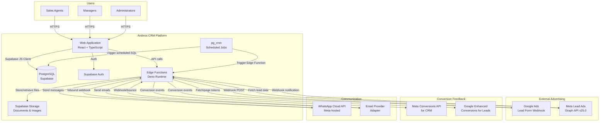

### B.2 Container / Component Diagram

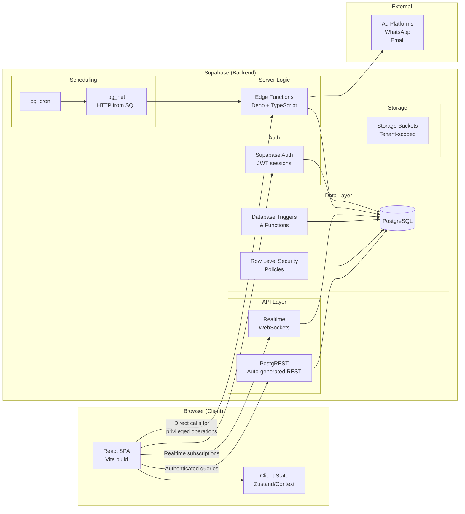

### B.3 Deployment Diagram

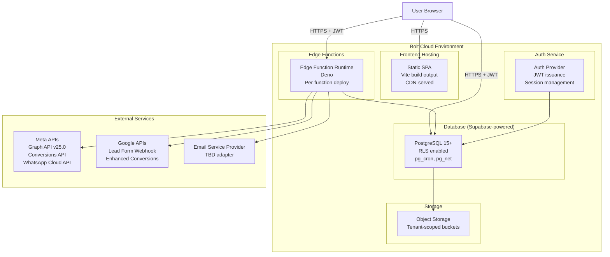

### B.4 Tenant and Trust-Boundary Diagram

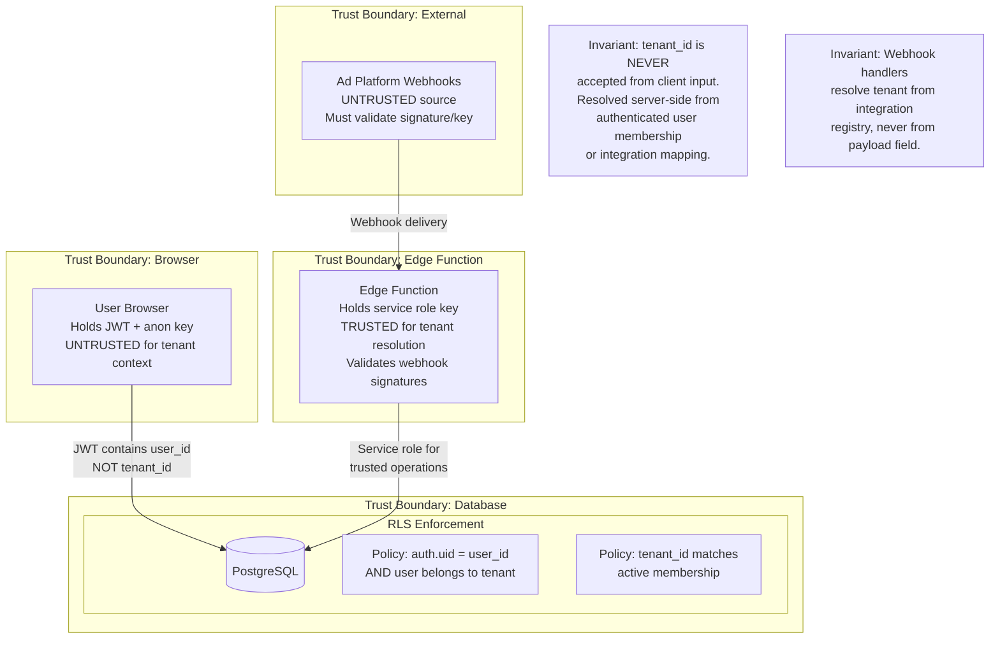

### B.5 Lead Ingestion Sequence Diagram

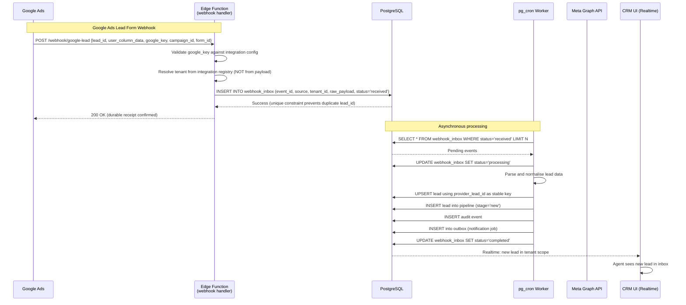

### B.6 Durable Inbox/Outbox Processing Sequence

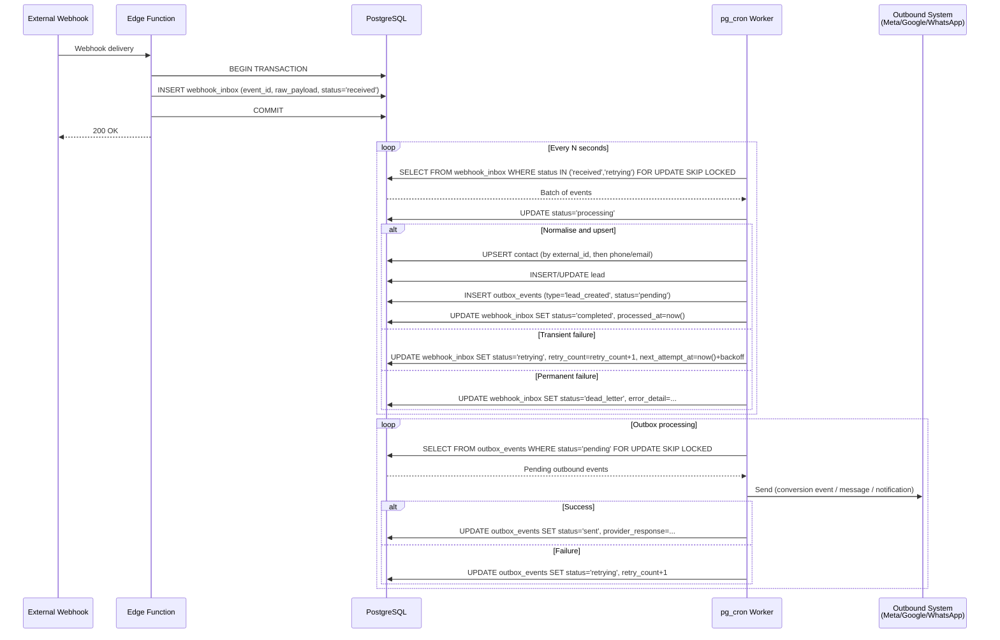

### B.7 Conversion Feedback Sequence (Meta and Google)

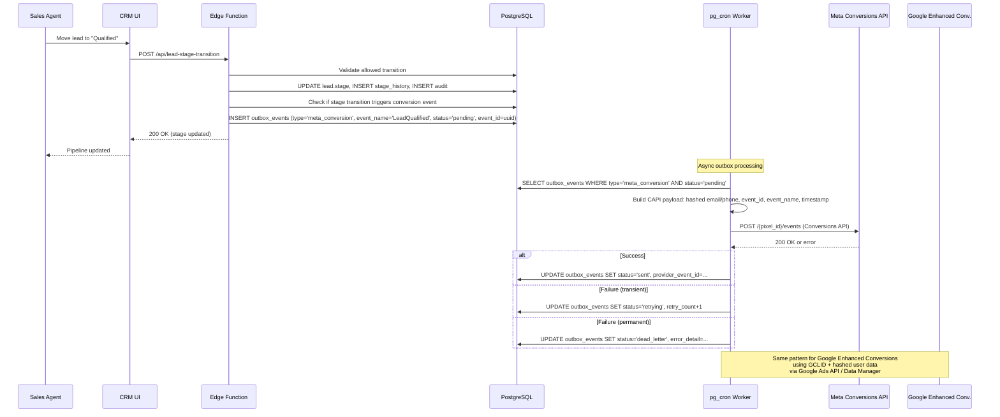

### B.8 Viewing-to-Booking Business Workflow

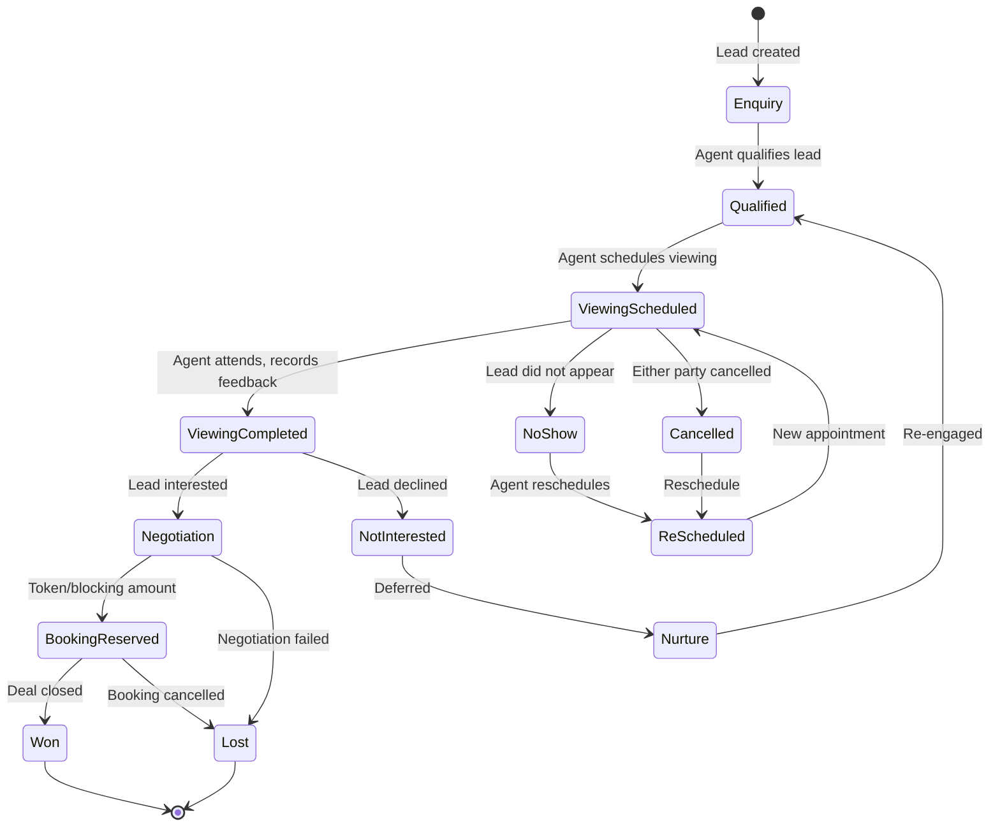

### B.9 Disaster Recovery Overview

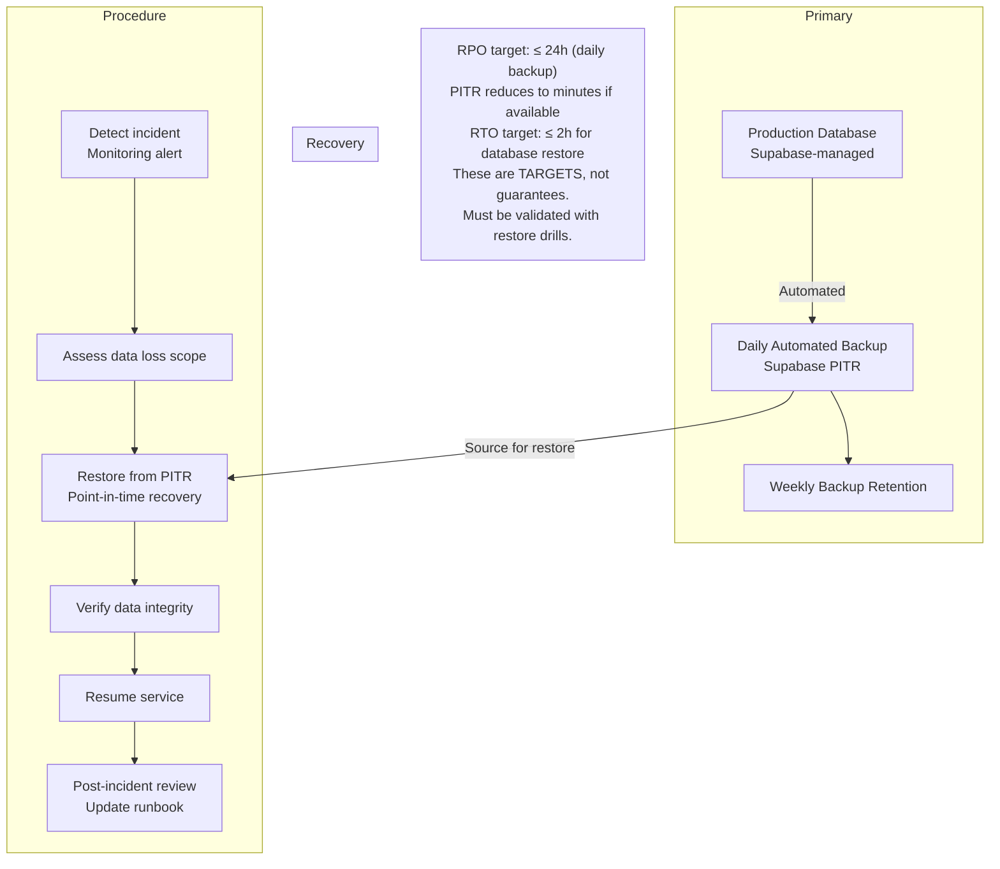

---

## Deliverable C — Technology Decision Records

### C.1 Frontend Framework

| Aspect | Decision |
|---|---|
| **Choice** | React 18 + TypeScript + Vite |
| **Rationale** | Bolt's native stack. Already provisioned. Largest ecosystem for enterprise UI components. TypeScript essential for a data-heavy CRM. Vite provides fast HMR and optimised builds. |
| **Alternatives** | Next.js (SSR/SSG) — adds complexity, Bolt builds SPAs. Vue — smaller ecosystem for enterprise components. |
| **Trade-offs** | SPA means no SSR; acceptable for an internal CRM behind auth. SEO irrelevant. |
| **Migration** | Could migrate to Next.js if SEO or public pages become needed. React component knowledge transfers. |

### C.2 Backend Execution Model

| Aspect | Decision |
|---|---|
| **Choice** | Supabase Edge Functions (Deno + TypeScript) for server-side logic, plus PostgreSQL functions/triggers for data-layer logic |
| **Rationale** | Edge Functions are Bolt's supported server-side runtime. They handle webhooks, privileged operations, external API calls, and scheduled job triggers. PostgreSQL functions handle atomic multi-row operations (state transitions, assignment logic) within a single transaction boundary. |
| **Limitations** | Edge Functions have execution time limits (~150s on Supabase free tier, longer on paid). No persistent in-memory state. Cold starts. No long-running worker process. |
| **Mitigation** | Use pg_cron + pg_net for scheduled job triggering. Keep individual function execution short. Use database-backed queue (webhook_inbox/outbox_events tables) instead of in-memory queues. |
| **Alternatives** | External Node.js worker (e.g., on Railway/Fly.io) — adds operational complexity and cost. Supabase Queue (pgmq) — available as extension, viable for durable queue. |
| **Date verified** | Bolt Help Center, October 2026. Supabase docs, October 2026. |

### C.3 Database

| Aspect | Decision |
|---|---|
| **Choice** | PostgreSQL (Supabase-managed) |
| **Rationale** | Already provisioned. Full PostgreSQL with RLS, triggers, functions, check constraints, unique constraints, pg_cron, pg_net. The relational model is correct for CRM data with complex relationships and reporting needs. |
| **Key extensions available** | pg_cron (scheduled jobs), pg_net (HTTP from SQL), pg_partman (partitioning for large tables like audit logs), pgcrypto ( hashing), uuid-ossp or pgcrypto (UUID generation). |
| **Alternatives** | External Supabase project — requires Pro/Teams plan, more operational control but same engine. External PostgreSQL (Neon, Railway) — more portability but loses Bolt integration. |
| **Migration** | Schema is standard PostgreSQL DDL. Portable to any PostgreSQL host. |

### C.4 Authentication

| Aspect | Decision |
|---|---|
| **Choice** | Supabase Auth (email/password) |
| **Rationale** | Native to the platform. JWT-based sessions. RLS integration via `auth.uid()`. Supports email confirmation, password reset, leaked password protection. No external auth service needed. |
| **Configuration** | Email confirmation OFF for internal pilot (per Bolt guidance). Leaked password protection ON. |
| **Future** | MFA/passkey support can be added when Supabase supports it or via edge function. Social login (Google SSO) is supported by Bolt if needed later. |
| **Session security** | JWT in httpOnly cookie or localStorage with short refresh window. Session revocation via Supabase admin API. |
| **Date verified** | Bolt Help Center authentication docs, October 2026. |

### C.5 RLS and Authorisation

| Aspect | Decision |
|---|---|
| **Choice** | PostgreSQL RLS policies on every tenant-owned table, plus SECURITY DEFINER functions for privileged cross-table operations |
| **Pattern** | Every tenant-owned row has `tenant_id`. RLS policy checks `auth.uid()` against a `tenant_memberships` table join. Platform-level tables (organisations, tenants) have separate policies for platform admins. |
| **SECURITY DEFINER** | Used for operations that need to write to multiple tables atomically (e.g., lead stage transition writes to leads + stage_history + outbox + audit). The function validates permissions before executing. |
| **Critical rule** | Tenant ID is resolved server-side from the authenticated user's active membership, never from client request parameters. |
| **Testing** | Automated negative tests: user A cannot SELECT, UPDATE, DELETE user B's tenant data. |

### C.6 Job Queue and Workers

| Aspect | Decision |
|---|---|
| **Choice** | Database-backed queue (webhook_inbox + outbox_events tables) with pg_cron as the polling dispatcher and Edge Functions as the processing unit |
| **Rationale** | No external queue service available in Bolt environment. PostgreSQL provides transactional guarantees, `FOR UPDATE SKIP LOCKED` for concurrent workers, and unique constraints for idempotency. pg_cron runs on a schedule (every 30–60 seconds) and either processes directly or triggers an Edge Function via pg_net. |
| **Pattern** | `webhook_inbox` for inbound events, `outbox_events` for outbound events. Each row has status (received/processing/completed/retrying/dead_letter), retry_count, next_attempt_at, and error_detail. |
| **Limitations** | pg_cron minimum interval is typically 1 minute on Supabase. For faster processing, an Edge Function can be called by the webhook handler itself to process immediately after durable receipt, with pg_cron as a fallback for retries and missed events. |
| **Alternatives** | pgmq extension (if available) — purpose-built message queue. External queue (Inngest, Trigger.dev) — adds dependency and cost. |
| **Trade-off** | Database-backed queue adds write load but eliminates an external service. Acceptable at initial scale. If volume grows, migrate to pgmq or external queue without changing the processing logic. |

### C.7 Realtime Updates

| Aspect | Decision |
|---|---|
| **Choice** | Supabase Realtime (PostgreSQL CDC / WAL-based) |
| **Rationale** | Built into Supabase. Broadcasts row changes to subscribed clients. RLS-aware — clients only receive events for rows they can see. |
| **Use cases** | New lead appears in inbox without refresh. Pipeline stage changes propagate to all viewing agents. Viewing calendar updates. |
| **Security** | Realtime respects RLS policies. Tenant-scoped by design — a client subscribed to `leads` will only receive events for rows matching their RLS policies. |
| **Limitations** | Connection limits on free tier. May need polling fallback for high-connection scenarios. |

### C.8 File Storage

| Aspect | Decision |
|---|---|
| **Choice** | Supabase Storage with tenant-scoped bucket paths |
| **Rationale** | Built into the platform. Supports private buckets with signed URLs. RLS policies on storage objects. |
| **Pattern** | Bucket path: `tenant/{tenant_id}/properties/{property_id}/images/`, `tenant/{tenant_id}/documents/`, etc. Signed URLs with expiry for access. Upload via Edge Function (not direct client upload for sensitive files). |
| **File types** | Images (jpg, png, webp), documents (pdf, docx), as supported by Bolt storage. |

### C.9 Email Provider Integration

| Aspect | Decision |
|---|---|
| **Choice** | Adapter pattern — initial implementation with Supabase's built-in email (auth emails) + a transactional email provider for CRM emails |
| **Candidates** | Resend (modern API, good free tier), SendGrid (enterprise-grade), Amazon SES (lowest cost at scale) |
| **Rationale** | Supabase handles auth emails (verification, reset). CRM transactional emails (viewing confirmations, lead notifications) need a dedicated provider. Adapter pattern allows switching. |
| **Credential storage** | Provider API keys stored as Edge Function secrets (Bolt Secrets menu), never in client code. |
| **Deferred to** | Phase 6. Not needed for MVP. |

### C.10 WhatsApp Integration

| Aspect | Decision |
|---|---|
| **Choice** | Meta WhatsApp Cloud API (not WhatsApp Business API on-premise, not unofficial automation) |
| **Rationale** | Meta-hosted, no infrastructure to manage. Free API access (pay per conversation/message per Meta's pricing). Cloud API receives updates faster. Supports webhooks for inbound messages and status. |
| **Key requirements** | WhatsApp Business account, phone number, Meta app with WhatsApp product, template message approval, webhook subscription. Messaging window rules (24h session for free-form, templates outside). |
| **Tenant-specific** | Each tenant configures their own WhatsApp Business account. Credentials stored per-tenant in encrypted form. |
| **Date verified** | Meta WhatsApp Cloud API docs, updated June 2026. |
| **Deferred to** | Phase 6. |

### C.11 Advertising Integrations

#### Google Ads Lead Form Webhook

| Aspect | Detail |
|---|---|
| **Source** | https://developers.google.com/google-ads/webhook/docs/implementation |
| **Mechanism** | Google POSTs JSON to a registered webhook endpoint. Payload includes `lead_id` (unique, for dedup), `user_column_data` (array of column_id/string_value pairs), `google_key` (verification), `campaign_id`, `form_id`. |
| **Auth** | `google_key` field in payload matched against integration configuration. |
| **Dedup** | `lead_id` is the stable unique key. Unique constraint on `(integration_id, provider_lead_id)`. |
| **Forward compat** | Must ignore unrecognised fields in `user_column_data` — Google may add new column types. |
| **Response codes** | 200 = success, 400 = non-retryable error, 500 = retryable error. |
| **Test vs real** | Google provides test payloads. Handler distinguishes by checking for test indicators in the payload. |

#### Meta Lead Ads

| Aspect | Detail |
|---|---|
| **Source** | Meta Graph API v25.0 (released Feb 2026). Webhook subscription for `leadgen` event. |
| **Mechanism** | Webhook notification contains `leadgen_id`. A subsequent authenticated Graph API call retrieves full lead data. The webhook itself does NOT contain all fields. |
| **Auth** | App secret for webhook signature verification (X-Hub-Signature-256 header). Page access token for lead retrieval. |
| **Permissions** | `leads_retrieval`, `pages_manage_ads`, `pages_read_engagement`. |
| **Dedup** | `leadgen_id` is the stable unique key. |
| **Rate limits** | Meta enforces rate limits on Graph API calls. Retry with backoff. |
| **2026 changes** | mTLS certificate switched to Meta-owned CA (March 2026). Webhook endpoint must accept new certificate. |

#### Meta Conversions API for CRM

| Aspect | Detail |
|---|---|
| **Source** | Meta Conversions API documentation, Conversion Leads Integration. |
| **Mechanism** | Server-side POST to `/{pixel_id}/events` with event data. For CRM conversion leads, use the Conversion Leads Integration flow. |
| **Events** | Map CRM lifecycle milestones to Meta events: `Lead` (lead received), `Contact` (first contact), `Schedule` (viewing scheduled), `SubmitApplication` or custom (qualified), `Purchase` (deal won). Exact supported event names must be confirmed against current Meta documentation at implementation time. |
| **Identifiers** | Hashed (SHA-256) email, phone. Event ID for deduplication with browser pixel events. |
| **Dedup** | `event_id` + `event_name` prevents duplicate counting when both browser pixel and server send the same event. |
| **Consent** | Must respect user consent. Include `ndid` or consent flags as required. |

#### Google Enhanced Conversions for Leads

| Aspect | Detail |
|---|---|
| **Source** | Google Ads API, Enhanced Conversions for Leads, Data Manager approach. |
| **Mechanism** | Upload offline conversion data with GCLID (Google Click ID) + hashed user data (SHA-256 email/phone). |
| **Key change** | Google's Data Manager is the current recommended approach. The older Google Ads API `CustomerConversionGoal` and `ConversionUpload` flow still works but verify at implementation time. |
| **Consent** | User consent for data sharing must be recorded. Google requires consent flags. |

### C.12 Hosting

| Aspect | Decision |
|---|---|
| **Choice** | Bolt Cloud hosting (static SPA + edge functions + database) |
| **Rationale** | Zero-config. CDN-served frontend. Edge functions deployed via `deploy_edge_functions` MCP tool. Database managed. All in one environment. |
| **Custom domain** | Requires Pro plan. Available when ready for production. |
| **Alternatives** | Netlify (Bolt supports). Vercel (manual deploy). Self-hosted — not practical for this stack. |

### C.13 Monitoring and Alerting

| Aspect | Decision |
|---|---|
| **Choice** | Bolt database logs (PostgreSQL, Edge Function, Auth, Realtime, Cron Job logs) + application-level health tables |
| **Pattern** | `integration_health` table records last successful/failed interaction per integration. `webhook_inbox` status distribution queryable for dead-letter monitoring. Edge Function structured logging with correlation IDs. |
| **Alerting** | pg_cron job checks for dead-letter count > threshold, integration stale > threshold, and inserts into `alerts` table. CRM admin dashboard surfaces alerts. For external alerting (email/Slack), an Edge Function can be triggered. |
| **Limitation** | No external monitoring service (Datadog, Sentry) in the Bolt environment. Application must self-monitor. |

### C.14 Backups and Recovery

| Aspect | Decision |
|---|---|
| **Development** | Bolt's built-in database management. Version history does NOT restore databases. Manual exports recommended. |
| **Production** | Supabase PITR (Point-In-Time Recovery) if available on the plan. Daily automated backups. Weekly backup retention. Periodic restore drill (quarterly). |
| **RPO target** | ≤ 24h (daily backup) or ≤ 1h (PITR if available). |
| **RTO target** | ≤ 2h for database restore. |
| **Limitation** | Bolt's version history feature does not support database restores. This is a known limitation documented in the Bolt Help Center. |
| **Mitigation** | Regular `pg_dump` exports via Edge Function to external storage for critical data. |

### C.15 Development and Deployment Environments

| Aspect | Decision |
|---|---|
| **Development** | Bolt preview environment. Database auto-provisioned. Hot reload via Vite HMR. |
| **Staging** | Separate Bolt project with its own database for integration testing before production. |
| **Production** | Published Bolt project with custom domain. |
| **Deployment** | Edge functions deployed via `deploy_edge_functions` MCP tool. Frontend built via `npm run build` and published via Bolt. Database migrations applied via `apply_migration` MCP tool. |
| **Version control** | Git-based. Bolt supports GitHub integration. |

---

## Deliverable D — Database and State Model

### D.1 Entity-Relationship Overview

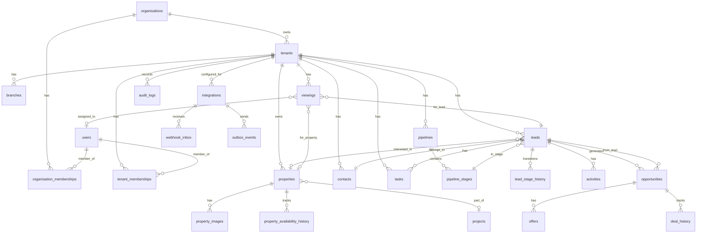

### D.2 Schema Proposal (Core Tables)

The full DDL will be applied via migrations when implementation begins. Below is the structural design for each major entity group.

#### D.2.1 Organisation and Tenant Hierarchy

```
organisations
  id (uuid, PK)
  name (text)
  type (enum: 'platform_owner', 'agency', 'client_business')
  parent_organisation_id (uuid, FK self, nullable)
  created_at, updated_at, deleted_at

tenants
  id (uuid, PK)
  organisation_id (uuid, FK organisations)
  name (text)
  slug (text, unique)
  status (enum: 'active', 'suspended', 'offboarded')
  settings (jsonb — tenant-specific config: currency, timezone, branding)
  created_at, updated_at, deleted_at

branches
  id (uuid, PK)
  tenant_id (uuid, FK tenants)
  name (text)
  location (text, nullable)
  created_at, updated_at

organisation_memberships
  id (uuid, PK)
  user_id (uuid, FK auth.users)
  organisation_id (uuid, FK organisations)
  role (enum: 'platform_owner', 'platform_admin', 'agency_owner', 'agency_admin')
  status (enum: 'active', 'invited', 'revoked')
  created_at, updated_at

tenant_memberships
  id (uuid, PK)
  user_id (uuid, FK auth.users)
  tenant_id (uuid, FK tenants)
  role (enum: 'tenant_owner', 'tenant_admin', 'sales_manager', 'sales_agent', 'marketing_manager', 'marketing_analyst', 'executive_readonly', 'auditor')
  branch_id (uuid, FK branches, nullable)
  status (enum: 'active', 'invited', 'revoked')
  created_at, updated_at
```

**Unique constraints:**
- `tenant_memberships (user_id, tenant_id)` — one membership per user per tenant
- `tenants.slug` — globally unique slug

**RLS pattern (all tenant-owned tables):**
```sql
-- Example for leads table
CREATE POLICY "select_own_tenant_leads" ON leads FOR SELECT
  TO authenticated
  USING (
    tenant_id IN (
      SELECT tenant_id FROM tenant_memberships
      WHERE user_id = auth.uid() AND status = 'active'
    )
  );
-- Same pattern for INSERT (WITH CHECK), UPDATE (USING + WITH CHECK), DELETE (USING)
```

#### D.2.2 Integrations and Credentials

```
integrations
  id (uuid, PK)
  tenant_id (uuid, FK tenants)
  provider (enum: 'google_ads', 'meta_lead_ads', 'meta_conversions', 'google_enhanced_conversions', 'whatsapp', 'email', 'website_form', 'manual', 'csv_import')
  display_name (text)
  status (enum: 'active', 'paused', 'error', 'disconnected')
  config (jsonb — provider-specific: account_id, page_id, pixel_id, webhook_url_key, form_ids, etc.)
  credential_ref (text — reference to edge function secret name, NOT the credential itself)
  last_health_check_at (timestamptz, nullable)
  last_success_at (timestamptz, nullable)
  last_error_at (timestamptz, nullable)
  last_error_detail (text, nullable)
  created_at, updated_at

integration_webhook_endpoints
  id (uuid, PK)
  integration_id (uuid, FK integrations)
  endpoint_path (text — e.g., '/webhook/google-lead/{integration_id}')
  webhook_secret (text — hashed verification key)
  is_active (boolean)
  created_at, updated_at
```

**Critical invariant:** The `credential_ref` column stores only the *name* of the secret in Bolt's secrets management, never the credential value. Edge Functions retrieve the actual secret at runtime via `Deno.env.get()`.

**Unique constraint:** `integrations (tenant_id, provider, config->>'account_id')` — one integration per provider per account per tenant.

#### D.2.3 Webhook Inbox (Inbound Event Queue)

```
webhook_inbox
  id (uuid, PK)
  integration_id (uuid, FK integrations)
  tenant_id (uuid, FK tenants) — resolved server-side, never from payload
  provider (text)
  provider_event_id (text — Google lead_id, Meta leadgen_id, etc.)
  raw_payload (jsonb — full original payload for replay/audit)
  status (enum: 'received', 'processing', 'completed', 'retrying', 'dead_letter', 'rejected')
  retry_count (int, default 0)
  max_retries (int, default 5)
  next_attempt_at (timestamptz, nullable)
  processed_at (timestamptz, nullable)
  error_detail (text, nullable)
  is_test (boolean, default false)
  received_at (timestamptz, default now())

UNIQUE CONSTRAINT: (integration_id, provider_event_id)
  — Prevents duplicate acceptance of the same external delivery.
  This is the primary idempotency mechanism.
```

**Index:** `CREATE INDEX ON webhook_inbox (status, next_attempt_at) WHERE status IN ('received', 'retrying')` — for worker polling.

#### D.2.4 Outbox Events (Outbound Event Queue)

```
outbox_events
  id (uuid, PK)
  tenant_id (uuid, FK tenants)
  event_type (enum: 'meta_conversion', 'google_conversion', 'whatsapp_message', 'email_message', 'internal_notification', 'lead_assignment')
  entity_type (text — 'lead', 'viewing', 'opportunity', 'task')
  entity_id (uuid)
  payload (jsonb — the full event content to send)
  status (enum: 'pending', 'processing', 'sent', 'retrying', 'dead_letter', 'superseded')
  event_id (uuid — provider-facing dedup ID, unique per logical event)
  retry_count (int, default 0)
  max_retries (int, default 5)
  next_attempt_at (timestamptz, nullable)
  sent_at (timestamptz, nullable)
  provider_response (jsonb, nullable)
  error_detail (text, nullable)
  created_at (timestamptz, default now())

UNIQUE CONSTRAINT: (event_type, event_id)
  — Prevents duplicate outbound events for the same logical occurrence.
```

**Superseded pattern:** When a lead stage changes multiple times (e.g., Qualified → Contacted → Qualified), only the latest qualifying event should be sent. The `superseded` status marks events that should not be sent because a newer event for the same entity supersedes them. This prevents duplicate conversions from repeated stage edits.

#### D.2.5 Contacts and Leads

```
contacts
  id (uuid, PK)
  tenant_id (uuid, FK tenants)
  first_name (text)
  last_name (text, nullable)
  email (text, nullable)
  email_normalized (text — lowercase trimmed, for matching)
  phone (text, nullable)
  phone_normalized (text — E.164 format, for matching)
  communication_consent (jsonb — {email: true/false, whatsapp: true/false, sms: true/false, consented_at, withdrawn_at})
  contact_preferences (jsonb — preferred contact time, language, etc.)
  source_summary (jsonb — first_source, first_campaign, first_at)
  created_at, updated_at, deleted_at

  INDEX: (tenant_id, email_normalized) WHERE email_normalized IS NOT NULL
  INDEX: (tenant_id, phone_normalized) WHERE phone_normalized IS NOT NULL

leads
  id (uuid, PK)
  tenant_id (uuid, FK tenants)
  contact_id (uuid, FK contacts)
  pipeline_id (uuid, FK pipelines)
  pipeline_stage_id (uuid, FK pipeline_stages)
  stage (text — denormalised for quick filtering, kept in sync by trigger)
  lead_source (enum: 'google_ads', 'meta_lead_ads', 'website_form', 'manual', 'csv_import', 'whatsapp', 'referral', 'other')
  integration_id (uuid, FK integrations, nullable)
  provider_lead_id (text, nullable — stable external ID for dedup)
  campaign_id (text, nullable)
  ad_group_id (text, nullable)
  ad_id (text, nullable)
  form_id (text, nullable)
  landing_page_url (text, nullable)
  gclid (text, nullable — Google Click ID)
  gbraid (text, nullable)
  wbraid (text, nullable)
  fbclid (text, nullable — Meta click ID, when available)
  utm_source, utm_medium, utm_campaign, utm_term, utm_content (text, nullable)
  assigned_to (uuid, FK auth.users, nullable)
  assigned_at (timestamptz, nullable)
  qualification_status (enum: 'unqualified', 'pending', 'qualified', 'disqualified', nullable)
  qualification_notes (text, nullable)
  budget_min, budget_max (numeric, nullable)
  desired_location (text, nullable)
  property_type_preference (text[], nullable)
  bedroom_preference (int[], nullable)
  transaction_intent (enum: 'buy', 'rent', 'lease', 'invest', nullable)
  expected_timeline (enum: 'immediate', '1_month', '3_months', '6_months', '12_months', 'exploring', nullable)
  financing_status (enum: 'pre_approved', 'arranging', 'self_funded', 'not_discussed', nullable)
  loss_reason (text, nullable)
  nurture_status (enum: 'none', 'active_nurture', 'paused', 'completed', nullable)
  lead_score (int, default 0 — computed from rules)
  response_sla_due_at (timestamptz, nullable)
  first_contacted_at (timestamptz, nullable)
  last_activity_at (timestamptz, nullable)
  created_at, updated_at, deleted_at

  UNIQUE CONSTRAINT: (integration_id, provider_lead_id) WHERE provider_lead_id IS NOT NULL
    — Prevents duplicate lead creation from the same external delivery.
  INDEX: (tenant_id, stage)
  INDEX: (tenant_id, assigned_to, stage)
  INDEX: (tenant_id, lead_source)
  INDEX: (tenant_id, created_at)
```

**Key design decision — contact vs lead separation:** A contact is a person. A lead is an enquiry/opportunity. One contact can have multiple leads (enquired about different properties, through different campaigns). This prevents incorrect merging of distinct opportunities and allows proper attribution per enquiry.

**Duplicate detection strategy:**
1. Match by `provider_lead_id` first (exact, unique constraint enforced).
2. If no provider ID, match by `(tenant_id, email_normalized)` or `(tenant_id, phone_normalized)`.
3. If both match but to different contacts, flag as potential duplicate for human review.
4. Never auto-merge contacts based on phone or email alone when the lead source or property interest differs.

#### D.2.6 Lead Stage History (State Machine Audit)

```
lead_stage_history
  id (uuid, PK)
  lead_id (uuid, FK leads)
  from_stage (text, nullable — null for initial creation)
  to_stage (text)
  changed_by (uuid, FK auth.users)
  changed_at (timestamptz, default now())
  reason (text, nullable)
  metadata (jsonb — any additional context: assignment change, qualification notes, etc.)

  INDEX: (lead_id, changed_at)
```

**Allowed transitions are enforced by a PostgreSQL function** (SECURITY DEFINER) that checks the current stage against an allowed-transition table before updating. This prevents invalid transitions regardless of how the request arrives.

```
pipeline_stage_transitions
  id (uuid, PK)
  pipeline_id (uuid, FK pipelines)
  from_stage (text)
  to_stage (text)
  is_allowed (boolean)
  required_fields (text[] — fields that must be populated before this transition)
  side_effect (text, nullable — identifier for automation to trigger)
```

#### D.2.7 Pipelines and Stages

```
pipelines
  id (uuid, PK)
  tenant_id (uuid, FK tenants)
  name (text)
  is_default (boolean)
  sort_order (int)
  created_at, updated_at

pipeline_stages
  id (uuid, PK)
  pipeline_id (uuid, FK pipelines)
  name (text)
  stage_key (text — machine name: 'new', 'contact_attempted', 'contacted', 'qualified', 'viewing_scheduled', 'viewing_completed', 'negotiation', 'booking_reserved', 'won', 'lost', 'invalid', 'unqualified', 'nurture')
  stage_type (enum: 'active', 'won', 'lost', 'terminal')
  sort_order (int)
  is_won_stage (boolean, default false)
  is_lost_stage (boolean, default false)
  requires_loss_reason (boolean, default false)
  color (text — for UI display)
  created_at, updated_at

  UNIQUE: (pipeline_id, stage_key)
```

#### D.2.8 Properties and Inventory

```
projects
  id (uuid, PK)
  tenant_id (uuid, FK tenants)
  name (text)
  developer (text, nullable)
  location (text, nullable)
  rera_number (text, nullable — India RERA registration)
  status (enum: 'planned', 'under_construction', 'ready', 'completed')
  created_at, updated_at

properties
  id (uuid, PK)
  tenant_id (uuid, FK tenants)
  project_id (uuid, FK projects, nullable)
  name (text — e.g., "3BHK in Tower A, Unit 1204")
  property_type (enum: 'apartment', 'villa', 'plot', 'independent_house', 'commercial', 'shop', 'office', 'land')
  transaction_type (enum: 'sale', 'rent', 'lease')
  listing_type (enum: 'new_booking', 'resale', 'rental')
  address_line1, address_line2, city, state, postal_code (text, nullable)
  locality (text, nullable)
  latitude, longitude (numeric, nullable)
  bedrooms (int, nullable)
  bathrooms (int, nullable)
  built_up_area_sqft (numeric, nullable)
  carpet_area_sqft (numeric, nullable)
  floor_number (int, nullable)
  total_floors (int, nullable)
  facing (text, nullable)
  furnishing (enum: 'unfurnished', 'semi_furnished', 'fully_furnished', nullable)
  amenities (text[], nullable)
  price (numeric, nullable)
  currency (text, default 'INR')
  price_per_sqft (numeric, nullable — computed)
  availability_status (enum: 'available', 'reserved', 'soft_hold', 'under_negotiation', 'booked', 'sold', 'off_market')
  availability_expires_at (timestamptz, nullable — for reserved/soft_hold)
  owner_name (text, nullable)
  commission_percentage (numeric, nullable — tenant-internal, not shown to leads)
  notes (text, nullable)
  images (jsonb — array of {url, caption, sort_order, is_primary})
  documents (jsonb — array of {url, type, name})
  status (enum: 'active', 'archived')
  created_at, updated_at, deleted_at

  UNIQUE: (tenant_id, project_id, name) WHERE project_id IS NOT NULL
    — Prevents duplicate unit representation within a project.
  INDEX: (tenant_id, property_type, transaction_type)
  INDEX: (tenant_id, availability_status)
  INDEX: (tenant_id, locality)
  INDEX: (tenant_id, price)

property_availability_history
  id (uuid, PK)
  property_id (uuid, FK properties)
  from_status (text, nullable)
  to_status (text)
  changed_by (uuid, FK auth.users, nullable)
  changed_at (timestamptz, default now())
  reason (text, nullable)
  expires_at (timestamptz, nullable)
```

#### D.2.9 Viewings

```
viewings
  id (uuid, PK)
  tenant_id (uuid, FK tenants)
  lead_id (uuid, FK leads)
  property_id (uuid, FK properties, nullable)
  assigned_to (uuid, FK auth.users)
  scheduled_date (date)
  scheduled_time (time)
  duration_minutes (int, default 60)
  timezone (text, default 'Asia/Kolkata')
  status (enum: 'scheduled', 'confirmed', 'completed', 'no_show', 'cancelled', 'rescheduled')
  notes (text, nullable)
  feedback (text, nullable)
  outcome (enum: 'interested', 'not_interested', 'undecided', 'no_feedback', nullable)
  cancelled_reason (text, nullable)
  cancelled_at (timestamptz, nullable)
  created_at, updated_at

  -- Double-booking prevention:
  -- Partial unique index on (assigned_to, scheduled_date, scheduled_time)
  -- WHERE status IN ('scheduled', 'confirmed')
  -- This prevents the same agent being double-booked at the same slot.
  -- Property-level conflict check done in application logic (multiple agents
  -- can show the same property, so property uniqueness is not a hard constraint).

  INDEX: (tenant_id, assigned_to, scheduled_date)
  INDEX: (tenant_id, lead_id)
  INDEX: (tenant_id, property_id, scheduled_date)
```

#### D.2.10 Opportunities and Deals

```
opportunities
  id (uuid, PK)
  tenant_id (uuid, FK tenants)
  lead_id (uuid, FK leads)
  property_id (uuid, FK properties, nullable)
  stage (enum: 'exploration', 'negotiation', 'offer_made', 'counter_offer', 'booking_reserved', 'won', 'lost')
  deal_amount (numeric, nullable)
  currency (text, default 'INR')
  expected_close_date (date, nullable)
  commission_amount (numeric, nullable)
  commission_percentage (numeric, nullable)
  loss_reason (text, nullable)
  won_at (timestamptz, nullable)
  lost_at (timestamptz, nullable)
  created_at, updated_at

  INDEX: (tenant_id, stage)

opportunity_offers
  id (uuid, PK)
  opportunity_id (uuid, FK opportunities)
  offer_type (enum: 'initial', 'counter', 'final')
  amount (numeric)
  currency (text, default 'INR')
  terms (text, nullable)
  made_by (enum: 'buyer', 'seller')
  status (enum: 'pending', 'accepted', 'rejected', 'expired')
  created_at, updated_at

opportunity_history
  id (uuid, PK)
  opportunity_id (uuid, FK opportunities)
  from_stage (text, nullable)
  to_stage (text)
  changed_by (uuid, FK auth.users)
  changed_at (timestamptz, default now())
  notes (text, nullable)
```

#### D.2.11 Activities, Tasks, Notes

```
activities
  id (uuid, PK)
  tenant_id (uuid, FK tenants)
  lead_id (uuid, FK leads, nullable)
  contact_id (uuid, FK contacts, nullable)
  opportunity_id (uuid, FK opportunities, nullable)
  type (enum: 'call', 'email', 'whatsapp', 'meeting', 'viewing', 'note', 'system', 'stage_change', 'assignment_change')
  direction (enum: 'inbound', 'outbound', 'internal', nullable)
  subject (text, nullable)
  content (text, nullable)
  performed_by (uuid, FK auth.users, nullable — nullable for system-generated)
  performed_at (timestamptz, default now())
  metadata (jsonb — provider message ID, call duration, etc.)
  is_internal (boolean, default true — internal notes vs customer-facing messages)
  created_at

  INDEX: (tenant_id, lead_id, performed_at)
  INDEX: (tenant_id, contact_id, performed_at)
  INDEX: (tenant_id, performed_at)

tasks
  id (uuid, PK)
  tenant_id (uuid, FK tenants)
  lead_id (uuid, FK leads, nullable)
  assigned_to (uuid, FK auth.users)
  title (text)
  description (text, nullable)
  due_date (date, nullable)
  due_time (time, nullable)
  priority (enum: 'low', 'medium', 'high', 'urgent')
  status (enum: 'open', 'in_progress', 'completed', 'cancelled', 'overdue')
  completed_at (timestamptz, nullable)
  created_by (uuid, FK auth.users)
  created_at, updated_at

  INDEX: (tenant_id, assigned_to, status, due_date)
  INDEX: (tenant_id, lead_id)
```

#### D.2.12 Marketing Attribution

```
marketing_attribution
  id (uuid, PK)
  tenant_id (uuid, FK tenants)
  lead_id (uuid, FK leads)
  touch_type (enum: 'first_touch', 'last_touch', 'assisting')
  source (text — google_ads, meta_lead_ads, website, etc.)
  campaign_id (text, nullable)
  campaign_name (text, nullable)
  ad_group_id (text, nullable)
  ad_id (text, nullable)
  form_id (text, nullable)
  landing_page (text, nullable)
  gclid (text, nullable)
  fbclid (text, nullable)
  utm_source, utm_medium, utm_campaign, utm_term, utm_content (text, nullable)
  attributed_at (timestamptz, default now())

  INDEX: (tenant_id, lead_id)
  INDEX: (tenant_id, source, campaign_id)
```

#### D.2.13 Audit Log

```
audit_logs
  id (uuid, PK)
  tenant_id (uuid, FK tenants, nullable — nullable for platform-level actions)
  user_id (uuid, FK auth.users, nullable — nullable for system actions)
  action (text — e.g., 'user_invited', 'integration_configured', 'data_exported', 'membership_changed', 'exceptional_access')
  entity_type (text)
  entity_id (uuid, nullable)
  old_value (jsonb, nullable)
  new_value (jsonb, nullable)
  ip_address (inet, nullable)
  user_agent (text, nullable)
  created_at (timestamptz, default now())

  INDEX: (tenant_id, created_at)
  INDEX: (tenant_id, action, created_at)
  INDEX: (user_id, created_at)
```

**Retention:** Audit logs are retained for a minimum of 2 years. Use pg_partman for monthly partitioning if volume warrants.

#### D.2.14 Communication Consent

```
communication_consents
  id (uuid, PK)
  tenant_id (uuid, FK tenants)
  contact_id (uuid, FK contacts)
  channel (enum: 'email', 'whatsapp', 'sms', 'call')
  status (enum: 'opted_in', 'opted_out', 'pending')
  consent_source (text — 'lead_form', 'explicit', 'imported', 'inferred_from_interaction')
  consented_at (timestamptz, nullable)
  withdrawn_at (timestamptz, nullable)
  created_at, updated_at

  UNIQUE: (tenant_id, contact_id, channel)
```

### D.3 RLS Policy Design

**Every tenant-owned table** follows this pattern:

```sql
-- The active tenant membership check is the core RLS predicate.
-- It ensures the authenticated user has an active membership in the
-- tenant that owns the row being accessed.

-- SELECT policy
CREATE POLICY "select_own_tenant_<table>" ON <table> FOR SELECT
  TO authenticated
  USING (
    tenant_id IN (
      SELECT tm.tenant_id
      FROM tenant_memberships tm
      WHERE tm.user_id = auth.uid()
        AND tm.status = 'active'
    )
  );

-- INSERT policy
CREATE POLICY "insert_own_tenant_<table>" ON <table> FOR INSERT
  TO authenticated
  WITH CHECK (
    tenant_id IN (
      SELECT tm.tenant_id
      FROM tenant_memberships tm
      WHERE tm.user_id = auth.uid()
        AND tm.status = 'active'
    )
  );

-- UPDATE policy
CREATE POLICY "update_own_tenant_<table>" ON <table> FOR UPDATE
  TO authenticated
  USING (
    tenant_id IN (
      SELECT tm.tenant_id
      FROM tenant_memberships tm
      WHERE tm.user_id = auth.uid()
        AND tm.status = 'active'
    )
  )
  WITH CHECK (
    tenant_id IN (
      SELECT tm.tenant_id
      FROM tenant_memberships tm
      WHERE tm.user_id = auth.uid()
        AND tm.status = 'active'
    )
  );

-- DELETE policy
CREATE POLICY "delete_own_tenant_<table>" ON <table> FOR DELETE
  TO authenticated
  USING (
    tenant_id IN (
      SELECT tm.tenant_id
      FROM tenant_memberships tm
      WHERE tm.user_id = auth.uid()
        AND tm.status = 'active'
    )
  );
```

**Platform-level tables** (organisations, tenants, organisation_memberships) have policies that check for platform-level roles via `organisation_memberships`:

```sql
CREATE POLICY "select_organisations_as_member" ON organisations FOR SELECT
  TO authenticated
  USING (
    id IN (
      SELECT organisation_id FROM organisation_memberships
      WHERE user_id = auth.uid() AND status = 'active'
    )
  );
```

**Role-based filtering within a tenant** is handled at the application layer (Edge Functions and frontend) using the user's role from `tenant_memberships`. RLS provides tenant isolation; role-based permissions provide feature-level access control on top.

### D.4 Permission Model

| Capability | Platform Owner | Agency Admin | Tenant Owner | Tenant Admin | Sales Manager | Sales Agent | Marketing Mgr | Auditor |
|---|---|---|---|---|---|---|---|---|
| View cross-tenant dashboard | Yes (delegated) | Yes (delegated, scoped) | No | No | No | No | No | No |
| Manage tenants | Yes | Yes (within agency) | No | No | No | No | No | No |
| Manage users in tenant | No | No | Yes | Yes | No | No | No | No |
| View all leads in tenant | No | No | Yes | Yes | Yes | Own + team | No | Yes (read) |
| Create/edit leads | No | No | Yes | Yes | Yes | Own + assigned | No | No |
| Delete leads | No | No | Yes | Yes | No | No | No | No |
| Manage integrations | No | No | Yes | Yes | No | No | Yes (marketing) | No |
| View reports | Yes (aggregate) | Yes (scoped) | Yes | Yes | Yes | Own performance | Yes | Yes (read) |
| Export data | No | Yes (scoped) | Yes | Yes | Yes | No | Yes | No |
| Manage properties | No | No | Yes | Yes | Yes | Yes | No | No |
| Configure pipeline | No | No | Yes | Yes | No | No | No | No |
| View audit log | Yes | Yes (scoped) | Yes | Yes | No | No | No | Yes |

**Note:** "Delegated" access for agency admins means they can view aggregate metrics across tenants they manage, but cannot open individual lead/contact details without an explicit exceptional-access workflow that is audited.

### D.5 Lead State Machine

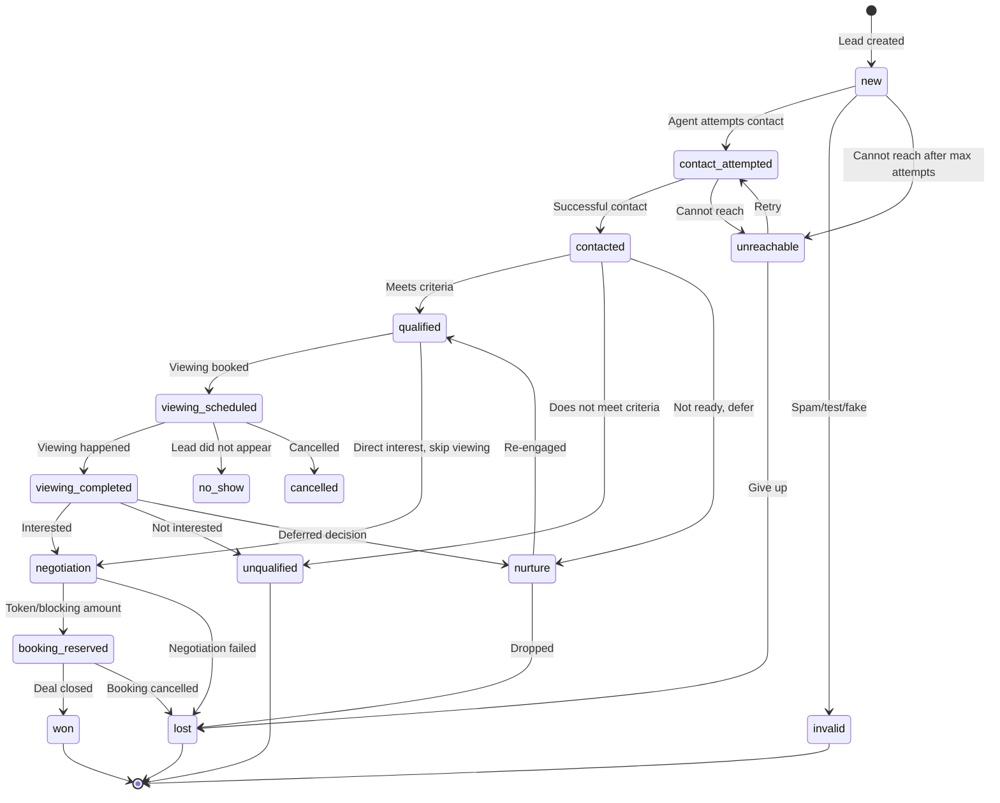

**Each transition enforces:**
- `from_stage` must match the lead's current stage
- `to_stage` must be in the allowed transitions for `from_stage`
- Required fields must be populated (e.g., `lost` requires `loss_reason`)
- Assignment may be required for certain transitions (e.g., `qualified` requires `assigned_to`)
- Timestamps are set automatically (`first_contacted_at` on first `contacted` transition)
- Audit event written to `lead_stage_history`
- Outbox events generated for eligible conversion-feedback triggers

### D.6 Webhook State Machine

```
received → processing → completed
                    ↗          ↘
              retrying → dead_letter
                    ↗
received → rejected (invalid signature, unresolvable tenant)

States:
  received    — Durably persisted, awaiting processing
  processing  — Worker has picked it up
  completed   — Lead created/updated successfully
  retrying    — Transient failure, will retry with backoff
  dead_letter — Max retries exceeded, needs manual intervention
  rejected    — Invalid at receipt time (bad signature, unknown tenant)
```

### D.7 Outbox Event State Machine

```
pending → processing → sent
                    ↗       ↘
              retrying → dead_letter
                    ↗
pending → superseded (a newer event for the same entity replaces this one)

States:
  pending      — Event recorded, awaiting outbound delivery
  processing   — Worker is sending to external system
  sent         — External system accepted the event
  retrying     — Transient failure, will retry with backoff
  dead_letter  — Max retries exceeded, needs manual intervention
  superseded   — A newer event supersedes this; do not send
```

### D.8 Stable Identity and Deduplication

**How every externally sourced lead receives a stable identity:**

1. Google Ads: `lead_id` from the webhook payload → stored as `provider_lead_id`. Unique constraint on `(integration_id, provider_lead_id)`.
2. Meta Lead Ads: `leadgen_id` from the webhook notification → stored as `provider_lead_id`. Same unique constraint.
3. Website forms: A generated UUID (or a hash of form+email+timestamp) → stored as `provider_lead_id`.
4. Manual entry: No `provider_lead_id` — dedup is by contact matching only.

**How legitimate repeated enquiries remain distinguishable from duplicate deliveries:**

- A **duplicate delivery** is the same webhook sent twice (same `provider_lead_id` for the same integration). The unique constraint on `webhook_inbox (integration_id, provider_event_id)` prevents double-processing.
- A **repeated enquiry** is the same person submitting a new form or enquiring about a different property. This creates a new `provider_lead_id` and therefore a new lead, linked to the same contact. The contact is matched by normalised email/phone, but the lead is distinct.
- The system never auto-merges leads. It may suggest a potential duplicate for human review when the same contact enquires through the same integration within a short window.

---

## Deliverable E — Security Review

### E.1 Threat Model

| # | Threat | Vector | Control | Test |
|---|---|---|---|---|
| T1 | Cross-tenant data leakage | User manipulates tenant_id in API request | RLS on every table; tenant_id never from client input; resolved from authenticated membership | Automated: user A queries user B's tenant → 0 rows |
| T2 | Cross-tenant data leakage via realtime | User subscribes to realtime channel for another tenant | Realtime respects RLS policies; client cannot subscribe to channels outside their tenant | Automated: subscribe as user A to user B's tenant channel → no events |
| T3 | Insecure direct object reference (IDOR) | User guesses/brute-forces entity UUID | RLS policy checks ownership; UUIDs are unguessable but RLS is the real control | Automated: user A requests lead UUID from user B's tenant by ID → 404/403 |
| T4 | Privilege escalation | Tenant admin changes own role to platform owner | Roles assigned via `organisation_memberships` and `tenant_memberships`; user cannot modify their own membership; SECURITY DEFINER functions validate caller permissions | Automated: attempt to self-escalate → denied |
| T5 | Forged webhook | Attacker sends fake webhook to create leads | Webhook signature/key validation (google_key for Google, X-Hub-Signature-256 for Meta); integration resolved from endpoint path, not payload | Manual: send forged webhook with wrong key → rejected |
| T6 | Replay attack | Attacker captures and replays a valid webhook | Unique constraint on `(integration_id, provider_event_id)` prevents duplicate processing; original delivery already completed | Automated: replay same webhook → rejected as duplicate |
| T7 | Duplicate delivery | Provider sends same webhook twice | Same as T6 — unique constraint on provider_event_id | Automated: send same payload twice → one lead created |
| T8 | Malformed/oversized payload | Attacker sends huge or malformed JSON | Edge Function validates payload size and structure before persisting; unknown fields ignored (per Google docs) | Manual: send oversized payload → rejected with 400 |
| T9 | Rate-limit abuse | Attacker floods webhook endpoint | Supabase platform-level rate limiting; webhook endpoint validates before processing; idempotency prevents resource exhaustion from duplicates | Manual: flood test |
| T10 | Unauthorised export | Low-privilege user exports all leads | Export requires `export` capability in permission model; Edge Function checks role before generating export; audit log records export | Automated: sales agent attempts export all → denied |
| T11 | Stored XSS | Malicious script in lead name/notes | React auto-escapes by default; no `dangerouslySetInnerHTML` usage; Content Security Policy headers | Code review + automated scan |
| T12 | SQL injection | Malicious input in search/filter parameters | Supabase client uses parameterised queries; Edge Functions use parameterised SQL; no string concatenation for queries | Code review |
| T13 | Session compromise | JWT stolen | Short-lived access tokens; secure refresh; httpOnly cookie storage; session revocation via Supabase admin API | Manual: revoke session, verify access denied |
| T14 | Broken access control | API allows operation not permitted by role | Every state-changing operation goes through Edge Function or SECURITY DEFINER function that validates the user's role and membership | Automated: attempt disallowed operation → denied |
| T15 | Insecure file upload | Malicious file uploaded as property image | File type validation in Edge Function; storage bucket policies; no executable file types allowed; file size limits | Manual: upload .exe → rejected |
| T16 | Log and backup leakage | Sensitive data in logs | Structured logging excludes secrets, tokens, raw payloads (only metadata); audit logs store changes not full content for sensitive fields | Code review |
| T17 | Insider misuse | Agency admin accesses client's sensitive leads | Exceptional-access workflow with audit trail; delegated access shows aggregates, not individual records; audit log review by auditor role | Process + audit review |
| T18 | Provider outage | Google/Meta API unavailable during processing | Retry with backoff; dead-letter queue; outbox events remain pending until provider recovers; no data loss | Manual: simulate provider outage |
| T19 | Data deletion and recovery | Malicious or accidental bulk delete | Soft delete (deleted_at) for critical tables; audit log of all deletions; backup recovery for catastrophic cases | Automated: verify soft delete preserves data |
| T20 | Credential leakage | Integration credentials exposed | Credentials stored as Edge Function secrets (Bolt Secrets), never in database columns or client code; `credential_ref` stores only the secret name | Code review + secret scan |

### E.2 OWASP ASVS Mapping

| ASVS Requirement | Implementation |
|---|---|
| V1.1 Architecture | Trust boundary documented; tenant isolation by design |
| V2.1 Password security | Supabase Auth with leaked password protection |
| V2.7 Session management | JWT with refresh; session revocation |
| V3.1 Session token generation | Supabase Auth manages token generation |
| V4.1 Access control | RLS + role-based permission matrix |
| V4.3 Operation-level authorisation | Every Edge Function validates caller permissions |
| V5.1 Input validation | Edge Function validates all inputs; unknown webhook fields ignored |
| V5.2 Sanitisation | React auto-escaping; no raw HTML injection |
| V7.1 Logging | Structured audit logs; no secrets in logs |
| V8.1 Data protection | Encryption in transit (HTTPS); at rest (Supabase); credential secrets management |
| V9.1 Communications | HTTPS only; webhook signature verification |

### E.3 Negative Test Plan

The following automated tests MUST pass before any phase is marked complete:

1. **Tenant isolation:** User with membership in Tenant A queries `leads` → only Tenant A's leads returned. Inject `tenant_id` of Tenant B in request → still only Tenant A's data.
2. **IDOR:** User A requests Tenant B's lead by UUID → 404 or 403.
3. **Role enforcement:** Sales agent attempts to manage users → denied. Marketing manager attempts to delete leads → denied.
4. **Webhook forgery:** POST to webhook endpoint with invalid `google_key` → 401/403, no lead created.
5. **Cross-tenant webhook:** Webhook payload claiming wrong tenant → tenant resolved from integration mapping, not payload.
6. **Duplicate delivery:** Same `provider_lead_id` sent twice → one lead, second delivery rejected/ignored.
7. **Simultaneous duplicate:** Two concurrent webhook deliveries with same `provider_lead_id` → unique constraint allows only one.
8. **Session revocation:** Revoked user's JWT → access denied.

---

## Deliverable F — Reliability Specification

### F.1 Delivery and Persistence Guarantees

| Guarantee | Mechanism | Scope |
|---|---|---|
| Webhook durable receipt | Raw payload persisted to `webhook_inbox` before 200 OK response | Database transaction |
| No duplicate lead from same delivery | Unique constraint on `(integration_id, provider_event_id)` | Database constraint |
| No duplicate outbound event | Unique constraint on `(event_type, event_id)` + superseded status | Database constraint |
| Atomic state transition | Lead update + stage history + outbox + audit in single transaction | PostgreSQL transaction |
| Message delivery independence | Outbox events processed async; CRM transaction does not wait for message send | Architecture separation |

**What is NOT guaranteed:**
- Exactly-once delivery to external providers (Meta/Google may accept but not process; we track "sent" not "processed by provider").
- Zero data loss in all scenarios (database failure between backup intervals may lose unreplicated data).
- Real-time processing (pg_cron interval introduces processing latency).

### F.2 Retry Policy and Backoff

| Parameter | Value |
|---|---|
| Max retries | 5 for webhook processing, 5 for outbox delivery |
| Backoff strategy | Exponential: 30s, 2min, 10min, 30min, 2h |
| Dead-letter threshold | After max retries, status → `dead_letter` |
| Dead-letter review | Admin dashboard surfaces dead-lettered events for manual review/replay |
| Replay | Admin can manually replay a dead-lettered event; creates a new processing attempt |

### F.3 Idempotency Rules

| Operation | Idempotency Key | Mechanism |
|---|---|---|
| Webhook acceptance | `(integration_id, provider_event_id)` | Unique constraint on `webhook_inbox` |
| Lead creation from webhook | `(integration_id, provider_lead_id)` | Unique constraint on `leads` |
| Conversion event to Meta/Google | `(event_type, event_id)` | Unique constraint on `outbox_events` |
| Stage transition | `(lead_id, to_stage, changed_by, changed_at)` | Checked in transition function — no-op if already in target stage |
| Message send | `(channel, contact_id, template_id, event_id)` | Checked before send — skip if already sent with same event_id |

### F.4 Dead-Letter and Replay Procedures

1. **Detection:** pg_cron job counts `dead_letter` events every 5 minutes. If count > 0, alert appears on admin dashboard.
2. **Review:** Admin opens dead-letter detail — sees raw payload, error detail, retry history.
3. **Replay:** Admin clicks "Replay" → event status reset to `received` (inbound) or `pending` (outbound), retry_count reset to 0.
4. **Discard:** Admin can mark as `permanently_failed` with a reason for audit purposes.
5. **Audit:** All replay/discard actions logged in `audit_logs`.

### F.5 Reconciliation Strategy

- **Weekly reconciliation job** (pg_cron): Compare webhook_inbox `completed` count against leads created for the same integration in the same period. Discrepancies flagged.
- **Monthly reconciliation**: Compare outbox_events `sent` count against provider-reported event counts (if provider offers a reporting API).
- **Manual reconciliation**: Admin can trigger a date-range reconciliation report for any integration.

### F.6 Service Level Objectives (SLOs)

| SLO | Target | Measurement | Assumptions |
|---|---|---|---|
| Webhook receipt-to-durable-acceptance | < 2s p95 | Time from webhook POST to 200 OK response | Supabase database responsive |
| Receipt-to-lead-visible | < 30s p95 | Time from webhook receipt to lead appearing in CRM | pg_cron 1-min interval + processing time |
| API response time (list views) | < 300ms p95 | Supabase PostgREST response time | Indexed queries, < 10K rows per tenant |
| API response time (detail views) | < 100ms p95 | Single record fetch | Indexed by PK |
| Job completion (outbox) | < 5min p95 | Time from outbox `pending` to `sent` | External provider responsive |
| Availability | 99.5% monthly | Uptime monitoring | Bolt Cloud availability |
| Data loss exposure (RPO) | ≤ 24h | Last successful backup | Daily backup; PITR if available reduces to minutes |
| Recovery time (RTO) | ≤ 2h | Time to restore database | Supabase restore process |

**These are targets, not guarantees.** They assume:
- Supabase free/Pro tier performance characteristics
- Moderate load (initial pilot: < 100 concurrent users, < 1000 leads/day)
- External providers (Meta, Google) are operational
- No cascading failure from dependent services

### F.7 Monitoring, Dashboards, and Alerts

| Metric | Source | Alert Threshold |
|---|---|---|
| Dead-letter count | `webhook_inbox` + `outbox_events` WHERE status='dead_letter' | > 0 |
| Processing lag | `webhook_inbox` WHERE status='received' AND received_at < now() - 5min | > 10 events |
| Integration health | `integrations.last_success_at` | > 1h since last success |
| Outbox backlog | `outbox_events` WHERE status='pending' AND created_at < now() - 10min | > 50 events |
| Failed auth attempts | Supabase auth logs | > 20 in 5min per user |
| Database query performance | PostgreSQL slow query log | > 1s |

### F.8 Backup Retention

| Type | Frequency | Retention | Notes |
|---|---|---|---|
| Supabase automated backup | Daily | 7 days (free) / 30 days (Pro) | PITR available on Pro |
| Manual pg_dump export | Weekly | 4 weeks | Edge Function exports to storage |
| Audit log archive | Monthly | 2 years minimum | Partitioned by month |

### F.9 Disaster Recovery and Restoration Drills

1. **Quarterly restore drill:** Restore latest backup to a staging database. Verify schema integrity and row counts match production.
2. **Documented procedure:** Step-by-step runbook for database restore, Edge Function redeployment, and frontend redeployment.
3. **Post-incident review template:** Timeline, root cause, data loss assessment, corrective actions.

### F.10 Expected Infrastructure Limits

| Limit | Free Tier | Pro Tier | Impact |
|---|---|---|---|
| Database size | 500MB | 8GB | Limits lead/property/activity history |
| Edge Function execution | ~150s timeout | Longer timeouts | Long-running jobs must be chunked |
| Realtime connections | 200 concurrent | Higher | Limits concurrent users |
| Storage | 1GB | 100GB | Limits document/image storage |
| API requests | Rate-limited | Higher limits | May throttle under load |
| Database auto-pause | Pauses after 6 days inactivity (unpublished) | No auto-pause | Development-only concern |

---

## Deliverable G — Implementation Roadmap

### Phase 0: Architecture and Threat-Model Approval (Current)

**Scope:** This document.
**Dependencies:** None.
**Deliverable:** Approved architecture, schema design, security model, and roadmap.
**Checkpoint:** User review and approval of this document before any implementation begins.

### Phase 1: Repository Foundation, Design System, Navigation, Application Shell

**Scope:**
- Project structure: `src/` with components, pages, lib, hooks, types, stores
- Design system: colour tokens, typography, spacing, button/form/table/dialog components
- Application shell: sidebar navigation, top bar with tenant selector, responsive layout
- Routing: React Router or hash-based routing
- Empty states, loading states, error states
- Authentication UI: sign-in page (wired to Supabase Auth)

**Dependencies:** Phase 0 approval.
**Schema changes:** None (auth tables are Supabase-managed).
**Affected modules:** Frontend only.
**Risks:** Design system decisions are hard to change later. Invest in getting tokens and component patterns right.
**Tests:** Visual review of all shell pages; auth flow works (sign in, sign out, session persists).
**Acceptance criteria:**
- User can sign in and see a navigation shell
- Design system is consistent and responsive
- All planned navigation items are present (even if pages are empty)

### Phase 2: Authentication, Tenant Isolation, Database Schema, Authorisation Tests

**Scope:**
- Database migrations: organisations, tenants, branches, memberships, users
- RLS policies on all tenant-owned tables
- Tenant selector: user can switch between tenants they belong to
- Role-based access control middleware (frontend route guards + Edge Function permission checks)
- Organisation management: create tenants, invite users, assign roles
- Automated negative tests for tenant isolation

**Dependencies:** Phase 1 (application shell, auth UI).
**Schema changes:** Core hierarchy tables, membership tables, audit log table.
**Affected modules:** Auth, database, frontend navigation, admin pages.
**Risks:** RLS policy errors can lock users out or expose data. Test thoroughly.
**Tests:** All 8 negative tests from Section E.3.
**Acceptance criteria:**
- User can sign in, see their tenants, switch active tenant
- RLS prevents all cross-tenant access (automated tests pass)
- Admin can invite users and assign roles
- Audit log records membership changes

### Phase 3: Leads, Contacts, Properties, Matching, Core Sales Pipeline

**Scope:**
- Database migrations: contacts, leads, pipelines, stages, properties, projects, activities, tasks, lead_stage_history, marketing_attribution
- Lead inbox: list, filter, sort, bulk select
- Lead detail: profile, activity timeline, stage transitions, assignment
- Pipeline board: kanban-style drag-and-drop with server-validated transitions
- Property inventory: list, detail, search, filters
- Property matching: rule-based engine, match results with explanation
- Task management: create, assign, complete
- Executive dashboard: core metrics (new leads, unassigned, SLA breaches, pipeline value, conversion rates)
- Contact management: list, detail, merge suggestion (no auto-merge)

**Dependencies:** Phase 2 (auth, tenant isolation, RLS).
**Schema changes:** All CRM domain tables.
**Affected modules:** Leads, properties, pipeline, dashboard, tasks.
**Risks:** Pipeline state machine must be correct — invalid transitions must be impossible. Matching engine must be explainable.
**Tests:** Pipeline transition validation tests; matching correctness tests (given requirements, expected matches).
**Acceptance criteria:**
- Agent can create a lead manually, move it through pipeline stages, assign it
- Property search returns relevant results with filters
- Matching engine produces explainable results for a lead's requirements
- Dashboard shows accurate real-time metrics
- All stage transitions are server-validated
- Drag-and-drop respects allowed transitions

### Phase 4: Durable Webhook Ingestion, Deduplication, Retries, Diagnostics

**Scope:**
- Database migrations: webhook_inbox, integrations, integration_webhook_endpoints
- Edge Function: Google Ads lead form webhook handler
- Edge Function: Meta Lead Ads webhook handler (webhook receipt + Graph API lead retrieval)
- pg_cron job: webhook_inbox processing worker
- Integration management UI: configure Google/Meta integrations, view health
- Webhook inbox diagnostics: admin view of received/processing/completed/retrying/dead_letter events
- Deduplication: unique constraint enforcement, duplicate detection on contact
- Test payload handling: distinguish Google test payloads from real leads

**Dependencies:** Phase 3 (leads, contacts, pipeline — webhook processing creates leads).
**Schema changes:** webhook_inbox, integrations, integration_webhook_endpoints.
**Affected modules:** Integrations, leads (creation path), admin diagnostics.
**Risks:** Webhook signature validation must be correct. Tenant resolution from integration mapping is critical.
**Tests:**
- Forged webhook with wrong key → rejected
- Duplicate delivery → one lead
- Simultaneous duplicate → one lead (unique constraint)
- Unknown fields in payload → ignored, lead still created
- Test payload → flagged, not treated as real lead
- Integration misconfiguration → delivery quarantined, not assigned to wrong tenant
**Acceptance criteria:**
- Google Ads test webhook creates a flagged test lead
- Meta Lead Ads webhook notification triggers Graph API retrieval and lead creation
- Duplicate deliveries do not create duplicate leads
- Dead-lettered events are visible in admin diagnostics
- Integration health is visible

### Phase 5: Meta and Google CRM Conversion Feedback

**Scope:**
- Database migrations: outbox_events (if not already in Phase 4), conversion event mapping config
- pg_cron job: outbox_events processing worker
- Edge Function: Meta Conversions API sender
- Edge Function: Google Enhanced Conversions sender
- Conversion event mapping UI: map CRM stages to Meta/Google events
- Outbox diagnostics: admin view of pending/sent/retrying/dead_letter events
- Superseded event handling: prevent duplicate conversions from repeated stage edits
- Consent checking: only send conversion events for leads with consent

**Dependencies:** Phase 4 (integrations, webhook_inbox, outbox_events).
**Schema changes:** outbox_events (or extend from Phase 4), conversion mapping config.
**Affected modules:** Pipeline (triggers outbox on stage change), integrations, admin diagnostics.
**Risks:** Sending PII to wrong advertising account is a critical error. Consent must be verified. Duplicate conversions from stage edits must be prevented.
**Tests:**
- Stage transition generates correct outbox event
- Repeated stage transitions (qualified → contacted → qualified) do not send duplicate conversion
- Outbox event sent to correct tenant's integration, never cross-tenant
- Transient provider failure → retrying → eventual success
- Permanent failure → dead_letter with error detail
- Conversion event includes hashed (not plaintext) user data
**Acceptance criteria:**
- Moving a lead to "Qualified" generates a Meta conversion event (if Meta integration configured)
- Event appears in outbox diagnostics as "sent" with provider response
- No duplicate events from repeated stage edits
- Consent-gating works (no event for opted-out leads)

### Phase 6: WhatsApp and Email Workflows

**Scope:**
- Edge Function: WhatsApp Cloud API adapter (send template message, send text, receive inbound webhook, status webhooks)
- Edge Function: Email adapter (send transactional email, receive bounce/complaint webhook)
- Database migrations: communication_consents, message logs
- WhatsApp management UI: configure WhatsApp Business account, template management, conversation view
- Email management UI: configure email provider, template builder, send history
- Consent management: opt-in/opt-out per channel per contact
- Message association: link messages to contacts and leads
- Outbox integration: WhatsApp/email sends go through outbox_events for durability

**Dependencies:** Phase 3 (contacts, leads, activities), Phase 4 (outbox pattern).
**Schema changes:** communication_consents, message_logs (or extend activities).
**Affected modules:** Communication, contacts, leads, activities.
**Risks:** WhatsApp messaging window violations (24h rule). Template approval required. Consent management is a legal requirement.
**Tests:**
- Send WhatsApp template message → message logged with status
- Inbound WhatsApp message → linked to contact, appears in conversation
- Opt-out respected → no messages sent to opted-out contacts
- Email bounce → recorded, contact flagged
- Messaging window expired → only template messages allowed
**Acceptance criteria:**
- Agent can send a WhatsApp message from a lead's detail page
- Inbound messages appear in the conversation timeline
- Opt-out is enforced
- Delivery status is visible

### Phase 7: Reporting, Attribution, and Automation

**Scope:**
- Reporting module: configurable reports with date ranges, CSV export
- Attribution dashboard: source-wise, campaign-wise performance by qualified leads and deals (not just raw enquiries)
- Automation rules: lead assignment rules (round-robin, workload-based), SLA timers, stale-lead detection, escalation
- Custom fields: tenant-specific fields on leads and properties
- Conversion feedback reporting: events generated vs events accepted by provider
- Bulk actions: import, export, reassign, status change with confirmation

**Dependencies:** Phases 3–6 (data exists to report on).
**Schema changes:** automation_rules, automation_executions, custom_field_definitions, custom_field_values.
**Affected modules:** Reports, dashboard, pipeline, admin configuration.
**Risks:** Automation rules can fire incorrectly and cause unintended actions. Test thoroughly. Bulk operations can affect many records — require confirmation.
**Tests:**
- Round-robin assignment distributes leads evenly
- SLA timer triggers escalation after threshold
- Report data matches raw query results
- CSV export contains only permitted columns
- Custom field appears on lead form and is searchable
**Acceptance criteria:**
- Marketing manager can see campaign ROI by qualified leads and deals
- Sales manager can configure assignment rules
- Reports can be exported with permission checks
- Automation failures are visible and recoverable

### Phase 8: SaaS Onboarding, Tenant Administration, Subscription Readiness

**Scope:**
- SaaS onboarding flow: self-serve tenant creation, initial admin user, default pipeline setup
- Tenant configuration: branding (logo, colours), custom pipeline stages, notification preferences
- Subscription readiness: subscription_plans, tenant_subscriptions, usage_metering tables (schema only, not wired to Stripe yet)
- User management UI: invite, deactivate, change role
- Audit log viewer: filterable by action, user, date range
- Data export: full tenant data export (GDPR/DPDP compliance)
- Data retention policies: configurable retention periods

**Dependencies:** Phases 2–7 (all modules must support tenant configuration).
**Schema changes:** subscription_plans, tenant_subscriptions, usage_metering, retention_policies.
**Affected modules:** Admin, settings, billing (schema only).
**Risks:** Self-serve onboarding must not allow privilege escalation or cross-tenant access.
**Tests:**
- New tenant creation → isolated, default pipeline configured
- User deactivation → access revoked immediately
- Data export → complete, only own tenant's data
**Acceptance criteria:**
- A new business can create a tenant, configure their pipeline, and invite users
- Audit log is filterable and exportable
- Subscription schema is ready for Stripe integration (not yet wired)

### Phase 9: Security Audit, Reliability Testing, Performance Testing, Backup Restoration, Controlled Production Rollout

**Scope:**
- Full security audit: run all negative tests, OWASP ASVS checklist, penetration testing
- Performance testing: load test with realistic data volumes (10K leads, 1K properties, 100 concurrent users)
- Backup restoration drill: restore from backup, verify data integrity
- Controlled production rollout: single pilot tenant, monitored closely
- Runbook finalisation: incident response, restore procedures, integration troubleshooting
- DPDP Act compliance review: consent management, data retention, export, deletion workflows

**Dependencies:** All prior phases.
**Schema changes:** None (verification phase).
**Affected modules:** All.
**Risks:** Performance issues at scale. Security issues discovered late.
**Tests:** All tests from all phases, re-run. New performance tests.
**Acceptance criteria:**
- All security negative tests pass
- API response times meet SLOs under load
- Database restore completes within RTO
- Pilot tenant operates successfully for 2 weeks without data issues

---

## Deliverable H — Cost and Operational Model

### H.1 Development Configuration (Cost-Minimising)

| Component | Free Tier | Cost |
|---|---|---|
| Bolt project | Free plan | $0 |
| Bolt hosting | Free `.bolt.host` domain | $0 |
| Supabase database (Bolt-managed) | 500MB storage, auto-pause risk | $0 |
| Supabase Auth | Up to 50,000 monthly active users | $0 |
| Supabase Edge Functions | Included (execution limits apply) | $0 |
| Supabase Realtime | 200 concurrent connections | $0 |
| Supabase Storage | 1GB | $0 |
| pg_cron | Included | $0 |
| Google Ads API | Free to use (ad spend separate) | $0 |
| Meta Graph API / Conversions API | Free to use (ad spend separate) | $0 |
| WhatsApp Cloud API | Free API access (per-message pricing) | ~$0.02–0.08 per conversation |
| Email (Resend free tier) | 3,000 emails/month | $0 |

**Development total:** $0/month (excluding ad spend and WhatsApp message costs).

### H.2 Production Configuration

| Component | Plan | Estimated Cost | Notes |
|---|---|---|---|
| Bolt Pro | Pro | ~$20/month | Custom domain, no auto-pause, higher limits |
| Supabase Pro (if claimed separately) | Pro | ~$25/month | 8GB database, PITR, daily backups, no auto-pause |
| Supabase storage | Included in Pro | — | 100GB |
| Email (Resend Pro) | Pro | ~$20/month | 50,000 emails/month |
| WhatsApp Cloud API | Per-message | Variable | ~$0.02–0.08 per conversation (business-initiated) |
| Custom domain | Via Bolt | ~$10–15/year | Or use existing domain |
| External backup storage | S3/Cloudflare R2 | ~$1–5/month | For pg_dump exports |

**Estimated production total:** ~$70–90/month + WhatsApp message costs + ad spend.

**Note:** Pricing is approximate as of October 2026. Verify current pricing at:
- Bolt: https://bolt.new/pricing
- Supabase: https://supabase.com/pricing
- Resend: https://resend.com/pricing
- WhatsApp: https://developers.facebook.com/docs/whatsapp/pricing

### H.3 Free Tier Limitations Unsuitable for Production

| Limitation | Impact | Mitigation |
|---|---|---|
| Database auto-pause (unpublished projects) | Database goes offline after 6 days inactivity | Publish project or use Pro tier |
| 500MB database | Limits data volume | Upgrade to Pro (8GB) |
| No PITR | RPO up to 24h instead of minutes | Supabase Pro includes PITR |
| 200 realtime connections | Limits concurrent users | Upgrade or use polling fallback |
| No custom domain | Unprofessional URL | Pro plan required |
| "Made in Bolt" badge on free | Unprofessional for SaaS | Pro plan removes badge |
| Edge Function timeout | Long jobs may timeout | Chunk processing, use pg_cron |

---

## Deliverable I — Quality and Acceptance Criteria

### I.1 Testable Requirements

| # | Requirement | Type | Phase |
|---|---|---|---|
| Q1 | Tenant isolation: user A cannot access tenant B's data via any API | Automated | 2 |
| Q2 | Role enforcement: sales agent cannot access admin functions | Automated | 2 |
| Q3 | Lead ingestion: webhook creates lead with correct fields | Automated | 4 |
| Q4 | Provider authentication: invalid webhook key → rejected | Automated | 4 |
| Q5 | Duplicate delivery: same provider_event_id → one lead | Automated | 4 |
| Q6 | Simultaneous duplicate: concurrent same provider_event_id → one lead | Automated | 4 |
| Q7 | Retry: transient failure → event retries with backoff | Automated | 4 |
| Q8 | Missing fields: unknown provider fields ignored, lead still created | Automated | 4 |
| Q9 | Provider API unavailable: event enters retrying state | Manual | 4 |
| Q10 | Stale credentials: integration shows error status | Manual | 4 |
| Q11 | Conversion feedback: stage transition generates outbox event | Automated | 5 |
| Q12 | Conversion dedup: repeated stage edits → no duplicate conversion | Automated | 5 |
| Q13 | Cross-tenant conversion: event sent to correct tenant's integration only | Automated | 5 |
| Q14 | Message delivery failure: WhatsApp send failure → logged, retrying | Manual | 6 |
| Q15 | Property matching: correct matches with explanation | Automated | 3 |
| Q16 | Viewing conflict: double-booking prevented by constraint | Automated | 3 |
| Q17 | Data export: only permitted columns, only own tenant's data | Automated | 7 |
| Q18 | Audit trail: all state changes recorded with user, timestamp, old/new | Automated | 2 |
| Q19 | Performance: list views < 300ms p95 with 10K rows | Manual | 9 |
| Q20 | Backup restoration: restore completes, data integrity verified | Manual | 9 |
| Q21 | Security regression: all negative tests pass after any change | Automated | All |

### I.2 Manual Verification Against Real Provider Accounts

The following require real external accounts and cannot be fully automated:

1. Google Ads lead form webhook delivery from a live Google Ads campaign
2. Meta Lead Ads webhook delivery from a live Meta ad campaign
3. Meta Conversions API event acceptance verification (check Meta Events Manager)
4. Google Enhanced Conversions acceptance verification (check Google Ads conversion tracking)
5. WhatsApp Cloud API message delivery to a real phone number
6. WhatsApp inbound message webhook delivery
7. Email delivery and bounce handling
8. Provider rate limit behaviour under load
9. Provider credential expiry and refresh flow

---

## Deliverable J — Improved Architecture Recommendation

### J.1 What You Understood Correctly

Your specification is one of the most thorough architecture briefs I have encountered. Specifically:

1. **Tenant isolation as foundational, not bolted-on** — correct. Retrofitting multi-tenancy is far more expensive than designing it from day one.
2. **Inbox/outbox pattern for reliable event processing** — correct and essential. The database is the durable boundary, not the webhook handler.
3. **Two-way advertising integration** — correctly identified that receiving leads is only half the value. Conversion feedback is the other half and is often missed.
4. **Separation of contact, lead, and opportunity** — correct CRM domain modelling. One person, multiple enquiries, multiple opportunities.
5. **Server-validated state machine for pipeline** — correct. Client-side validation is UX, not security.
6. **Integration registry for tenant routing** — correct. Never infer tenant from payload.
7. **DPDP Act awareness** — correctly flagged. The 2025 Rules and phased commencement are real.
8. **Cost-conscious development vs production-grade reliability** — correctly distinguished.

### J.2 What Should Be Changed

1. **pg_cron as the sole job dispatcher is viable for MVP but has a 1-minute minimum interval.** For webhook processing, this means up to 60 seconds of latency between receipt and lead visibility. **Recommendation:** The webhook handler Edge Function should process the event immediately after durable receipt (synchronously or via a fire-and-forget call to a processing Edge Function), with pg_cron as a reliability fallback for retries and missed events. This gives sub-second processing for fresh events and guarantees no events are lost.

2. **The original spec mentions evaluating "a dedicated backend" but the Bolt environment's server-side is Edge Functions only.** A dedicated Node.js backend is possible but adds operational complexity and cost. **Recommendation:** Stay with Edge Functions + PostgreSQL functions for Phase 1–7. If processing volume exceeds Edge Function limits in Phase 9, evaluate an external worker at that point.

3. **The spec lists "messaging windows" for WhatsApp but doesn't address template message lifecycle management.** WhatsApp template messages require Meta approval and have expiry. **Recommendation:** Add template status tracking to the integration management module in Phase 6.

### J.3 Important Features Missing

(See Section A.7 — identified 12 missing capabilities.)

**Highest-impact additions:**
- **Lead scoring** (P0 for MVP — agents need prioritisation, not just a flat inbox)
- **Commission tracking** (P1 — without it, deal reporting is incomplete for real estate)
- **Telephony/call logging** (P1 — Indian real estate runs on phone calls; even click-to-call + manual logging is valuable)
- **Lead cap and rotation** (P1 — prevents hoarding and ensures fair distribution)

### J.4 What Should Be in the MVP

**MVP (Phases 1–3):**
- Application shell, design system, auth, tenant isolation
- Lead and contact management with manual entry
- Property inventory and search
- Property matching (rule-based)
- Sales pipeline with server-validated state machine
- Task management
- Executive dashboard
- Lead scoring (simple rule-based, not ML)

This gives Anibros a usable CRM for manual lead management while the integration layers are built in subsequent phases.

### J.5 What Should Be Postponed

- Google/Meta webhook ingestion (Phase 4) — requires real ad accounts, testing infrastructure
- Conversion feedback (Phase 5) — requires Phase 4 + provider configuration
- WhatsApp/email (Phase 6) — requires provider accounts, template approval processes
- Automation rules (Phase 7) — requires sufficient data and workflow understanding
- SaaS onboarding (Phase 8) — not needed until external businesses want to subscribe
- Map-based search — provider evaluation not yet done
- Dark mode — consistency risk; not essential
- Mobile native app — responsive web covers field agents initially

### J.6 Greatest Security or Reliability Risks in Assumptions

1. **Assumption: RLS alone is sufficient for tenant isolation.** RLS is necessary but not sufficient. A misconfigured policy, a SECURITY DEFINER function that bypasses RLS, or a service-role-key leak can expose all tenants. **Mitigation:** Automated negative tests run on every deployment. Service role key used only in Edge Functions, never in client code.

2. **Assumption: pg_cron will reliably process the inbox.** pg_cron runs inside the database and may be affected by long-running transactions or database load. **Mitigation:** Monitor processing lag; have a manual trigger Edge Function as fallback.

3. **Assumption: Edge Function cold starts won't affect webhook receipt latency.** Cold starts can add 200–500ms. **Mitigation:** Keep webhook handler minimal (just persist + return 200). Processing happens async.

4. **Assumption: Provider APIs (Meta, Google) are stable.** Both Meta and Google regularly deprecate API versions. Meta's Graph API v25.0 (Feb 2026) will eventually be deprecated. Google's Data Manager approach may change. **Mitigation:** Pin API versions; monitor deprecation announcements; adapter pattern isolates changes.

5. **Assumption: WhatsApp Cloud API pricing remains low.** Meta has changed WhatsApp pricing multiple times. **Mitigation:** Usage monitoring; cost alerts; budget caps.

### J.7 Alternative Architecture: External Worker

An alternative is to use an external always-on Node.js worker (e.g., on Railway, Fly.io, or Render) instead of pg_cron + Edge Functions for job processing.

**Advantages:**
- Sub-second polling interval (vs 1-minute pg_cron minimum)
- Persistent in-memory state for connection pooling
- Can use a purpose-built queue (BullMQ, Inngest)
- No Edge Function timeout concerns

**Disadvantages:**
- Additional infrastructure to manage and monitor
- Additional cost ($5–20/month minimum)
- Additional deployment complexity
- Network latency between worker and Supabase database
- Loses Bolt's all-in-one environment benefit

**Recommendation:** Start with pg_cron + Edge Functions. The 1-minute interval is acceptable for the initial pilot. If processing latency becomes a problem at scale, add an external worker in Phase 9 without changing the queue schema (the `webhook_inbox` and `outbox_events` tables are the contract; the processor is replaceable).

### J.8 Cost of Adopting the Alternative

- External worker hosting: ~$5–20/month
- Additional monitoring: manual (no built-in Bolt monitoring for external services)
- Additional deployment step: deploy worker separately from Bolt
- Development effort: ~1–2 additional days to set up and integrate
- **Verdict:** Not worth it for MVP. Revisit at Phase 9 if needed.

### J.9 Decisions Required Before Implementation

The following decisions materially affect the architecture and need your approval before Phase 1 implementation:

1. **Approve the overall architecture** (Edge Functions + PostgreSQL + pg_cron + database-backed queue) as the backend for the initial build.

2. **Approve the phased roadmap** (Phases 0–9 as described). Specifically, confirm that Phases 1–3 (manual CRM) should be built before Phase 4 (webhook ingestion).

3. **Confirm the MVP scope** (Section A.6). Should lead scoring be added to the MVP? Should telephony integration be prioritised earlier?

4. **Approve the tenant model**: one organisation → many tenants, with memberships. Is the role set (8 roles) correct, or should it be simplified for the MVP?

5. **Confirm authentication approach**: email/password via Supabase Auth, no social login initially. Is MFA needed for the MVP, or can it wait?

6. **Approve the database-backed queue** (webhook_inbox + outbox_events with pg_cron) over an external queue service. Accept the ~1-minute processing latency for retries.

7. **Confirm that the platform starts as a single-tenant-deployment** (Anibros operating for clients) rather than immediately multi-tenant SaaS. The schema is multi-tenant from day one, but the UX and onboarding flow are agency-operated initially.

8. **Decide on the design direction**: light theme, professional real estate SaaS aesthetic, specific brand colours for Anibros (not purple/indigo per your preferences — do you have brand colours?).

9. **Confirm the DPDP Act compliance approach**: design consent management and audit trails now, but defer formal legal compliance review to Phase 9. Is this acceptable, or do you need legal review before storing any personal data?

10. **Approve the cost model**: start on free tier, upgrade to Pro before production pilot. Is the ~$70–90/month production cost acceptable?

---

## Summary

### Recommended Architecture

A modular monolith built on Bolt's native stack: React + TypeScript + Vite frontend, Supabase (PostgreSQL with RLS) database, Edge Functions (Deno) for server-side logic, pg_cron for scheduled job dispatch, and database-backed queues (webhook_inbox + outbox_events) for reliable event processing. Tenant isolation is enforced by PostgreSQL RLS on every tenant-owned table. Integrations are adapter-pattern modules. The queue contract (table schema) is independent of the processing mechanism, allowing migration to an external worker if scale demands it.

### Complete Phased Implementation Roadmap

| Phase | Scope | Dependencies |
|---|---|---|
| 0 | Architecture approval (this document) | None |
| 1 | App shell, design system, navigation, auth UI | Phase 0 |
| 2 | Tenant hierarchy, RLS, roles, negative tests | Phase 1 |
| 3 | Leads, contacts, properties, matching, pipeline, dashboard, tasks | Phase 2 |
| 4 | Webhook ingestion (Google/Meta), dedup, retries, diagnostics | Phase 3 |
| 5 | Conversion feedback (Meta CAPI, Google Enhanced Conversions) | Phase 4 |
| 6 | WhatsApp Cloud API, email, consent management | Phases 3, 4 |
| 7 | Reporting, attribution, automation, custom fields | Phases 3–6 |
| 8 | SaaS onboarding, tenant admin, subscription readiness | Phases 2–7 |
| 9 | Security audit, performance, backup drill, production rollout | All |

### Critical Decisions Requiring Approval

See Section J.9 — 10 decisions listed above.

### Initial Acceptance Criteria

Phase 1 acceptance: user can sign in, see navigation shell with all planned sections, switch tenants (if multiple memberships), and the design system is consistent and responsive.

### Precise Recommendation for the First Implementation Phase

**Begin with Phase 1**: build the application shell, design system, and authentication. This is the foundation everything else depends on. It is low-risk, has no external dependencies, and gives you something visible to review and adjust before the complex database and integration work begins.

I will wait for your review and the 10 decisions above before starting implementation.


---

# SECTION: RAW PREVIOUS BOLT PROJECT LOG SNAPSHOT

# Anibros CRM — Project Log

> Read this file first to understand what's been built and what's next.

## Tech Stack
- React 18 + TypeScript + Vite
- Tailwind CSS 3 (custom design system with primary/accent/success/warning/error/surface color ramps)
- Supabase (PostgreSQL + Auth + RLS + Edge Functions)
- React Router DOM 7, Zustand 5, clsx, tailwind-merge, date-fns, lucide-react
- Path alias: `@/` maps to `src/`

## Database Migrations (12 applied)
1. `001_organisation_tenant_hierarchy` — organisations, tenants, branches, organisation_memberships, tenant_memberships + RLS + helper functions (is_platform_admin, is_agency_admin_for_org, get_user_tenant_ids)
2. `002_crm_domain_tables` — pipelines, pipeline_stages, pipeline_stage_transitions, contacts, leads, lead_stage_history, marketing_attribution, projects, properties, property_availability_history, activities, tasks, viewings, audit_logs, webhook_inbox, outbox_events. All have tenant_id + 4 RLS policies each (SELECT/INSERT/UPDATE/DELETE checking tenant_memberships)
3. `003_seed_pipeline_and_transition_function` — `transition_lead_stage()` SECURITY DEFINER function (validates membership, checks allowed transitions, atomic update + history + audit + activity), `seed_default_pipeline()` function (creates 13 standard RE stages + 30+ allowed transitions)
4. `004_fix_security_advisor_warnings` — Added explicit search_path to helper functions
5. `005_fix_function_grants` — Revoked EXECUTE from PUBLIC on all SECURITY DEFINER functions, granted only to authenticated
6. `006_auto_onboarding_function` — `create_default_tenant()` function auto-creates org + tenant + memberships + pipeline for new sign-ups
7. `007_lead_scoring_function` — `calculate_lead_score()` function (rule-based scoring from source, budget, timeline, engagement)
8. `008_integrations_consent_customfields_automation_subscriptions` — integrations, integration_webhook_endpoints, communication_consents, custom_field_definitions, custom_field_values, automation_rules, automation_executions, subscription_plans (seeded free+pro), tenant_subscriptions. All with tenant_id + 4 RLS policies
9. `009_user_invitation_function` — `invite_user_to_tenant()` SECURITY DEFINER function (verifies caller is tenant_owner/admin, creates invited membership, logs audit)
10. `010_role_based_permission_enforcement` — `get_user_tenant_role()` helper function. Role-aware DELETE/UPDATE/INSERT policies on 20+ tables. Sales agents can no longer delete records. Config tables (integrations, pipeline, automation, custom fields, webhook/outbox) restricted to admin/marketing_manager roles. Auditors and read-only roles blocked from writes on config tables.
11. `011_database_integrity_composite_fks` — Composite unique constraints (tenant_id, id) on 9 parent tables. Replaced 19 single-column FKs with composite FKs to prevent cross-tenant child references. Added 13 performance indexes for common queries.
12. `012_stuck_job_recovery` — `reset_stuck_webhook_jobs()` and `reset_stuck_outbox_jobs()` SECURITY DEFINER functions. Reset processing records stuck for >10 minutes back to received/pending for retry.

## Frontend Files Built

### Infrastructure
- `src/lib/supabase.ts` — Supabase client singleton
- `src/lib/utils.ts` — cn(), formatCurrency, formatNumber, formatDate, formatDateTime, timeAgo, initials, normalizeEmail, normalizePhone, slugify
- `src/types/index.ts` — All TypeScript interfaces (Organisation, Tenant, Branch, Memberships, Contact, Pipeline, PipelineStage, Lead, Property, Project, Activity, Task, Viewing, AuditLog, LeadStageHistory, Integration, CommunicationConsent, CustomFieldDefinition, CustomFieldValue, AutomationRule, SubscriptionPlan, TenantSubscription + all enum types)
- `src/stores/auth-store.ts` — Zustand auth store (user, tenants, activeTenant, tenantMembership, orgMemberships, loadTenantData, setActiveTenant, signOut)
- `src/hooks/use-tenant-data.ts` — useTenantQuery() and useTenantData() hooks for tenant-scoped Supabase queries

### UI Components (src/components/ui/)
- `Button.tsx` — 6 variants (primary/secondary/outline/ghost/danger/success), 4 sizes, loading state
- `Input.tsx` — Input, Textarea, Select with label/error/hint support
- `Card.tsx` — Card, CardHeader, CardTitle, CardContent, CardFooter
- `Badge.tsx` — 7 variants with optional dot indicator
- `Avatar.tsx` — Initials-based avatar with image fallback, 4 sizes
- `Spinner.tsx` — Spinner + FullPageSpinner
- `EmptyState.tsx` — Icon, title, description, action
- `Dialog.tsx` — Modal with ESC close, backdrop, 4 sizes
- `Table.tsx` — Table primitives + DataTable generic component

### Auth (src/components/auth/)
- `AuthProvider.tsx` — Session management, onAuthStateChange with IIFE deadlock guard, auto-onboarding for users with no tenants
- `ProtectedRoute.tsx` — Redirects to /sign-in if no user, shows "No Tenant Access" if no activeTenant

### Layout (src/components/layout/)
- `AppLayout.tsx` — Sidebar (17 items: Dashboard, Leads, Contacts, Pipeline, Properties, Projects, Calendar, Tasks, Reports, Integrations, Webhooks, Outbox, Custom Fields, Automation, Tenant Config, Subscription, Settings), top bar with tenant selector dropdown, search, notifications, user profile with sign-out. Responsive with mobile sidebar.

### Pages (src/pages/)
- `auth/SignInPage.tsx` — Email/password sign-in with error handling
- `auth/SignUpPage.tsx` — Sign-up with first/last name, email, password
- `DashboardPage.tsx` — 8 metric cards (total/new/qualified/won leads, pipeline value, unassigned, stale, tasks due), recent leads list
- `leads/LeadsPage.tsx` — Leads list with search, stage/source filters, create lead dialog, CSV import (paste CSV data), CSV export (download), auto-seeds pipeline if missing
- `leads/LeadDetailPage.tsx` — Lead detail with stage transition (via RPC), activity timeline (add notes/calls/emails), tasks, contact info, lead details, assignment dropdown
- `PipelinePage.tsx` — Kanban board with drag-and-drop stage transitions, per-stage columns with lead cards
- `contacts/ContactsPage.tsx` — Contact list with search, click to navigate to associated lead
- `properties/PropertiesPage.tsx` — Property grid with search, type/availability filters, create property dialog
- `properties/PropertyDetailPage.tsx` — Property detail with edit mode, overview stats, notes, amenities
- `projects/ProjectsPage.tsx` — Project list with create dialog
- `TasksPage.tsx` — Task list with open/completed/all filters, create task dialog, toggle complete
- `CalendarPage.tsx` — Upcoming viewings grouped by date, click to navigate to lead
- `ReportsPage.tsx` — Date range filter (7d/30d/90d/365d/all), CSV export, 8 metric cards (total/qualified/won/conversion rate/avg response time/stale leads/contacted/pipeline value), lead source breakdown bars, pipeline distribution bars, agent performance table with win rates
- `integrations/IntegrationsPage.tsx` — Integration config UI (add/pause/activate/delete integrations, provider selector, status badges, health timestamps)
- `integrations/WebhookDiagnosticsPage.tsx` — Webhook inbox monitoring (status filter tabs, event detail dialog with raw payload, replay dead-lettered events, recover stuck processing jobs button)
- `integrations/OutboxDiagnosticsPage.tsx` — Outbox event monitoring (status filter tabs, event detail with payload + provider response, retry/replay failed/dead-lettered events, recover stuck processing jobs button)
- `settings/SettingsPage.tsx` — Tabs: General (tenant info, user role), Members (membership list with emails, invite user dialog with role selector, revoke access), Audit Log (recent entries with JSON detail)
- `settings/CustomFieldsPage.tsx` — Custom field management (entity type tabs, create/edit/delete fields, field type selector, options for select/multiselect, required/searchable flags)
- `settings/AutomationRulesPage.tsx` — Automation rules management (create/edit/delete rules, trigger/action selectors, enable/disable toggle, rule cards with badges)
- `settings/TenantConfigPage.tsx` — Tenant configuration: Branding tab (org name, timezone, currency, primary/accent color picker with preview), Pipeline tab (view/edit/add/delete pipeline stages, stage types, loss reason requirement)
- `settings/SubscriptionPage.tsx` — Subscription management: current plan summary with status badge, available plans grid (free/pro with features + limits), upgrade buttons (disabled until Stripe is configured), billing not-yet-active notice
- `PropertyMatchingPage.tsx` — Property matching engine: lead selector with search, matches properties by budget (30pts), location (25pts), property type (20pts), bedrooms (15pts), transaction intent (10pts). Shows match percentage, color-coded score indicator, per-match-reason breakdown with check/X icons and detail text. Sorted by match score, top 12 results.

### Routing (src/App.tsx)
- Public routes: /sign-in, /sign-up
- Protected routes: /, /leads, /leads/:id, /contacts, /pipeline, /properties, /properties/:id, /property-matching, /projects, /tasks, /calendar, /reports, /integrations, /integrations/webhooks, /integrations/outbox, /settings, /settings/custom-fields, /settings/automation, /settings/tenant, /settings/subscription

### Sidebar Navigation Items (18)
Dashboard, Leads, Contacts, Pipeline, Properties, Matching, Projects, Calendar, Tasks, Reports, Integrations, Webhooks, Outbox, Custom Fields, Automation, Tenant Config, Subscription, Settings

## Edge Functions (4 deployed)
1. `webhook-ingestion` — Receives Google Ads + Meta Lead Ads webhooks. Google: validates per-integration google_key with constant-time comparison. Meta: HMAC-SHA256 signature verification against raw body using META_APP_SECRET, GET verification challenge flow. Resolves tenant from integration config (never from request body). Persists to webhook_inbox with idempotency (23505 unique constraint).
2. `process-webhooks` — Processes webhook_inbox events: normalizes lead data, deduplicates contacts/leads by email/phone, creates marketing attribution, retries with exponential backoff, dead-letters after max retries.
3. `process-outbox` — Processes outbox_events for outbound conversion uploads. Per-tenant credential resolution via credential_ref prefix (e.g. HPR_INFRA_GOOGLE_CLIENT_ID). Google Ads: OAuth refresh + enhanced conversions upload with login-customer-id header for manager-account access. Developer-token optional (sunset Sept 2026). Meta CAPI: per-tenant access token via credential_ref. Fails closed with clear error if credentials missing.
4. `integration-status` — POST endpoint that checks integration configuration completeness and provider connectivity WITHOUT sending live events. Google Ads: validates OAuth token refresh succeeds. Meta CAPI: read-only GET on Pixel to verify token. Webhook providers: validates config fields. Sanitizes all error messages to redact credentials.

## Build Status
- TypeScript: PASSES (0 errors)
- Vite build: PASSES (540KB JS, 29KB CSS gzipped)
- Edge Functions: 4 deployed and ACTIVE (webhook-ingestion, process-webhooks, process-outbox, integration-status)

## What's Done
- [x] Phase 1: Design system, app shell, navigation, components, auth, loading/error/empty states
- [x] Phase 2: Organisations, tenants, memberships, roles, tenant switching, RLS, auto-onboarding, user invitation, role-based permission enforcement at DB level (Migration 010)
- [x] Phase 3: Contacts, leads, properties, projects, pipelines, validated stage transitions, activities, tasks, assignment, dashboard, lead scoring, composite FKs for cross-tenant prevention (Migration 011), property matching engine UI
- [x] Phase 4 (code only): webhook-ingestion + process-webhooks edge functions deployed. Integration config UI + webhook diagnostics UI built. BLOCKED on real credentials for testing.
- [x] Phase 5: process-outbox edge function built and deployed. Per-tenant credential resolution, Google Ads enhanced conversions with manager-account login-customer-id header, Meta CAPI with per-tenant access token. Integration status/test endpoint deployed (no live events). BLOCKED on real credentials for end-to-end testing.
- [x] Phase 7: Custom fields management, automation rules UI, lead CSV import/export, reports page with date range filter + CSV export, 8 metric cards, source/stage breakdowns, agent performance
- [x] Phase 8 (partial): Subscription plans schema, user invitation flow, tenant admin features, tenant configuration UI (branding + pipeline customization), subscription/plan page
- [x] Frontend role-based UI gating: usePermissions hook with role-based permission booleans. Applied across 13 pages — hides create/delete/edit/export/assign/config actions based on role. Sidebar nav items filtered by role (auditors see fewer items, config pages admin-only).

## What's NOT Done
- [ ] Phase 4: Real Google/Meta credentials for end-to-end testing — BLOCKED (code complete, needs secrets)
- [ ] Phase 5: End-to-end conversion upload testing — BLOCKED (code complete, needs OAuth credentials + live approval)
- [ ] Phase 6: WhatsApp Cloud API + email workflows — BLOCKED (needs provider accounts)
- [ ] Phase 8: SaaS self-serve onboarding wizard, Stripe billing integration — BLOCKED (needs Stripe account)
- [ ] Phase 9: Security audit, performance testing, backup drills, production deployment

## Architecture Corrections Status
1. **Tenant-level Authorization** — DONE (Migration 010: role-based DELETE/UPDATE/INSERT policies on 20+ tables)
2. **Per-tenant Integration Credentials** — DONE (credential_ref prefix pattern: HPR_INFRA_GOOGLE_{CLIENT_ID,CLIENT_SECRET,REFRESH_TOKEN}, HPR_INFRA_META_ACCESS_TOKEN. Fallback to application-wide secrets for single-tenant pilot. Server-side only, never exposed to frontend.)
3. **Durable Event Processing** — DONE (database-backed inbox/outbox, idempotency, bounded retries, dead-letter, replay)
4. **Database Integrity** — DONE (Migration 011: composite FKs on 19 relationships, 13 performance indexes)
5. **Real Advertising Integrations** — BLOCKED (code written, needs credentials)
6. **Privacy & Authentication** — PARTIAL (consent tracking done, MFA not implemented)
7. **Backups & Operations** — NOT STARTED (needs Supabase Pro for PITR)

## Blockers for Phases 4-6
- Google Ads OAuth credentials (client ID, client secret, refresh token) — developer token NO LONGER REQUIRED (sunset Sept 9, 2026)
- Meta Graph API credentials (app secret for webhook signature verification, page access token for lead retrieval, CAPI access token for conversion uploads)
- WhatsApp Cloud API credentials (phone number ID, access token)
- Email provider credentials (SendGrid/SES/Resend API key)
- Stripe API keys (for subscription billing)

## Auth/Onboarding Fix (Oct 9-10, 2026)
- Fixed: auth-store.ts had truncated file (missing closing braces for signOut and create())
- Fixed: AuthProvider ensureTenantAccess called loadTenantData from component scope instead of useAuthStore.getState()
- Fixed: ProtectedRoute now shows recoverable "Workspace Setup Required" screen with Retry + Sign Out buttons instead of dead-end "No Tenant Access"
- Fixed: onboardingError state tracks auto-onboarding failures for user-facing display
- Fixed: TenantConfigPage.tsx type error (Tenant -> Record<string,unknown> cast needed unknown intermediate)
- Fixed (Oct 10): Race condition — getSession() and onAuthStateChange INITIAL_SESSION fired concurrently, both calling loadTenantData and clobbering each other's state. AuthProvider now skips INITIAL_SESSION event when getSession already loaded data for the same user.
- Fixed (Oct 10): loadTenantData silently swallowed query errors. Now logs errors and sets empty state explicitly instead of leaving stale state.
- Fixed (Oct 10): loadTenantData changed from single joined query (select('*, tenant:tenants(*)')) to two separate queries (memberships first, then tenant records by ID). Eliminates any PostgREST join/RLS interaction issue.
- Root cause of "No Tenant Access" screen: The existing user (rakesh@anibrosdesign.com) HAS a valid tenant and active membership in the database. The problem was a frontend race condition where concurrent calls from getSession() and onAuthStateChange's INITIAL_SESSION event both ran loadTenantData, with the second call resetting state to empty while the first was still populating it.
- Verified at database level: user 529aeff8 has tenant 93e50d1e (My Workspace, active) with tenant_owner membership (active). RLS policies, grants, and column privileges all correct.
- Runtime verification NOT performed: Cannot run browser preview to confirm the fix works at runtime. Build and typecheck pass.

## Signup/Onboarding Race Condition Fix (Oct 10, 2026 — Round 2)
- Root cause: After signup, `loadTenantData` finds zero memberships for a new user, sets `tenantLoading: false` and returns. AuthProvider then calls `create_default_tenant` RPC. During the RPC (which takes ~200ms), `tenantLoading` is `false` and `activeTenant` is `null`, so ProtectedRoute immediately renders "Workspace Setup Required" instead of a loading spinner. The database side was always working — both existing users have exactly 1 tenant, 1 owner membership, and a fully seeded 13-stage pipeline.
- Fix: Added `tenantLoading` boolean to auth-store. AuthProvider now sets `tenantLoading: true` at the start of `ensureTenantAccess` (before `loadTenantData`), and only sets it `false` when onboarding fully completes (success or error). ProtectedRoute shows a "Setting up your workspace..." spinner when `!activeTenant && tenantLoading` instead of the error screen.
- Fix: AuthProvider uses `onboardingPromise` ref to track in-flight onboarding. `setInitializing(false)` in the getSession() IIFE now waits for any onboarding started by a SIGNED_IN event that fired first, preventing premature initialization completion.
- Fix: SignUpPage no longer navigates to non-existent `/sign-up-success` route when email confirmation is ON. Now shows an inline "Check Your Email" confirmation screen with a link to sign in. Does NOT call tenant provisioning when no session exists.
- Fix: ProtectedRoute retry handler now sets `tenantLoading: true` during the retry RPC call so the spinner shows instead of the error screen.
- Fix: `signOut` in auth-store now clears `tenantLoading: false`.
- SIGNED_OUT handler in AuthProvider now clears `tenantLoading: false`.
- Database verification: `create_default_tenant` function is SECURITY DEFINER with `search_path = 'public', 'auth'`, EXECUTE granted to `authenticated` only. It uses `auth.uid()`, checks for existing membership first (idempotent), creates org + tenant + org_membership + tenant_membership + default pipeline atomically. Both test users have exactly 1 tenant, 1 membership, 1 pipeline with 13 stages — no duplicates.
- Email confirmation: Currently OFF (verified by checking `email_confirmed_at` timestamps — both users confirmed within 0.07 seconds of creation, indicating autoconfirm). SignUpPage handles both cases (session returned vs no session) correctly.
- Runtime verification NOT performed: Cannot run browser preview or email delivery in this environment. Build and typecheck pass.

## Password Recovery Flow (Oct 10, 2026)
- Added: ForgotPasswordPage at /forgot-password — uses supabase.auth.resetPasswordForEmail() with redirectTo to /reset-password. Generic success message (no email enumeration). Resend with 30s cooldown. Back to sign-in link.
- Added: ResetPasswordPage at /reset-password — validates recovery session (checks URL hash for type=recovery + active session). Handles expired/invalid/already-used links with clear error + link to request new one. Show/hide password toggles, min 6 char validation, confirm-match validation. Uses supabase.auth.updateUser({password}). Signs out recovery session after success, redirects to /sign-in.
- Added: "Forgot password?" link on SignInPage near password field.
- Updated: AuthProvider handles PASSWORD_RECOVERY event — sets user but skips tenant loading and auto-onboarding so recovery session doesn't trigger workspace creation.
- Routes: /forgot-password and /reset-password are public (outside ProtectedRoute), accessible without tenant.
- NOT verified at runtime: Email delivery, recovery redirect, and end-to-end password reset flow require Supabase Auth email configuration. The code is correct but email sending depends on Supabase project settings.
- Manual Supabase configuration required:
  1. Supabase Dashboard → Authentication → URL Configuration
  2. Site URL: set to the production domain (or Bolt preview URL for testing)
  3. Redirect URLs: add /reset-password path (e.g. https://your-domain.com/reset-password)
  4. Email Templates → Reset Password: ensure {{ .ConfirmationURL }} is in the template (Supabase generates the recovery link with type=recovery in the hash)
  5. Email confirmation: currently OFF (password reset still works via email link)

## Key Architecture Decisions
1. All tables have tenant_id directly (including child tables like pipeline_stages) for uniform RLS
2. RLS checks tenant_memberships for every query — no client-supplied tenant_id
3. Stage transitions via SECURITY DEFINER function with allowed-transition validation
4. Auto-onboarding creates org+tenant+pipeline for new sign-ups automatically
5. SECURITY DEFINER functions: EXECUTE revoked from PUBLIC/anon, granted to authenticated only
6. Integration credentials stored as edge function secrets (credential_ref stores name only, never value)
7. Communication consent tracked separately from preferences (auditable consent history)
8. Custom fields support lead/property/contact entities with text/number/date/select/multiselect/boolean types
9. Subscription plans seeded (free + pro) — schema ready for Stripe, not yet wired
10. Role-based permissions enforced at DB level (Migration 010): agents can't delete, analysts read-only, config changes admin-only
11. Composite FKs prevent cross-tenant child references (Migration 011): 19 relationships enforced
12. Database-backed inbox/outbox pattern (not pgmq): transactional consistency, manual retry/backoff, stuck-job recovery via reset_stuck_webhook_jobs/reset_stuck_outbox_jobs functions (Migration 012)
13. Frontend role-based UI gating via usePermissions hook: role checks for create/delete/edit/export/assign/config actions across all pages. Sidebar nav filtered by role. DB-level RLS already enforces permissions server-side; UI gating is convenience layer.


---

# SECTION: PYTHON CONTEXT-PRESERVATION SCRIPT

```python
#!/usr/bin/env python3
"""Regenerate a sanitized AI handoff bundle from the repository and context docs.

Safe by design:
- Never reads .env files or prints environment variable values.
- Does not modify application source, migrations, configuration or database.
- Writes only AI_CONTEXT_BUNDLE.md in the current repository root.
- Uses only Python's standard library.

Run from repository root:
    python scripts/update_ai_context.py
Optional:
    python scripts/update_ai_context.py --output AI_CONTEXT_BUNDLE.md
    python scripts/update_ai_context.py --max-files 1200
"""
from __future__ import annotations

import argparse
import datetime as dt
import json
import os
import subprocess
from pathlib import Path
from typing import Iterable

SKIP_DIRS = {
    ".git", "node_modules", "dist", "build", ".next", ".vite", ".turbo",
    "coverage", "playwright-report", "test-results", ".venv", "venv",
    "__pycache__", ".idea", ".vscode", "vendor", "target",
}
SKIP_NAMES = {
    ".env", ".env.local", ".env.development", ".env.production",
    ".env.test", ".env.staging", "id_rsa", "id_ed25519", "credentials.json",
    "service-account.json", "supabase-service-role.txt",
}
CONTEXT_FILES = [
    "MASTER_CONTEXT.md",
    "plan.md",
    "PROJECT_LOG.md",
    "AI_AGENT_MASTER_PROMPT.md",
]
TEXT_EXTENSIONS = {
    ".ts", ".tsx", ".js", ".jsx", ".mjs", ".cjs", ".json", ".md",
    ".sql", ".toml", ".yaml", ".yml", ".html", ".css", ".scss",
    ".sh", ".py", ".jsonc",
}


def safe_rel(path: Path, root: Path) -> str:
    try:
        return path.relative_to(root).as_posix()
    except ValueError:
        return str(path)


def should_skip(path: Path, root: Path) -> bool:
    rel_parts = path.relative_to(root).parts
    if any(part in SKIP_DIRS for part in rel_parts):
        return True
    if path.name in SKIP_NAMES or path.name.startswith(".env"):
        return True
    if path.suffix.lower() in {".pem", ".key", ".p12", ".pfx", ".keystore", ".sqlite", ".db"}:
        return True
    return False


def run_command(root: Path, args: list[str]) -> tuple[int, str]:
    try:
        proc = subprocess.run(
            args, cwd=root, text=True, stdout=subprocess.PIPE,
            stderr=subprocess.STDOUT, timeout=8, check=False,
        )
        return proc.returncode, proc.stdout.strip()
    except (OSError, subprocess.TimeoutExpired) as exc:
        return 127, f"Unavailable: {type(exc).__name__}: {exc}"


def git_info(root: Path) -> str:
    code, branch = run_command(root, ["git", "branch", "--show-current"])
    if code != 0:
        return "Git metadata unavailable (not a Git checkout or git command unavailable)."
    _, commit = run_command(root, ["git", "rev-parse", "--short", "HEAD"])
    _, status = run_command(root, ["git", "status", "--short"])
    return "\n".join([
        f"- Branch: `{branch or 'unknown'}`",
        f"- Commit: `{commit or 'unknown'}`",
        "- Working tree status:",
        "```text",
        status if status else "clean (according to git status)",
        "```",
    ])


def package_info(root: Path) -> str:
    p = root / "package.json"
    if not p.exists():
        return "No root `package.json` found. Verify the repository root."
    try:
        data = json.loads(p.read_text(encoding="utf-8"))
    except Exception as exc:  # don't stop context generation for invalid json
        return f"Could not parse package.json: {exc}"
    scripts = data.get("scripts", {}) or {}
    deps = data.get("dependencies", {}) or {}
    devdeps = data.get("devDependencies", {}) or {}
    lines = [f"- Name: `{data.get('name', 'unknown')}`", f"- Version: `{data.get('version', 'unknown')}`", "", "### Package scripts", "```json", json.dumps(scripts, indent=2, ensure_ascii=False), "```", "", "### Key dependencies (names and versions only)", "```text"]
    for name, version in sorted({**deps, **devdeps}.items()):
        if any(key in name.lower() for key in ("react", "vite", "supabase", "router", "zustand", "tailwind", "typescript", "vitest", "playwright", "jest", "eslint", "zod", "sentry")):
            lines.append(f"{name}: {version}")
    lines.append("```")
    return "\n".join(lines)


def walk_files(root: Path, max_files: int) -> list[Path]:
    files: list[Path] = []
    for base, dirs, names in os.walk(root):
        base_path = Path(base)
        dirs[:] = sorted(d for d in dirs if not should_skip(base_path / d, root))
        for name in sorted(names):
            p = base_path / name
            if should_skip(p, root):
                continue
            if p.is_file():
                files.append(p)
                if len(files) >= max_files:
                    return files
    return files


def file_tree(paths: Iterable[Path], root: Path) -> str:
    grouped: dict[str, list[str]] = {}
    for p in paths:
        rel = safe_rel(p, root)
        first = rel.split("/", 1)[0]
        grouped.setdefault(first, []).append(rel)
    lines: list[str] = []
    for first in sorted(grouped):
        lines.append(f"### `{first}/` (or root files)")
        lines.extend(f"- `{name}`" for name in grouped[first])
        lines.append("")
    return "\n".join(lines).rstrip()


def inventory(paths: list[Path], root: Path) -> str:
    migrations = [p for p in paths if "/migrations/" in ("/" + safe_rel(p, root)) and p.suffix.lower() == ".sql"]
    functions = [p for p in paths if "/functions/" in ("/" + safe_rel(p, root)) and p.suffix.lower() in {".ts", ".js", ".tsx"}]
    tests = [p for p in paths if any(t in p.name.lower() or t in safe_rel(p, root).lower() for t in ("test", "spec", "playwright", "vitest"))]
    lines = ["### SQL migrations", f"Count: {len(migrations)}", *[f"- `{safe_rel(p, root)}`" for p in sorted(migrations)], "", "### Server/Edge Function source files", f"Count: {len(functions)}", *[f"- `{safe_rel(p, root)}`" for p in sorted(functions)], "", "### Candidate test files/config", f"Count: {len(tests)}", *[f"- `{safe_rel(p, root)}`" for p in sorted(tests)], ""]
    if not migrations:
        lines.append("NOTE: No `*.sql` under a path named `migrations` was found by this inventory. Verify project structure manually.")
    if not functions:
        lines.append("NOTE: No obvious Edge Function source files were found by this inventory. They may be in a different folder or absent from this export.")
    if not tests:
        lines.append("NOTE: No candidate test files were found. Check package scripts and add tests where missing.")
    return "\n".join(lines)


def env_names_only(root: Path) -> str:
    """Read .env.example names only if present; never read .env files or values."""
    candidates = [root / ".env.example", root / ".env.sample", root / ".env.template"]
    names: set[str] = set()
    for p in candidates:
        if not p.exists():
            continue
        try:
            for line in p.read_text(encoding="utf-8", errors="ignore").splitlines():
                stripped = line.strip()
                if not stripped or stripped.startswith("#") or "=" not in stripped:
                    continue
                key = stripped.split("=", 1)[0].strip()
                if key and all(ch.isalnum() or ch == "_" for ch in key):
                    names.add(key)
        except OSError:
            pass
    if not names:
        return "No variable names were extracted from `.env.example`/`.env.sample`/`.env.template`. The script intentionally does not read `.env` or secret values."
    return "\n".join(f"- `{name}` (name only; value intentionally omitted)" for name in sorted(names))


def read_context(root: Path) -> str:
    chunks: list[str] = []
    for rel in CONTEXT_FILES:
        path = root / rel
        if path.is_file():
            chunks.append(f"\n\n# BEGIN {rel}\n\n" + path.read_text(encoding="utf-8", errors="replace") + f"\n\n# END {rel}\n")
        else:
            chunks.append(f"\n\n# MISSING CONTEXT FILE: {rel}\n\nCopy/restore this canonical file from the handoff package and keep it updated.\n")
    return "".join(chunks)


def main() -> int:
    parser = argparse.ArgumentParser(description=__doc__)
    parser.add_argument("--output", default="AI_CONTEXT_BUNDLE.md", help="output path relative to repo root")
    parser.add_argument("--max-files", type=int, default=3000, help="maximum repository files to inventory")
    args = parser.parse_args()

    root = Path.cwd().resolve()
    out = (root / args.output).resolve()
    try:
        out.relative_to(root)
    except ValueError:
        raise SystemExit("Refusing to write outside the repository root.")

    paths = walk_files(root, max(1, args.max_files))
    generated = dt.datetime.now().astimezone().isoformat(timespec="seconds")
    sections = [
        "# Generated AI Context Bundle — Anibros CRM",
        f"\n> Generated: `{generated}`. This file is a generated snapshot; canonical docs remain MASTER_CONTEXT.md, plan.md and PROJECT_LOG.md.",
        "\n## Instructions for the coding agent\n\nRead all embedded canonical docs. Confirm actual repo and database facts. Do not assume historical claims are current. Do not expose secrets. Update the canonical plan and project log after each significant task.",
        "\n## Git state\n\n" + git_info(root),
        "\n## Runtime/package inventory\n\n" + package_info(root),
        "\n## Environment variable names only\n\n" + env_names_only(root),
        "\n## Migration/functions/test inventory\n\n" + inventory(paths, root),
        "\n## Repository file inventory\n\n" + file_tree(paths, root),
        "\n## Canonical project context and plan\n" + read_context(root),
        "\n## Safety notice\n\nThis script did not connect to Supabase, query the database, inspect deployed Edge Functions, execute tests, or read secret values. Those are separate tasks. The presence of a file does not prove runtime deployment or functionality.",
    ]
    out.write_text("\n\n---\n\n".join(sections) + "\n", encoding="utf-8")
    print(f"Wrote {safe_rel(out, root)}")
    print(f"Inventory scanned: {len(paths)} files (max={args.max_files})")
    print("Security: .env files and secret values were not read or emitted.")
    return 0


if __name__ == "__main__":
    raise SystemExit(main())

```
