# Historical Original Architecture Baseline (Preserved)

> This is the full original architecture/implementation plan copied from the prior project context, without changing its body. It was dated 9 October 2026 and marked “planning / awaiting review before implementation.” That status is stale because implementation subsequently continued in Bolt. Use it for original design rationale, schema details, diagrams, state machines, threat model, reliability requirements, cost discussion and phase plan—not as proof of current implementation status. Current context and status are in `MASTER_CONTEXT.md` and `PROJECT_LOG.md`.

---

# Anibros CRM — Architecture and Implementation Plan

> **Status:** Planning document, awaiting review before implementation.
> **Date:** October 2026. All vendor API details verified against official documentation as of this date.
> **Stage:** Phase 0 — Architecture and threat-model approval.

---

## Table of Contents

- [Deliverable A — Product Specification](#deliverable-a--product-specification)
- [Deliverable B — Architecture and Diagrams](#deliverable-b--architecture-and-diagrams)
- [Deliverable C — Technology Decision Records](#deliverable-c--technology-decision-records)
- [Deliverable D — Database and State Model](#deliverable-d--database-and-state-model)
- [Deliverable E — Security Review](#deliverable-e--security-review)
- [Deliverable F — Reliability Specification](#deliverable-f--reliability-specification)
- [Deliverable G — Implementation Roadmap](#deliverable-g--implementation-roadmap)
- [Deliverable H — Cost and Operational Model](#deliverable-h--cost-and-operational-model)
- [Deliverable I — Quality and Acceptance Criteria](#deliverable-i--quality-and-acceptance-criteria)
- [Deliverable J — Improved Architecture Recommendation](#deliverable-j--improved-architecture-recommendation)

---

## Deliverable A — Product Specification

### A.1 Product Vision

Anibros CRM is a multi-tenant real estate CRM and marketing operating platform that centralises lead management, property inventory, sales pipelines, advertising attribution, communication, and business reporting. It begins as an internal platform for Anibros Design and is architected from day one to become a commercially sold SaaS product.

The product differentiates itself not through feature breadth alone but through **reliable, auditable lead-to-deal workflows** — every lead has a traceable origin, every pipeline transition is validated and recorded, and every advertising integration is a real two-way connection (inbound lead ingestion plus outbound conversion feedback) rather than a cosmetic "Connected" badge.

### A.2 Target Customers and Users

**Phase 1 (Internal):** Anibros Design operates the platform for its real estate clients. Agency staff manage multiple client tenants.

**Phase 2 (Pilot):** Selected real estate businesses onboarded with guided setup.

**Phase 3 (SaaS):** Self-serve or sales-led onboarding for agencies, developers, brokers, and real estate firms.

**Primary user personas:**

| Persona | Core Need |
|---|---|
| Sales agent | Fast lead access, follow-up queue, viewing calendar, WhatsApp/email from one screen |
| Sales manager | Pipeline visibility, assignment control, SLA monitoring, agent performance |
| Marketing manager | Source attribution, campaign ROI by qualified leads not raw enquiries, conversion feedback health |
| Tenant administrator | User management, integrations, custom fields, workflow configuration |
| Agency administrator (Anibros) | Cross-tenant operational dashboard, delegated access, audit |
| Platform owner | SaaS administration, billing, provisioning, system health |
| Auditor | Read-only access to audit trails, compliance evidence |

### A.3 Core Business Workflows

1. **Lead ingestion → assignment → first contact → qualification → viewing → negotiation → booking/won**
2. **Advertising lead arrives → durable receipt → dedup → normalise → assign → notify agent → SLA timer starts**
3. **Lead stage changes → eligible transitions generate outbound conversion events → Meta/Google receive feedback**
4. **Property enquiry → matching engine suggests inventory → agent shortlists → viewing scheduled → feedback recorded**
5. **WhatsApp/email conversation → linked to contact and lead → audit-logged → opt-out respected**
6. **Manager reviews stale leads → reassigns → escalation triggered → resolution recorded**

### A.4 Functional Requirements

Refer to the master prompt's Section 6 (modules A–I) for the full functional scope. The key functional requirements that distinguish this CRM from a generic dashboard are:

- **Durable webhook ingestion** with inbox/outbox pattern, not direct lead creation from webhook handlers.
- **Two-way advertising integration**: inbound lead receipt AND outbound conversion feedback to Meta and Google.
- **Explainable property matching** with hard filters and weighted preferences, not a black box.
- **Server-validated pipeline transitions** with allowed-state-machine enforcement, not free-form status edits.
- **Tenant-isolated everything**: data, integrations, credentials, file storage, realtime channels, reports, exports.
- **Audit trail** for all state-changing operations, membership changes, integration configuration, and exceptional access.

### A.5 Non-Functional Requirements

| Category | Requirement |
|---|---|
| Security | RLS on every tenant-owned table; server-side authorisation; no tenant ID from client input; credential encryption |
| Reliability | Webhook receipt durably persisted before ACK; effectively-once lead creation; bounded retries with backoff |
| Performance | API responses < 300ms p95 for list views; lead visible in CRM < 10s after webhook receipt (p95) |
| Isolation | No cross-tenant access via any path: APIs, exports, realtime, files, jobs, admin tools |
| Observability | Structured logs, correlation IDs, integration health metrics, dead-letter monitoring |
| Privacy | Consent records, communication preferences, DPDP Act awareness, data retention controls |
| Portability | Core schema is standard PostgreSQL; vendor-specific code isolated to adapter modules |

### A.6 MVP Scope (Phase 1–3)

**In scope:**
- Organisation/tenant hierarchy with RLS
- Email/password authentication with Supabase Auth
- Role-based access control (platform owner, agency admin, tenant admin, sales manager, sales agent, marketing manager)
- Lead and contact management with duplicate detection
- Property and inventory management
- Property matching engine (rule-based, explainable)
- Sales pipeline with server-validated state machine
- Task and activity management
- Viewing/calendar management
- Executive dashboard with core metrics
- Basic reporting (source, pipeline, agent performance)
- Application shell: navigation, design system, tenant selector

**Explicitly deferred:**
- Google Ads and Meta Ads webhook ingestion (Phase 4)
- Conversion feedback to Meta/Google (Phase 5)
- WhatsApp integration (Phase 6)
- Email provider integration (Phase 6)
- Marketing attribution dashboard (Phase 7)
- Automation rules engine (Phase 7)
- SaaS self-serve onboarding and billing (Phase 8)
- Map-based property search (post-MVP, pending provider evaluation)
- Mobile native app (post-MVP; responsive web is MVP)
- Custom field builder (Phase 8, tenant configuration)
- Dark mode (post-MVP if consistent)

### A.7 Missing Real-World CRM Capabilities (Identified)

The following capabilities were not in the original specification but are standard in serious real estate CRMs:

1. **Lead scoring**: Automatic priority assignment based on source quality, engagement, budget, timeline. Reduces agent cognitive load.
2. **Drip nurture campaigns**: Automated multi-step follow-up sequences for deferred/unqualified leads. Currently only "nurture status" is mentioned.
3. **Commission tracking and split**: Real estate transactions involve commission splits between agents, managers, and agencies. Needed before deal reporting is meaningful.
4. **Document generation**: Offer letters, booking confirmations, quotation sheets. Common in Indian real estate.
5. **Telephony integration (click-to-call + call logging)**: Sales agents in real estate live on the phone. Call recordings and outcomes are critical activity records.
6. **Lead cap and rotation rules**: Prevent top agents from hoarding leads; fair distribution with performance gates.
7. **Property availability lifecycle**: Beyond "available/sold", real estate needs reserved, blocked, soft-hold, under-negotiation states with expiry timers.
8. **Co-broking / channel partner management**: Leads and deals often involve external partners with their own commission structures.
9. **GST/RERA compliance fields**: Indian real estate regulatory requirements (RERA registration numbers, GST applicable, carpet area disclosure).
10. **Bulk SMS**: WhatsApp is one channel; SMS remains a primary reach channel in India for transactional alerts.
11. **Email template builder with merge fields**: Beyond "email templates", agents need drag-and-drop or at least merge-field templates for property sharing.
12. **Lead source quality scoring**: Not all leads from the same campaign are equal. Historical conversion rate by source/campaign informs priority.

**Priority recommendation:** Lead scoring (1), commission tracking (3), telephony integration (5), and lead cap/rotation (6) should enter the roadmap by Phase 3–4. The others can be deferred but should be designed for in the schema.

### A.8 Business Value by Module

| Module | Business Value | Priority |
|---|---|---|
| Lead management | Core revenue driver — every deal starts as a lead | P0 |
| Pipeline & sales workflow | Directly impacts conversion rate and revenue | P0 |
| Property inventory | Without inventory, matching and viewings cannot function | P0 |
| Property matching | Reduces agent effort, increases enquiry-to-viewing rate | P1 |
| Executive dashboard | Management visibility, SLA monitoring, resource allocation | P1 |
| Webhook ingestion (Google/Meta) | Eliminates manual lead entry, reduces response time | P1 |
| Conversion feedback | Improves ad spend efficiency by reporting real outcomes | P1 |
| WhatsApp/email | Primary communication channels for Indian real estate | P1 |
| Reporting & attribution | Data-driven marketing decisions, agent accountability | P2 |
| Viewing/calendar | Operational efficiency, conflict prevention | P1 |
| Task management | Follow-up discipline, nothing falls through cracks | P1 |
| SaaS onboarding | Revenue from selling the platform | P3 |

---

## Deliverable B — Architecture and Diagrams

### B.1 System Context Diagram

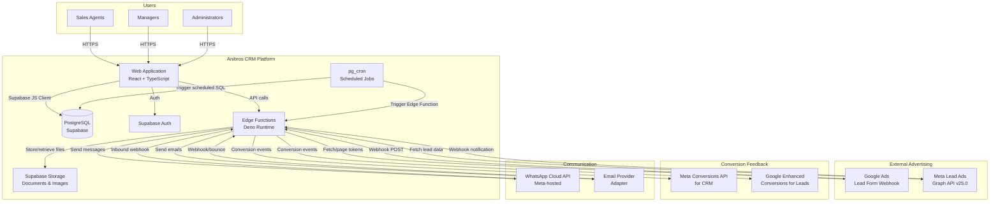

### B.2 Container / Component Diagram

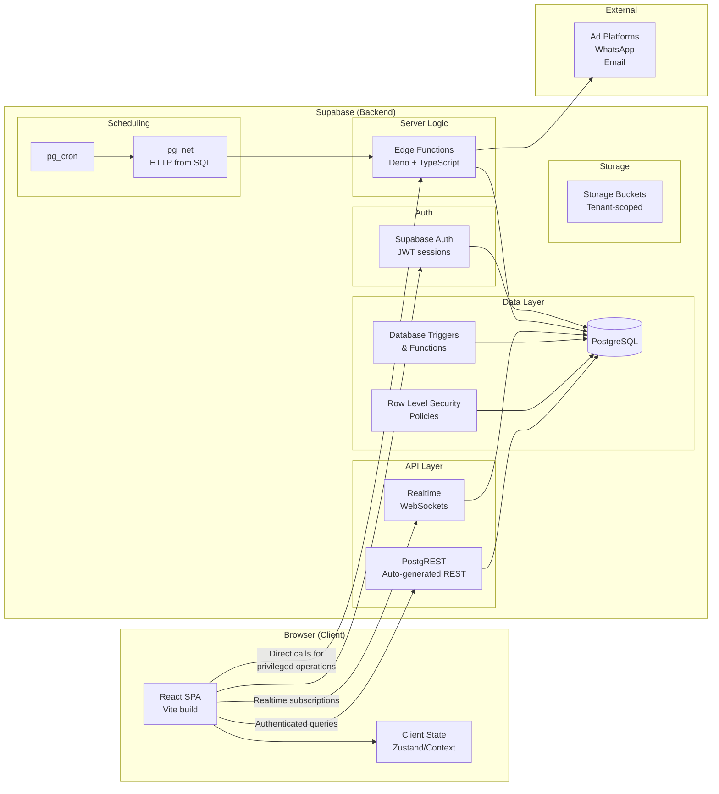

### B.3 Deployment Diagram

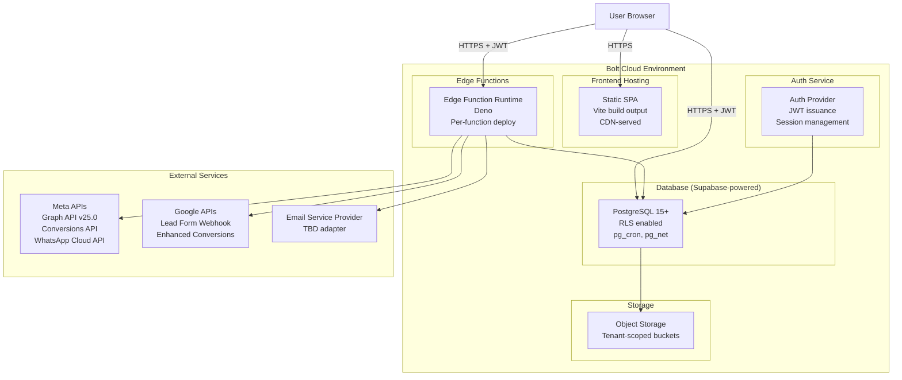

### B.4 Tenant and Trust-Boundary Diagram

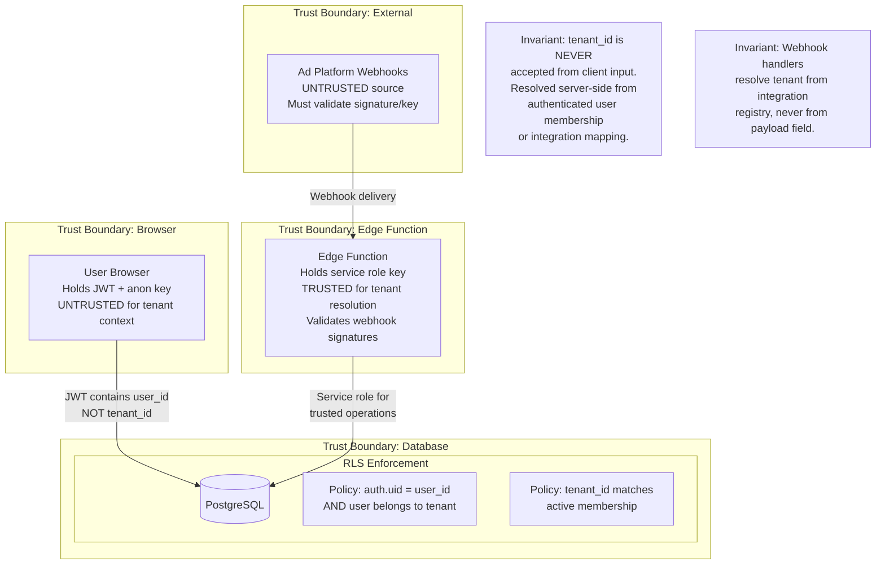

### B.5 Lead Ingestion Sequence Diagram

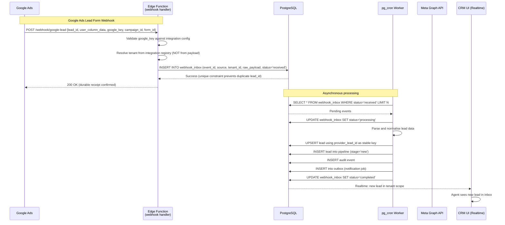

### B.6 Durable Inbox/Outbox Processing Sequence

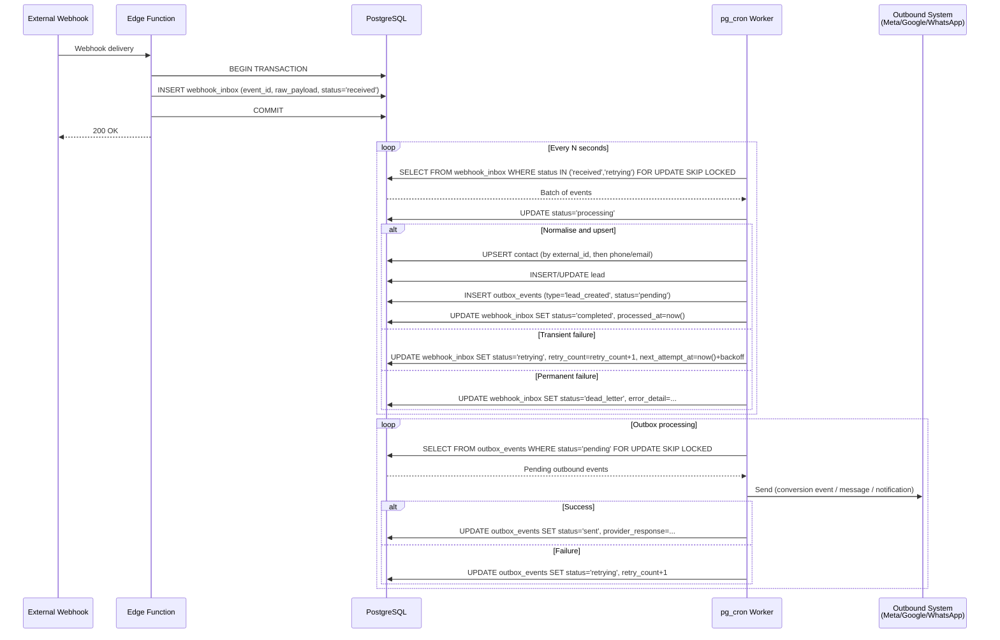

### B.7 Conversion Feedback Sequence (Meta and Google)

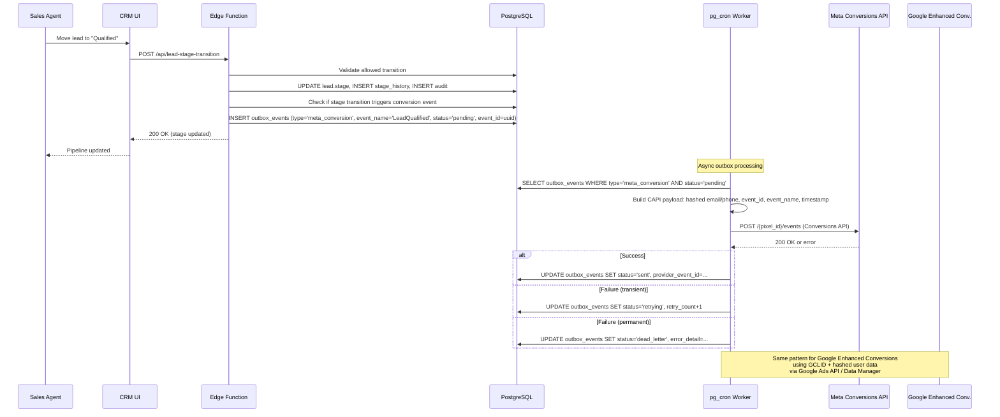

### B.8 Viewing-to-Booking Business Workflow

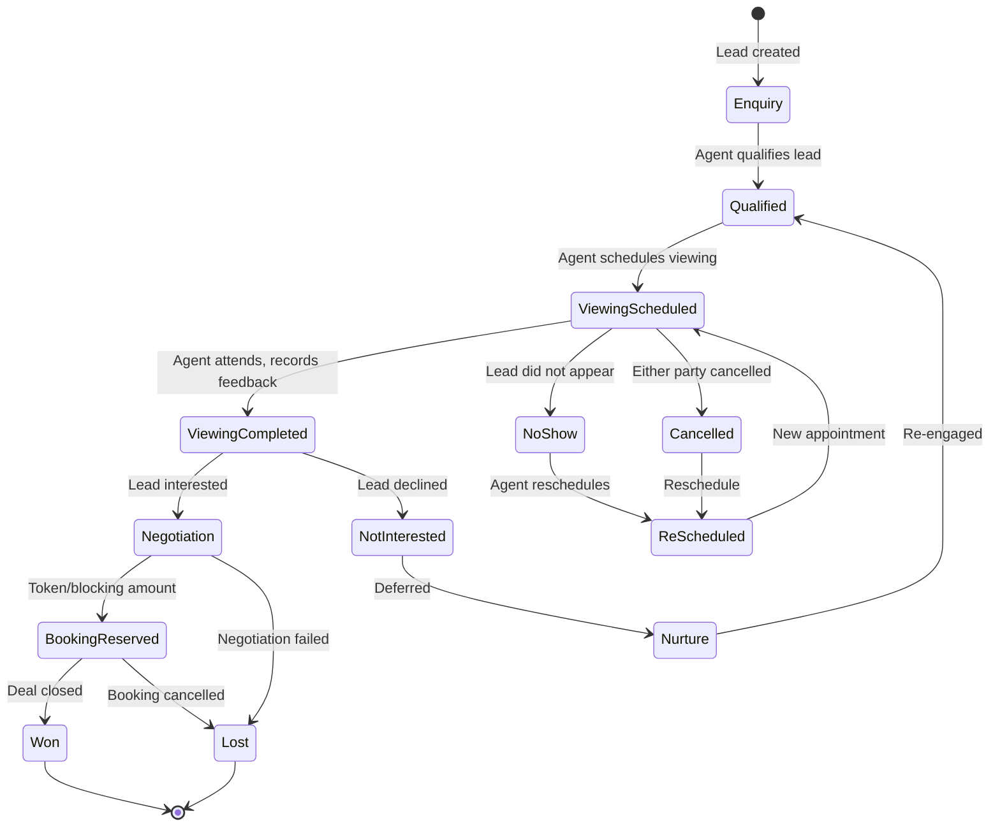

### B.9 Disaster Recovery Overview

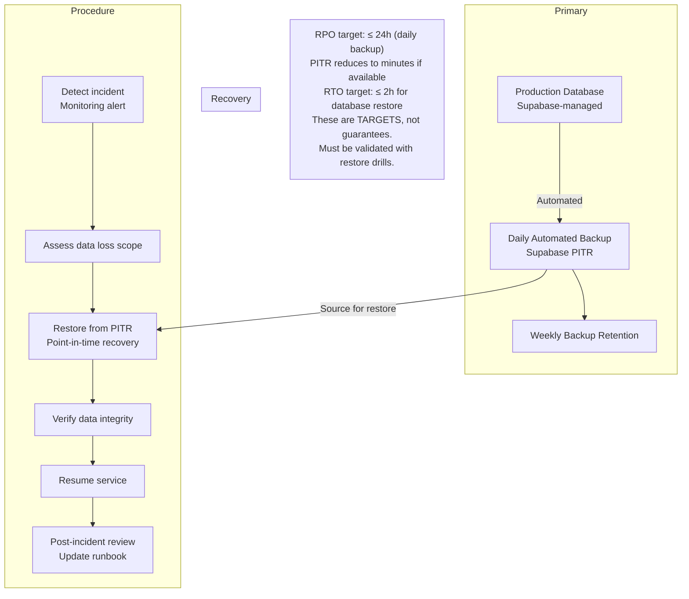

---

## Deliverable C — Technology Decision Records

### C.1 Frontend Framework

| Aspect | Decision |
|---|---|
| **Choice** | React 18 + TypeScript + Vite |
| **Rationale** | Bolt's native stack. Already provisioned. Largest ecosystem for enterprise UI components. TypeScript essential for a data-heavy CRM. Vite provides fast HMR and optimised builds. |
| **Alternatives** | Next.js (SSR/SSG) — adds complexity, Bolt builds SPAs. Vue — smaller ecosystem for enterprise components. |
| **Trade-offs** | SPA means no SSR; acceptable for an internal CRM behind auth. SEO irrelevant. |
| **Migration** | Could migrate to Next.js if SEO or public pages become needed. React component knowledge transfers. |

### C.2 Backend Execution Model

| Aspect | Decision |
|---|---|
| **Choice** | Supabase Edge Functions (Deno + TypeScript) for server-side logic, plus PostgreSQL functions/triggers for data-layer logic |
| **Rationale** | Edge Functions are Bolt's supported server-side runtime. They handle webhooks, privileged operations, external API calls, and scheduled job triggers. PostgreSQL functions handle atomic multi-row operations (state transitions, assignment logic) within a single transaction boundary. |
| **Limitations** | Edge Functions have execution time limits (~150s on Supabase free tier, longer on paid). No persistent in-memory state. Cold starts. No long-running worker process. |
| **Mitigation** | Use pg_cron + pg_net for scheduled job triggering. Keep individual function execution short. Use database-backed queue (webhook_inbox/outbox_events tables) instead of in-memory queues. |
| **Alternatives** | External Node.js worker (e.g., on Railway/Fly.io) — adds operational complexity and cost. Supabase Queue (pgmq) — available as extension, viable for durable queue. |
| **Date verified** | Bolt Help Center, October 2026. Supabase docs, October 2026. |

### C.3 Database

| Aspect | Decision |
|---|---|
| **Choice** | PostgreSQL (Supabase-managed) |
| **Rationale** | Already provisioned. Full PostgreSQL with RLS, triggers, functions, check constraints, unique constraints, pg_cron, pg_net. The relational model is correct for CRM data with complex relationships and reporting needs. |
| **Key extensions available** | pg_cron (scheduled jobs), pg_net (HTTP from SQL), pg_partman (partitioning for large tables like audit logs), pgcrypto ( hashing), uuid-ossp or pgcrypto (UUID generation). |
| **Alternatives** | External Supabase project — requires Pro/Teams plan, more operational control but same engine. External PostgreSQL (Neon, Railway) — more portability but loses Bolt integration. |
| **Migration** | Schema is standard PostgreSQL DDL. Portable to any PostgreSQL host. |

### C.4 Authentication

| Aspect | Decision |
|---|---|
| **Choice** | Supabase Auth (email/password) |
| **Rationale** | Native to the platform. JWT-based sessions. RLS integration via `auth.uid()`. Supports email confirmation, password reset, leaked password protection. No external auth service needed. |
| **Configuration** | Email confirmation OFF for internal pilot (per Bolt guidance). Leaked password protection ON. |
| **Future** | MFA/passkey support can be added when Supabase supports it or via edge function. Social login (Google SSO) is supported by Bolt if needed later. |
| **Session security** | JWT in httpOnly cookie or localStorage with short refresh window. Session revocation via Supabase admin API. |
| **Date verified** | Bolt Help Center authentication docs, October 2026. |

### C.5 RLS and Authorisation

| Aspect | Decision |
|---|---|
| **Choice** | PostgreSQL RLS policies on every tenant-owned table, plus SECURITY DEFINER functions for privileged cross-table operations |
| **Pattern** | Every tenant-owned row has `tenant_id`. RLS policy checks `auth.uid()` against a `tenant_memberships` table join. Platform-level tables (organisations, tenants) have separate policies for platform admins. |
| **SECURITY DEFINER** | Used for operations that need to write to multiple tables atomically (e.g., lead stage transition writes to leads + stage_history + outbox + audit). The function validates permissions before executing. |
| **Critical rule** | Tenant ID is resolved server-side from the authenticated user's active membership, never from client request parameters. |
| **Testing** | Automated negative tests: user A cannot SELECT, UPDATE, DELETE user B's tenant data. |

### C.6 Job Queue and Workers

| Aspect | Decision |
|---|---|
| **Choice** | Database-backed queue (webhook_inbox + outbox_events tables) with pg_cron as the polling dispatcher and Edge Functions as the processing unit |
| **Rationale** | No external queue service available in Bolt environment. PostgreSQL provides transactional guarantees, `FOR UPDATE SKIP LOCKED` for concurrent workers, and unique constraints for idempotency. pg_cron runs on a schedule (every 30–60 seconds) and either processes directly or triggers an Edge Function via pg_net. |
| **Pattern** | `webhook_inbox` for inbound events, `outbox_events` for outbound events. Each row has status (received/processing/completed/retrying/dead_letter), retry_count, next_attempt_at, and error_detail. |
| **Limitations** | pg_cron minimum interval is typically 1 minute on Supabase. For faster processing, an Edge Function can be called by the webhook handler itself to process immediately after durable receipt, with pg_cron as a fallback for retries and missed events. |
| **Alternatives** | pgmq extension (if available) — purpose-built message queue. External queue (Inngest, Trigger.dev) — adds dependency and cost. |
| **Trade-off** | Database-backed queue adds write load but eliminates an external service. Acceptable at initial scale. If volume grows, migrate to pgmq or external queue without changing the processing logic. |

### C.7 Realtime Updates

| Aspect | Decision |
|---|---|
| **Choice** | Supabase Realtime (PostgreSQL CDC / WAL-based) |
| **Rationale** | Built into Supabase. Broadcasts row changes to subscribed clients. RLS-aware — clients only receive events for rows they can see. |
| **Use cases** | New lead appears in inbox without refresh. Pipeline stage changes propagate to all viewing agents. Viewing calendar updates. |
| **Security** | Realtime respects RLS policies. Tenant-scoped by design — a client subscribed to `leads` will only receive events for rows matching their RLS policies. |
| **Limitations** | Connection limits on free tier. May need polling fallback for high-connection scenarios. |

### C.8 File Storage

| Aspect | Decision |
|---|---|
| **Choice** | Supabase Storage with tenant-scoped bucket paths |
| **Rationale** | Built into the platform. Supports private buckets with signed URLs. RLS policies on storage objects. |
| **Pattern** | Bucket path: `tenant/{tenant_id}/properties/{property_id}/images/`, `tenant/{tenant_id}/documents/`, etc. Signed URLs with expiry for access. Upload via Edge Function (not direct client upload for sensitive files). |
| **File types** | Images (jpg, png, webp), documents (pdf, docx), as supported by Bolt storage. |

### C.9 Email Provider Integration

| Aspect | Decision |
|---|---|
| **Choice** | Adapter pattern — initial implementation with Supabase's built-in email (auth emails) + a transactional email provider for CRM emails |
| **Candidates** | Resend (modern API, good free tier), SendGrid (enterprise-grade), Amazon SES (lowest cost at scale) |
| **Rationale** | Supabase handles auth emails (verification, reset). CRM transactional emails (viewing confirmations, lead notifications) need a dedicated provider. Adapter pattern allows switching. |
| **Credential storage** | Provider API keys stored as Edge Function secrets (Bolt Secrets menu), never in client code. |
| **Deferred to** | Phase 6. Not needed for MVP. |

### C.10 WhatsApp Integration

| Aspect | Decision |
|---|---|
| **Choice** | Meta WhatsApp Cloud API (not WhatsApp Business API on-premise, not unofficial automation) |
| **Rationale** | Meta-hosted, no infrastructure to manage. Free API access (pay per conversation/message per Meta's pricing). Cloud API receives updates faster. Supports webhooks for inbound messages and status. |
| **Key requirements** | WhatsApp Business account, phone number, Meta app with WhatsApp product, template message approval, webhook subscription. Messaging window rules (24h session for free-form, templates outside). |
| **Tenant-specific** | Each tenant configures their own WhatsApp Business account. Credentials stored per-tenant in encrypted form. |
| **Date verified** | Meta WhatsApp Cloud API docs, updated June 2026. |
| **Deferred to** | Phase 6. |

### C.11 Advertising Integrations

#### Google Ads Lead Form Webhook

| Aspect | Detail |
|---|---|
| **Source** | https://developers.google.com/google-ads/webhook/docs/implementation |
| **Mechanism** | Google POSTs JSON to a registered webhook endpoint. Payload includes `lead_id` (unique, for dedup), `user_column_data` (array of column_id/string_value pairs), `google_key` (verification), `campaign_id`, `form_id`. |
| **Auth** | `google_key` field in payload matched against integration configuration. |
| **Dedup** | `lead_id` is the stable unique key. Unique constraint on `(integration_id, provider_lead_id)`. |
| **Forward compat** | Must ignore unrecognised fields in `user_column_data` — Google may add new column types. |
| **Response codes** | 200 = success, 400 = non-retryable error, 500 = retryable error. |
| **Test vs real** | Google provides test payloads. Handler distinguishes by checking for test indicators in the payload. |

#### Meta Lead Ads

| Aspect | Detail |
|---|---|
| **Source** | Meta Graph API v25.0 (released Feb 2026). Webhook subscription for `leadgen` event. |
| **Mechanism** | Webhook notification contains `leadgen_id`. A subsequent authenticated Graph API call retrieves full lead data. The webhook itself does NOT contain all fields. |
| **Auth** | App secret for webhook signature verification (X-Hub-Signature-256 header). Page access token for lead retrieval. |
| **Permissions** | `leads_retrieval`, `pages_manage_ads`, `pages_read_engagement`. |
| **Dedup** | `leadgen_id` is the stable unique key. |
| **Rate limits** | Meta enforces rate limits on Graph API calls. Retry with backoff. |
| **2026 changes** | mTLS certificate switched to Meta-owned CA (March 2026). Webhook endpoint must accept new certificate. |

#### Meta Conversions API for CRM

| Aspect | Detail |
|---|---|
| **Source** | Meta Conversions API documentation, Conversion Leads Integration. |
| **Mechanism** | Server-side POST to `/{pixel_id}/events` with event data. For CRM conversion leads, use the Conversion Leads Integration flow. |
| **Events** | Map CRM lifecycle milestones to Meta events: `Lead` (lead received), `Contact` (first contact), `Schedule` (viewing scheduled), `SubmitApplication` or custom (qualified), `Purchase` (deal won). Exact supported event names must be confirmed against current Meta documentation at implementation time. |
| **Identifiers** | Hashed (SHA-256) email, phone. Event ID for deduplication with browser pixel events. |
| **Dedup** | `event_id` + `event_name` prevents duplicate counting when both browser pixel and server send the same event. |
| **Consent** | Must respect user consent. Include `ndid` or consent flags as required. |

#### Google Enhanced Conversions for Leads

| Aspect | Detail |
|---|---|
| **Source** | Google Ads API, Enhanced Conversions for Leads, Data Manager approach. |
| **Mechanism** | Upload offline conversion data with GCLID (Google Click ID) + hashed user data (SHA-256 email/phone). |
| **Key change** | Google's Data Manager is the current recommended approach. The older Google Ads API `CustomerConversionGoal` and `ConversionUpload` flow still works but verify at implementation time. |
| **Consent** | User consent for data sharing must be recorded. Google requires consent flags. |

### C.12 Hosting

| Aspect | Decision |
|---|---|
| **Choice** | Bolt Cloud hosting (static SPA + edge functions + database) |
| **Rationale** | Zero-config. CDN-served frontend. Edge functions deployed via `deploy_edge_functions` MCP tool. Database managed. All in one environment. |
| **Custom domain** | Requires Pro plan. Available when ready for production. |
| **Alternatives** | Netlify (Bolt supports). Vercel (manual deploy). Self-hosted — not practical for this stack. |

### C.13 Monitoring and Alerting

| Aspect | Decision |
|---|---|
| **Choice** | Bolt database logs (PostgreSQL, Edge Function, Auth, Realtime, Cron Job logs) + application-level health tables |
| **Pattern** | `integration_health` table records last successful/failed interaction per integration. `webhook_inbox` status distribution queryable for dead-letter monitoring. Edge Function structured logging with correlation IDs. |
| **Alerting** | pg_cron job checks for dead-letter count > threshold, integration stale > threshold, and inserts into `alerts` table. CRM admin dashboard surfaces alerts. For external alerting (email/Slack), an Edge Function can be triggered. |
| **Limitation** | No external monitoring service (Datadog, Sentry) in the Bolt environment. Application must self-monitor. |

### C.14 Backups and Recovery

| Aspect | Decision |
|---|---|
| **Development** | Bolt's built-in database management. Version history does NOT restore databases. Manual exports recommended. |
| **Production** | Supabase PITR (Point-In-Time Recovery) if available on the plan. Daily automated backups. Weekly backup retention. Periodic restore drill (quarterly). |
| **RPO target** | ≤ 24h (daily backup) or ≤ 1h (PITR if available). |
| **RTO target** | ≤ 2h for database restore. |
| **Limitation** | Bolt's version history feature does not support database restores. This is a known limitation documented in the Bolt Help Center. |
| **Mitigation** | Regular `pg_dump` exports via Edge Function to external storage for critical data. |

### C.15 Development and Deployment Environments

| Aspect | Decision |
|---|---|
| **Development** | Bolt preview environment. Database auto-provisioned. Hot reload via Vite HMR. |
| **Staging** | Separate Bolt project with its own database for integration testing before production. |
| **Production** | Published Bolt project with custom domain. |
| **Deployment** | Edge functions deployed via `deploy_edge_functions` MCP tool. Frontend built via `npm run build` and published via Bolt. Database migrations applied via `apply_migration` MCP tool. |
| **Version control** | Git-based. Bolt supports GitHub integration. |

---

## Deliverable D — Database and State Model

### D.1 Entity-Relationship Overview

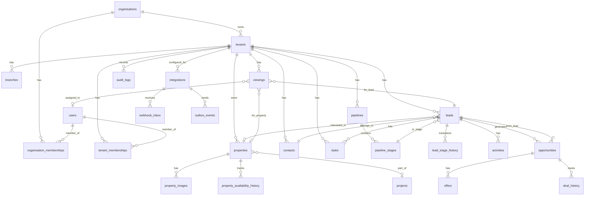

### D.2 Schema Proposal (Core Tables)

The full DDL will be applied via migrations when implementation begins. Below is the structural design for each major entity group.

#### D.2.1 Organisation and Tenant Hierarchy

```
organisations
  id (uuid, PK)
  name (text)
  type (enum: 'platform_owner', 'agency', 'client_business')
  parent_organisation_id (uuid, FK self, nullable)
  created_at, updated_at, deleted_at

tenants
  id (uuid, PK)
  organisation_id (uuid, FK organisations)
  name (text)
  slug (text, unique)
  status (enum: 'active', 'suspended', 'offboarded')
  settings (jsonb — tenant-specific config: currency, timezone, branding)
  created_at, updated_at, deleted_at

branches
  id (uuid, PK)
  tenant_id (uuid, FK tenants)
  name (text)
  location (text, nullable)
  created_at, updated_at

organisation_memberships
  id (uuid, PK)
  user_id (uuid, FK auth.users)
  organisation_id (uuid, FK organisations)
  role (enum: 'platform_owner', 'platform_admin', 'agency_owner', 'agency_admin')
  status (enum: 'active', 'invited', 'revoked')
  created_at, updated_at

tenant_memberships
  id (uuid, PK)
  user_id (uuid, FK auth.users)
  tenant_id (uuid, FK tenants)
  role (enum: 'tenant_owner', 'tenant_admin', 'sales_manager', 'sales_agent', 'marketing_manager', 'marketing_analyst', 'executive_readonly', 'auditor')
  branch_id (uuid, FK branches, nullable)
  status (enum: 'active', 'invited', 'revoked')
  created_at, updated_at
```

**Unique constraints:**
- `tenant_memberships (user_id, tenant_id)` — one membership per user per tenant
- `tenants.slug` — globally unique slug

**RLS pattern (all tenant-owned tables):**
```sql
-- Example for leads table
CREATE POLICY "select_own_tenant_leads" ON leads FOR SELECT
  TO authenticated
  USING (
    tenant_id IN (
      SELECT tenant_id FROM tenant_memberships
      WHERE user_id = auth.uid() AND status = 'active'
    )
  );
-- Same pattern for INSERT (WITH CHECK), UPDATE (USING + WITH CHECK), DELETE (USING)
```

#### D.2.2 Integrations and Credentials

```
integrations
  id (uuid, PK)
  tenant_id (uuid, FK tenants)
  provider (enum: 'google_ads', 'meta_lead_ads', 'meta_conversions', 'google_enhanced_conversions', 'whatsapp', 'email', 'website_form', 'manual', 'csv_import')
  display_name (text)
  status (enum: 'active', 'paused', 'error', 'disconnected')
  config (jsonb — provider-specific: account_id, page_id, pixel_id, webhook_url_key, form_ids, etc.)
  credential_ref (text — reference to edge function secret name, NOT the credential itself)
  last_health_check_at (timestamptz, nullable)
  last_success_at (timestamptz, nullable)
  last_error_at (timestamptz, nullable)
  last_error_detail (text, nullable)
  created_at, updated_at

integration_webhook_endpoints
  id (uuid, PK)
  integration_id (uuid, FK integrations)
  endpoint_path (text — e.g., '/webhook/google-lead/{integration_id}')
  webhook_secret (text — hashed verification key)
  is_active (boolean)
  created_at, updated_at
```

**Critical invariant:** The `credential_ref` column stores only the *name* of the secret in Bolt's secrets management, never the credential value. Edge Functions retrieve the actual secret at runtime via `Deno.env.get()`.

**Unique constraint:** `integrations (tenant_id, provider, config->>'account_id')` — one integration per provider per account per tenant.

#### D.2.3 Webhook Inbox (Inbound Event Queue)

```
webhook_inbox
  id (uuid, PK)
  integration_id (uuid, FK integrations)
  tenant_id (uuid, FK tenants) — resolved server-side, never from payload
  provider (text)
  provider_event_id (text — Google lead_id, Meta leadgen_id, etc.)
  raw_payload (jsonb — full original payload for replay/audit)
  status (enum: 'received', 'processing', 'completed', 'retrying', 'dead_letter', 'rejected')
  retry_count (int, default 0)
  max_retries (int, default 5)
  next_attempt_at (timestamptz, nullable)
  processed_at (timestamptz, nullable)
  error_detail (text, nullable)
  is_test (boolean, default false)
  received_at (timestamptz, default now())

UNIQUE CONSTRAINT: (integration_id, provider_event_id)
  — Prevents duplicate acceptance of the same external delivery.
  This is the primary idempotency mechanism.
```

**Index:** `CREATE INDEX ON webhook_inbox (status, next_attempt_at) WHERE status IN ('received', 'retrying')` — for worker polling.

#### D.2.4 Outbox Events (Outbound Event Queue)

```
outbox_events
  id (uuid, PK)
  tenant_id (uuid, FK tenants)
  event_type (enum: 'meta_conversion', 'google_conversion', 'whatsapp_message', 'email_message', 'internal_notification', 'lead_assignment')
  entity_type (text — 'lead', 'viewing', 'opportunity', 'task')
  entity_id (uuid)
  payload (jsonb — the full event content to send)
  status (enum: 'pending', 'processing', 'sent', 'retrying', 'dead_letter', 'superseded')
  event_id (uuid — provider-facing dedup ID, unique per logical event)
  retry_count (int, default 0)
  max_retries (int, default 5)
  next_attempt_at (timestamptz, nullable)
  sent_at (timestamptz, nullable)
  provider_response (jsonb, nullable)
  error_detail (text, nullable)
  created_at (timestamptz, default now())

UNIQUE CONSTRAINT: (event_type, event_id)
  — Prevents duplicate outbound events for the same logical occurrence.
```

**Superseded pattern:** When a lead stage changes multiple times (e.g., Qualified → Contacted → Qualified), only the latest qualifying event should be sent. The `superseded` status marks events that should not be sent because a newer event for the same entity supersedes them. This prevents duplicate conversions from repeated stage edits.

#### D.2.5 Contacts and Leads

```
contacts
  id (uuid, PK)
  tenant_id (uuid, FK tenants)
  first_name (text)
  last_name (text, nullable)
  email (text, nullable)
  email_normalized (text — lowercase trimmed, for matching)
  phone (text, nullable)
  phone_normalized (text — E.164 format, for matching)
  communication_consent (jsonb — {email: true/false, whatsapp: true/false, sms: true/false, consented_at, withdrawn_at})
  contact_preferences (jsonb — preferred contact time, language, etc.)
  source_summary (jsonb — first_source, first_campaign, first_at)
  created_at, updated_at, deleted_at

  INDEX: (tenant_id, email_normalized) WHERE email_normalized IS NOT NULL
  INDEX: (tenant_id, phone_normalized) WHERE phone_normalized IS NOT NULL

leads
  id (uuid, PK)
  tenant_id (uuid, FK tenants)
  contact_id (uuid, FK contacts)
  pipeline_id (uuid, FK pipelines)
  pipeline_stage_id (uuid, FK pipeline_stages)
  stage (text — denormalised for quick filtering, kept in sync by trigger)
  lead_source (enum: 'google_ads', 'meta_lead_ads', 'website_form', 'manual', 'csv_import', 'whatsapp', 'referral', 'other')
  integration_id (uuid, FK integrations, nullable)
  provider_lead_id (text, nullable — stable external ID for dedup)
  campaign_id (text, nullable)
  ad_group_id (text, nullable)
  ad_id (text, nullable)
  form_id (text, nullable)
  landing_page_url (text, nullable)
  gclid (text, nullable — Google Click ID)
  gbraid (text, nullable)
  wbraid (text, nullable)
  fbclid (text, nullable — Meta click ID, when available)
  utm_source, utm_medium, utm_campaign, utm_term, utm_content (text, nullable)
  assigned_to (uuid, FK auth.users, nullable)
  assigned_at (timestamptz, nullable)
  qualification_status (enum: 'unqualified', 'pending', 'qualified', 'disqualified', nullable)
  qualification_notes (text, nullable)
  budget_min, budget_max (numeric, nullable)
  desired_location (text, nullable)
  property_type_preference (text[], nullable)
  bedroom_preference (int[], nullable)
  transaction_intent (enum: 'buy', 'rent', 'lease', 'invest', nullable)
  expected_timeline (enum: 'immediate', '1_month', '3_months', '6_months', '12_months', 'exploring', nullable)
  financing_status (enum: 'pre_approved', 'arranging', 'self_funded', 'not_discussed', nullable)
  loss_reason (text, nullable)
  nurture_status (enum: 'none', 'active_nurture', 'paused', 'completed', nullable)
  lead_score (int, default 0 — computed from rules)
  response_sla_due_at (timestamptz, nullable)
  first_contacted_at (timestamptz, nullable)
  last_activity_at (timestamptz, nullable)
  created_at, updated_at, deleted_at

  UNIQUE CONSTRAINT: (integration_id, provider_lead_id) WHERE provider_lead_id IS NOT NULL
    — Prevents duplicate lead creation from the same external delivery.
  INDEX: (tenant_id, stage)
  INDEX: (tenant_id, assigned_to, stage)
  INDEX: (tenant_id, lead_source)
  INDEX: (tenant_id, created_at)
```

**Key design decision — contact vs lead separation:** A contact is a person. A lead is an enquiry/opportunity. One contact can have multiple leads (enquired about different properties, through different campaigns). This prevents incorrect merging of distinct opportunities and allows proper attribution per enquiry.

**Duplicate detection strategy:**
1. Match by `provider_lead_id` first (exact, unique constraint enforced).
2. If no provider ID, match by `(tenant_id, email_normalized)` or `(tenant_id, phone_normalized)`.
3. If both match but to different contacts, flag as potential duplicate for human review.
4. Never auto-merge contacts based on phone or email alone when the lead source or property interest differs.

#### D.2.6 Lead Stage History (State Machine Audit)

```
lead_stage_history
  id (uuid, PK)
  lead_id (uuid, FK leads)
  from_stage (text, nullable — null for initial creation)
  to_stage (text)
  changed_by (uuid, FK auth.users)
  changed_at (timestamptz, default now())
  reason (text, nullable)
  metadata (jsonb — any additional context: assignment change, qualification notes, etc.)

  INDEX: (lead_id, changed_at)
```

**Allowed transitions are enforced by a PostgreSQL function** (SECURITY DEFINER) that checks the current stage against an allowed-transition table before updating. This prevents invalid transitions regardless of how the request arrives.

```
pipeline_stage_transitions
  id (uuid, PK)
  pipeline_id (uuid, FK pipelines)
  from_stage (text)
  to_stage (text)
  is_allowed (boolean)
  required_fields (text[] — fields that must be populated before this transition)
  side_effect (text, nullable — identifier for automation to trigger)
```

#### D.2.7 Pipelines and Stages

```
pipelines
  id (uuid, PK)
  tenant_id (uuid, FK tenants)
  name (text)
  is_default (boolean)
  sort_order (int)
  created_at, updated_at

pipeline_stages
  id (uuid, PK)
  pipeline_id (uuid, FK pipelines)
  name (text)
  stage_key (text — machine name: 'new', 'contact_attempted', 'contacted', 'qualified', 'viewing_scheduled', 'viewing_completed', 'negotiation', 'booking_reserved', 'won', 'lost', 'invalid', 'unqualified', 'nurture')
  stage_type (enum: 'active', 'won', 'lost', 'terminal')
  sort_order (int)
  is_won_stage (boolean, default false)
  is_lost_stage (boolean, default false)
  requires_loss_reason (boolean, default false)
  color (text — for UI display)
  created_at, updated_at

  UNIQUE: (pipeline_id, stage_key)
```

#### D.2.8 Properties and Inventory

```
projects
  id (uuid, PK)
  tenant_id (uuid, FK tenants)
  name (text)
  developer (text, nullable)
  location (text, nullable)
  rera_number (text, nullable — India RERA registration)
  status (enum: 'planned', 'under_construction', 'ready', 'completed')
  created_at, updated_at

properties
  id (uuid, PK)
  tenant_id (uuid, FK tenants)
  project_id (uuid, FK projects, nullable)
  name (text — e.g., "3BHK in Tower A, Unit 1204")
  property_type (enum: 'apartment', 'villa', 'plot', 'independent_house', 'commercial', 'shop', 'office', 'land')
  transaction_type (enum: 'sale', 'rent', 'lease')
  listing_type (enum: 'new_booking', 'resale', 'rental')
  address_line1, address_line2, city, state, postal_code (text, nullable)
  locality (text, nullable)
  latitude, longitude (numeric, nullable)
  bedrooms (int, nullable)
  bathrooms (int, nullable)
  built_up_area_sqft (numeric, nullable)
  carpet_area_sqft (numeric, nullable)
  floor_number (int, nullable)
  total_floors (int, nullable)
  facing (text, nullable)
  furnishing (enum: 'unfurnished', 'semi_furnished', 'fully_furnished', nullable)
  amenities (text[], nullable)
  price (numeric, nullable)
  currency (text, default 'INR')
  price_per_sqft (numeric, nullable — computed)
  availability_status (enum: 'available', 'reserved', 'soft_hold', 'under_negotiation', 'booked', 'sold', 'off_market')
  availability_expires_at (timestamptz, nullable — for reserved/soft_hold)
  owner_name (text, nullable)
  commission_percentage (numeric, nullable — tenant-internal, not shown to leads)
  notes (text, nullable)
  images (jsonb — array of {url, caption, sort_order, is_primary})
  documents (jsonb — array of {url, type, name})
  status (enum: 'active', 'archived')
  created_at, updated_at, deleted_at

  UNIQUE: (tenant_id, project_id, name) WHERE project_id IS NOT NULL
    — Prevents duplicate unit representation within a project.
  INDEX: (tenant_id, property_type, transaction_type)
  INDEX: (tenant_id, availability_status)
  INDEX: (tenant_id, locality)
  INDEX: (tenant_id, price)

property_availability_history
  id (uuid, PK)
  property_id (uuid, FK properties)
  from_status (text, nullable)
  to_status (text)
  changed_by (uuid, FK auth.users, nullable)
  changed_at (timestamptz, default now())
  reason (text, nullable)
  expires_at (timestamptz, nullable)
```

#### D.2.9 Viewings

```
viewings
  id (uuid, PK)
  tenant_id (uuid, FK tenants)
  lead_id (uuid, FK leads)
  property_id (uuid, FK properties, nullable)
  assigned_to (uuid, FK auth.users)
  scheduled_date (date)
  scheduled_time (time)
  duration_minutes (int, default 60)
  timezone (text, default 'Asia/Kolkata')
  status (enum: 'scheduled', 'confirmed', 'completed', 'no_show', 'cancelled', 'rescheduled')
  notes (text, nullable)
  feedback (text, nullable)
  outcome (enum: 'interested', 'not_interested', 'undecided', 'no_feedback', nullable)
  cancelled_reason (text, nullable)
  cancelled_at (timestamptz, nullable)
  created_at, updated_at

  -- Double-booking prevention:
  -- Partial unique index on (assigned_to, scheduled_date, scheduled_time)
  -- WHERE status IN ('scheduled', 'confirmed')
  -- This prevents the same agent being double-booked at the same slot.
  -- Property-level conflict check done in application logic (multiple agents
  -- can show the same property, so property uniqueness is not a hard constraint).

  INDEX: (tenant_id, assigned_to, scheduled_date)
  INDEX: (tenant_id, lead_id)
  INDEX: (tenant_id, property_id, scheduled_date)
```

#### D.2.10 Opportunities and Deals

```
opportunities
  id (uuid, PK)
  tenant_id (uuid, FK tenants)
  lead_id (uuid, FK leads)
  property_id (uuid, FK properties, nullable)
  stage (enum: 'exploration', 'negotiation', 'offer_made', 'counter_offer', 'booking_reserved', 'won', 'lost')
  deal_amount (numeric, nullable)
  currency (text, default 'INR')
  expected_close_date (date, nullable)
  commission_amount (numeric, nullable)
  commission_percentage (numeric, nullable)
  loss_reason (text, nullable)
  won_at (timestamptz, nullable)
  lost_at (timestamptz, nullable)
  created_at, updated_at

  INDEX: (tenant_id, stage)

opportunity_offers
  id (uuid, PK)
  opportunity_id (uuid, FK opportunities)
  offer_type (enum: 'initial', 'counter', 'final')
  amount (numeric)
  currency (text, default 'INR')
  terms (text, nullable)
  made_by (enum: 'buyer', 'seller')
  status (enum: 'pending', 'accepted', 'rejected', 'expired')
  created_at, updated_at

opportunity_history
  id (uuid, PK)
  opportunity_id (uuid, FK opportunities)
  from_stage (text, nullable)
  to_stage (text)
  changed_by (uuid, FK auth.users)
  changed_at (timestamptz, default now())
  notes (text, nullable)
```

#### D.2.11 Activities, Tasks, Notes

```
activities
  id (uuid, PK)
  tenant_id (uuid, FK tenants)
  lead_id (uuid, FK leads, nullable)
  contact_id (uuid, FK contacts, nullable)
  opportunity_id (uuid, FK opportunities, nullable)
  type (enum: 'call', 'email', 'whatsapp', 'meeting', 'viewing', 'note', 'system', 'stage_change', 'assignment_change')
  direction (enum: 'inbound', 'outbound', 'internal', nullable)
  subject (text, nullable)
  content (text, nullable)
  performed_by (uuid, FK auth.users, nullable — nullable for system-generated)
  performed_at (timestamptz, default now())
  metadata (jsonb — provider message ID, call duration, etc.)
  is_internal (boolean, default true — internal notes vs customer-facing messages)
  created_at

  INDEX: (tenant_id, lead_id, performed_at)
  INDEX: (tenant_id, contact_id, performed_at)
  INDEX: (tenant_id, performed_at)

tasks
  id (uuid, PK)
  tenant_id (uuid, FK tenants)
  lead_id (uuid, FK leads, nullable)
  assigned_to (uuid, FK auth.users)
  title (text)
  description (text, nullable)
  due_date (date, nullable)
  due_time (time, nullable)
  priority (enum: 'low', 'medium', 'high', 'urgent')
  status (enum: 'open', 'in_progress', 'completed', 'cancelled', 'overdue')
  completed_at (timestamptz, nullable)
  created_by (uuid, FK auth.users)
  created_at, updated_at

  INDEX: (tenant_id, assigned_to, status, due_date)
  INDEX: (tenant_id, lead_id)
```

#### D.2.12 Marketing Attribution

```
marketing_attribution
  id (uuid, PK)
  tenant_id (uuid, FK tenants)
  lead_id (uuid, FK leads)
  touch_type (enum: 'first_touch', 'last_touch', 'assisting')
  source (text — google_ads, meta_lead_ads, website, etc.)
  campaign_id (text, nullable)
  campaign_name (text, nullable)
  ad_group_id (text, nullable)
  ad_id (text, nullable)
  form_id (text, nullable)
  landing_page (text, nullable)
  gclid (text, nullable)
  fbclid (text, nullable)
  utm_source, utm_medium, utm_campaign, utm_term, utm_content (text, nullable)
  attributed_at (timestamptz, default now())

  INDEX: (tenant_id, lead_id)
  INDEX: (tenant_id, source, campaign_id)
```

#### D.2.13 Audit Log

```
audit_logs
  id (uuid, PK)
  tenant_id (uuid, FK tenants, nullable — nullable for platform-level actions)
  user_id (uuid, FK auth.users, nullable — nullable for system actions)
  action (text — e.g., 'user_invited', 'integration_configured', 'data_exported', 'membership_changed', 'exceptional_access')
  entity_type (text)
  entity_id (uuid, nullable)
  old_value (jsonb, nullable)
  new_value (jsonb, nullable)
  ip_address (inet, nullable)
  user_agent (text, nullable)
  created_at (timestamptz, default now())

  INDEX: (tenant_id, created_at)
  INDEX: (tenant_id, action, created_at)
  INDEX: (user_id, created_at)
```

**Retention:** Audit logs are retained for a minimum of 2 years. Use pg_partman for monthly partitioning if volume warrants.

#### D.2.14 Communication Consent

```
communication_consents
  id (uuid, PK)
  tenant_id (uuid, FK tenants)
  contact_id (uuid, FK contacts)
  channel (enum: 'email', 'whatsapp', 'sms', 'call')
  status (enum: 'opted_in', 'opted_out', 'pending')
  consent_source (text — 'lead_form', 'explicit', 'imported', 'inferred_from_interaction')
  consented_at (timestamptz, nullable)
  withdrawn_at (timestamptz, nullable)
  created_at, updated_at

  UNIQUE: (tenant_id, contact_id, channel)
```

### D.3 RLS Policy Design

**Every tenant-owned table** follows this pattern:

```sql
-- The active tenant membership check is the core RLS predicate.
-- It ensures the authenticated user has an active membership in the
-- tenant that owns the row being accessed.

-- SELECT policy
CREATE POLICY "select_own_tenant_<table>" ON <table> FOR SELECT
  TO authenticated
  USING (
    tenant_id IN (
      SELECT tm.tenant_id
      FROM tenant_memberships tm
      WHERE tm.user_id = auth.uid()
        AND tm.status = 'active'
    )
  );

-- INSERT policy
CREATE POLICY "insert_own_tenant_<table>" ON <table> FOR INSERT
  TO authenticated
  WITH CHECK (
    tenant_id IN (
      SELECT tm.tenant_id
      FROM tenant_memberships tm
      WHERE tm.user_id = auth.uid()
        AND tm.status = 'active'
    )
  );

-- UPDATE policy
CREATE POLICY "update_own_tenant_<table>" ON <table> FOR UPDATE
  TO authenticated
  USING (
    tenant_id IN (
      SELECT tm.tenant_id
      FROM tenant_memberships tm
      WHERE tm.user_id = auth.uid()
        AND tm.status = 'active'
    )
  )
  WITH CHECK (
    tenant_id IN (
      SELECT tm.tenant_id
      FROM tenant_memberships tm
      WHERE tm.user_id = auth.uid()
        AND tm.status = 'active'
    )
  );

-- DELETE policy
CREATE POLICY "delete_own_tenant_<table>" ON <table> FOR DELETE
  TO authenticated
  USING (
    tenant_id IN (
      SELECT tm.tenant_id
      FROM tenant_memberships tm
      WHERE tm.user_id = auth.uid()
        AND tm.status = 'active'
    )
  );
```

**Platform-level tables** (organisations, tenants, organisation_memberships) have policies that check for platform-level roles via `organisation_memberships`:

```sql
CREATE POLICY "select_organisations_as_member" ON organisations FOR SELECT
  TO authenticated
  USING (
    id IN (
      SELECT organisation_id FROM organisation_memberships
      WHERE user_id = auth.uid() AND status = 'active'
    )
  );
```

**Role-based filtering within a tenant** is handled at the application layer (Edge Functions and frontend) using the user's role from `tenant_memberships`. RLS provides tenant isolation; role-based permissions provide feature-level access control on top.

### D.4 Permission Model

| Capability | Platform Owner | Agency Admin | Tenant Owner | Tenant Admin | Sales Manager | Sales Agent | Marketing Mgr | Auditor |
|---|---|---|---|---|---|---|---|---|
| View cross-tenant dashboard | Yes (delegated) | Yes (delegated, scoped) | No | No | No | No | No | No |
| Manage tenants | Yes | Yes (within agency) | No | No | No | No | No | No |
| Manage users in tenant | No | No | Yes | Yes | No | No | No | No |
| View all leads in tenant | No | No | Yes | Yes | Yes | Own + team | No | Yes (read) |
| Create/edit leads | No | No | Yes | Yes | Yes | Own + assigned | No | No |
| Delete leads | No | No | Yes | Yes | No | No | No | No |
| Manage integrations | No | No | Yes | Yes | No | No | Yes (marketing) | No |
| View reports | Yes (aggregate) | Yes (scoped) | Yes | Yes | Yes | Own performance | Yes | Yes (read) |
| Export data | No | Yes (scoped) | Yes | Yes | Yes | No | Yes | No |
| Manage properties | No | No | Yes | Yes | Yes | Yes | No | No |
| Configure pipeline | No | No | Yes | Yes | No | No | No | No |
| View audit log | Yes | Yes (scoped) | Yes | Yes | No | No | No | Yes |

**Note:** "Delegated" access for agency admins means they can view aggregate metrics across tenants they manage, but cannot open individual lead/contact details without an explicit exceptional-access workflow that is audited.

### D.5 Lead State Machine

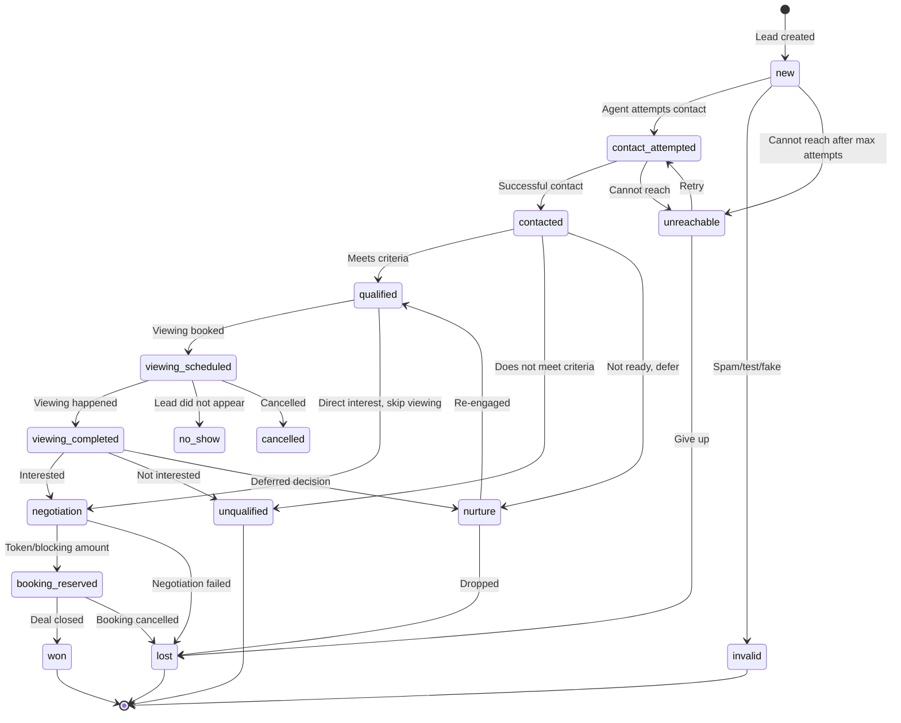

**Each transition enforces:**
- `from_stage` must match the lead's current stage
- `to_stage` must be in the allowed transitions for `from_stage`
- Required fields must be populated (e.g., `lost` requires `loss_reason`)
- Assignment may be required for certain transitions (e.g., `qualified` requires `assigned_to`)
- Timestamps are set automatically (`first_contacted_at` on first `contacted` transition)
- Audit event written to `lead_stage_history`
- Outbox events generated for eligible conversion-feedback triggers

### D.6 Webhook State Machine

```
received → processing → completed
                    ↗          ↘
              retrying → dead_letter
                    ↗
received → rejected (invalid signature, unresolvable tenant)

States:
  received    — Durably persisted, awaiting processing
  processing  — Worker has picked it up
  completed   — Lead created/updated successfully
  retrying    — Transient failure, will retry with backoff
  dead_letter — Max retries exceeded, needs manual intervention
  rejected    — Invalid at receipt time (bad signature, unknown tenant)
```

### D.7 Outbox Event State Machine

```
pending → processing → sent
                    ↗       ↘
              retrying → dead_letter
                    ↗
pending → superseded (a newer event for the same entity replaces this one)

States:
  pending      — Event recorded, awaiting outbound delivery
  processing   — Worker is sending to external system
  sent         — External system accepted the event
  retrying     — Transient failure, will retry with backoff
  dead_letter  — Max retries exceeded, needs manual intervention
  superseded   — A newer event supersedes this; do not send
```

### D.8 Stable Identity and Deduplication

**How every externally sourced lead receives a stable identity:**

1. Google Ads: `lead_id` from the webhook payload → stored as `provider_lead_id`. Unique constraint on `(integration_id, provider_lead_id)`.
2. Meta Lead Ads: `leadgen_id` from the webhook notification → stored as `provider_lead_id`. Same unique constraint.
3. Website forms: A generated UUID (or a hash of form+email+timestamp) → stored as `provider_lead_id`.
4. Manual entry: No `provider_lead_id` — dedup is by contact matching only.

**How legitimate repeated enquiries remain distinguishable from duplicate deliveries:**

- A **duplicate delivery** is the same webhook sent twice (same `provider_lead_id` for the same integration). The unique constraint on `webhook_inbox (integration_id, provider_event_id)` prevents double-processing.
- A **repeated enquiry** is the same person submitting a new form or enquiring about a different property. This creates a new `provider_lead_id` and therefore a new lead, linked to the same contact. The contact is matched by normalised email/phone, but the lead is distinct.
- The system never auto-merges leads. It may suggest a potential duplicate for human review when the same contact enquires through the same integration within a short window.

---

## Deliverable E — Security Review

### E.1 Threat Model

| # | Threat | Vector | Control | Test |
|---|---|---|---|---|
| T1 | Cross-tenant data leakage | User manipulates tenant_id in API request | RLS on every table; tenant_id never from client input; resolved from authenticated membership | Automated: user A queries user B's tenant → 0 rows |
| T2 | Cross-tenant data leakage via realtime | User subscribes to realtime channel for another tenant | Realtime respects RLS policies; client cannot subscribe to channels outside their tenant | Automated: subscribe as user A to user B's tenant channel → no events |
| T3 | Insecure direct object reference (IDOR) | User guesses/brute-forces entity UUID | RLS policy checks ownership; UUIDs are unguessable but RLS is the real control | Automated: user A requests lead UUID from user B's tenant by ID → 404/403 |
| T4 | Privilege escalation | Tenant admin changes own role to platform owner | Roles assigned via `organisation_memberships` and `tenant_memberships`; user cannot modify their own membership; SECURITY DEFINER functions validate caller permissions | Automated: attempt to self-escalate → denied |
| T5 | Forged webhook | Attacker sends fake webhook to create leads | Webhook signature/key validation (google_key for Google, X-Hub-Signature-256 for Meta); integration resolved from endpoint path, not payload | Manual: send forged webhook with wrong key → rejected |
| T6 | Replay attack | Attacker captures and replays a valid webhook | Unique constraint on `(integration_id, provider_event_id)` prevents duplicate processing; original delivery already completed | Automated: replay same webhook → rejected as duplicate |
| T7 | Duplicate delivery | Provider sends same webhook twice | Same as T6 — unique constraint on provider_event_id | Automated: send same payload twice → one lead created |
| T8 | Malformed/oversized payload | Attacker sends huge or malformed JSON | Edge Function validates payload size and structure before persisting; unknown fields ignored (per Google docs) | Manual: send oversized payload → rejected with 400 |
| T9 | Rate-limit abuse | Attacker floods webhook endpoint | Supabase platform-level rate limiting; webhook endpoint validates before processing; idempotency prevents resource exhaustion from duplicates | Manual: flood test |
| T10 | Unauthorised export | Low-privilege user exports all leads | Export requires `export` capability in permission model; Edge Function checks role before generating export; audit log records export | Automated: sales agent attempts export all → denied |
| T11 | Stored XSS | Malicious script in lead name/notes | React auto-escapes by default; no `dangerouslySetInnerHTML` usage; Content Security Policy headers | Code review + automated scan |
| T12 | SQL injection | Malicious input in search/filter parameters | Supabase client uses parameterised queries; Edge Functions use parameterised SQL; no string concatenation for queries | Code review |
| T13 | Session compromise | JWT stolen | Short-lived access tokens; secure refresh; httpOnly cookie storage; session revocation via Supabase admin API | Manual: revoke session, verify access denied |
| T14 | Broken access control | API allows operation not permitted by role | Every state-changing operation goes through Edge Function or SECURITY DEFINER function that validates the user's role and membership | Automated: attempt disallowed operation → denied |
| T15 | Insecure file upload | Malicious file uploaded as property image | File type validation in Edge Function; storage bucket policies; no executable file types allowed; file size limits | Manual: upload .exe → rejected |
| T16 | Log and backup leakage | Sensitive data in logs | Structured logging excludes secrets, tokens, raw payloads (only metadata); audit logs store changes not full content for sensitive fields | Code review |
| T17 | Insider misuse | Agency admin accesses client's sensitive leads | Exceptional-access workflow with audit trail; delegated access shows aggregates, not individual records; audit log review by auditor role | Process + audit review |
| T18 | Provider outage | Google/Meta API unavailable during processing | Retry with backoff; dead-letter queue; outbox events remain pending until provider recovers; no data loss | Manual: simulate provider outage |
| T19 | Data deletion and recovery | Malicious or accidental bulk delete | Soft delete (deleted_at) for critical tables; audit log of all deletions; backup recovery for catastrophic cases | Automated: verify soft delete preserves data |
| T20 | Credential leakage | Integration credentials exposed | Credentials stored as Edge Function secrets (Bolt Secrets), never in database columns or client code; `credential_ref` stores only the secret name | Code review + secret scan |

### E.2 OWASP ASVS Mapping

| ASVS Requirement | Implementation |
|---|---|
| V1.1 Architecture | Trust boundary documented; tenant isolation by design |
| V2.1 Password security | Supabase Auth with leaked password protection |
| V2.7 Session management | JWT with refresh; session revocation |
| V3.1 Session token generation | Supabase Auth manages token generation |
| V4.1 Access control | RLS + role-based permission matrix |
| V4.3 Operation-level authorisation | Every Edge Function validates caller permissions |
| V5.1 Input validation | Edge Function validates all inputs; unknown webhook fields ignored |
| V5.2 Sanitisation | React auto-escaping; no raw HTML injection |
| V7.1 Logging | Structured audit logs; no secrets in logs |
| V8.1 Data protection | Encryption in transit (HTTPS); at rest (Supabase); credential secrets management |
| V9.1 Communications | HTTPS only; webhook signature verification |

### E.3 Negative Test Plan

The following automated tests MUST pass before any phase is marked complete:

1. **Tenant isolation:** User with membership in Tenant A queries `leads` → only Tenant A's leads returned. Inject `tenant_id` of Tenant B in request → still only Tenant A's data.
2. **IDOR:** User A requests Tenant B's lead by UUID → 404 or 403.
3. **Role enforcement:** Sales agent attempts to manage users → denied. Marketing manager attempts to delete leads → denied.
4. **Webhook forgery:** POST to webhook endpoint with invalid `google_key` → 401/403, no lead created.
5. **Cross-tenant webhook:** Webhook payload claiming wrong tenant → tenant resolved from integration mapping, not payload.
6. **Duplicate delivery:** Same `provider_lead_id` sent twice → one lead, second delivery rejected/ignored.
7. **Simultaneous duplicate:** Two concurrent webhook deliveries with same `provider_lead_id` → unique constraint allows only one.
8. **Session revocation:** Revoked user's JWT → access denied.

---

## Deliverable F — Reliability Specification

### F.1 Delivery and Persistence Guarantees

| Guarantee | Mechanism | Scope |
|---|---|---|
| Webhook durable receipt | Raw payload persisted to `webhook_inbox` before 200 OK response | Database transaction |
| No duplicate lead from same delivery | Unique constraint on `(integration_id, provider_event_id)` | Database constraint |
| No duplicate outbound event | Unique constraint on `(event_type, event_id)` + superseded status | Database constraint |
| Atomic state transition | Lead update + stage history + outbox + audit in single transaction | PostgreSQL transaction |
| Message delivery independence | Outbox events processed async; CRM transaction does not wait for message send | Architecture separation |

**What is NOT guaranteed:**
- Exactly-once delivery to external providers (Meta/Google may accept but not process; we track "sent" not "processed by provider").
- Zero data loss in all scenarios (database failure between backup intervals may lose unreplicated data).
- Real-time processing (pg_cron interval introduces processing latency).

### F.2 Retry Policy and Backoff

| Parameter | Value |
|---|---|
| Max retries | 5 for webhook processing, 5 for outbox delivery |
| Backoff strategy | Exponential: 30s, 2min, 10min, 30min, 2h |
| Dead-letter threshold | After max retries, status → `dead_letter` |
| Dead-letter review | Admin dashboard surfaces dead-lettered events for manual review/replay |
| Replay | Admin can manually replay a dead-lettered event; creates a new processing attempt |

### F.3 Idempotency Rules

| Operation | Idempotency Key | Mechanism |
|---|---|---|
| Webhook acceptance | `(integration_id, provider_event_id)` | Unique constraint on `webhook_inbox` |
| Lead creation from webhook | `(integration_id, provider_lead_id)` | Unique constraint on `leads` |
| Conversion event to Meta/Google | `(event_type, event_id)` | Unique constraint on `outbox_events` |
| Stage transition | `(lead_id, to_stage, changed_by, changed_at)` | Checked in transition function — no-op if already in target stage |
| Message send | `(channel, contact_id, template_id, event_id)` | Checked before send — skip if already sent with same event_id |

### F.4 Dead-Letter and Replay Procedures

1. **Detection:** pg_cron job counts `dead_letter` events every 5 minutes. If count > 0, alert appears on admin dashboard.
2. **Review:** Admin opens dead-letter detail — sees raw payload, error detail, retry history.
3. **Replay:** Admin clicks "Replay" → event status reset to `received` (inbound) or `pending` (outbound), retry_count reset to 0.
4. **Discard:** Admin can mark as `permanently_failed` with a reason for audit purposes.
5. **Audit:** All replay/discard actions logged in `audit_logs`.

### F.5 Reconciliation Strategy

- **Weekly reconciliation job** (pg_cron): Compare webhook_inbox `completed` count against leads created for the same integration in the same period. Discrepancies flagged.
- **Monthly reconciliation**: Compare outbox_events `sent` count against provider-reported event counts (if provider offers a reporting API).
- **Manual reconciliation**: Admin can trigger a date-range reconciliation report for any integration.

### F.6 Service Level Objectives (SLOs)

| SLO | Target | Measurement | Assumptions |
|---|---|---|---|
| Webhook receipt-to-durable-acceptance | < 2s p95 | Time from webhook POST to 200 OK response | Supabase database responsive |
| Receipt-to-lead-visible | < 30s p95 | Time from webhook receipt to lead appearing in CRM | pg_cron 1-min interval + processing time |
| API response time (list views) | < 300ms p95 | Supabase PostgREST response time | Indexed queries, < 10K rows per tenant |
| API response time (detail views) | < 100ms p95 | Single record fetch | Indexed by PK |
| Job completion (outbox) | < 5min p95 | Time from outbox `pending` to `sent` | External provider responsive |
| Availability | 99.5% monthly | Uptime monitoring | Bolt Cloud availability |
| Data loss exposure (RPO) | ≤ 24h | Last successful backup | Daily backup; PITR if available reduces to minutes |
| Recovery time (RTO) | ≤ 2h | Time to restore database | Supabase restore process |

**These are targets, not guarantees.** They assume:
- Supabase free/Pro tier performance characteristics
- Moderate load (initial pilot: < 100 concurrent users, < 1000 leads/day)
- External providers (Meta, Google) are operational
- No cascading failure from dependent services

### F.7 Monitoring, Dashboards, and Alerts

| Metric | Source | Alert Threshold |
|---|---|---|
| Dead-letter count | `webhook_inbox` + `outbox_events` WHERE status='dead_letter' | > 0 |
| Processing lag | `webhook_inbox` WHERE status='received' AND received_at < now() - 5min | > 10 events |
| Integration health | `integrations.last_success_at` | > 1h since last success |
| Outbox backlog | `outbox_events` WHERE status='pending' AND created_at < now() - 10min | > 50 events |
| Failed auth attempts | Supabase auth logs | > 20 in 5min per user |
| Database query performance | PostgreSQL slow query log | > 1s |

### F.8 Backup Retention

| Type | Frequency | Retention | Notes |
|---|---|---|---|
| Supabase automated backup | Daily | 7 days (free) / 30 days (Pro) | PITR available on Pro |
| Manual pg_dump export | Weekly | 4 weeks | Edge Function exports to storage |
| Audit log archive | Monthly | 2 years minimum | Partitioned by month |

### F.9 Disaster Recovery and Restoration Drills

1. **Quarterly restore drill:** Restore latest backup to a staging database. Verify schema integrity and row counts match production.
2. **Documented procedure:** Step-by-step runbook for database restore, Edge Function redeployment, and frontend redeployment.
3. **Post-incident review template:** Timeline, root cause, data loss assessment, corrective actions.

### F.10 Expected Infrastructure Limits

| Limit | Free Tier | Pro Tier | Impact |
|---|---|---|---|
| Database size | 500MB | 8GB | Limits lead/property/activity history |
| Edge Function execution | ~150s timeout | Longer timeouts | Long-running jobs must be chunked |
| Realtime connections | 200 concurrent | Higher | Limits concurrent users |
| Storage | 1GB | 100GB | Limits document/image storage |
| API requests | Rate-limited | Higher limits | May throttle under load |
| Database auto-pause | Pauses after 6 days inactivity (unpublished) | No auto-pause | Development-only concern |

---

## Deliverable G — Implementation Roadmap

### Phase 0: Architecture and Threat-Model Approval (Current)

**Scope:** This document.
**Dependencies:** None.
**Deliverable:** Approved architecture, schema design, security model, and roadmap.
**Checkpoint:** User review and approval of this document before any implementation begins.

### Phase 1: Repository Foundation, Design System, Navigation, Application Shell

**Scope:**
- Project structure: `src/` with components, pages, lib, hooks, types, stores
- Design system: colour tokens, typography, spacing, button/form/table/dialog components
- Application shell: sidebar navigation, top bar with tenant selector, responsive layout
- Routing: React Router or hash-based routing
- Empty states, loading states, error states
- Authentication UI: sign-in page (wired to Supabase Auth)

**Dependencies:** Phase 0 approval.
**Schema changes:** None (auth tables are Supabase-managed).
**Affected modules:** Frontend only.
**Risks:** Design system decisions are hard to change later. Invest in getting tokens and component patterns right.
**Tests:** Visual review of all shell pages; auth flow works (sign in, sign out, session persists).
**Acceptance criteria:**
- User can sign in and see a navigation shell
- Design system is consistent and responsive
- All planned navigation items are present (even if pages are empty)

### Phase 2: Authentication, Tenant Isolation, Database Schema, Authorisation Tests

**Scope:**
- Database migrations: organisations, tenants, branches, memberships, users
- RLS policies on all tenant-owned tables
- Tenant selector: user can switch between tenants they belong to
- Role-based access control middleware (frontend route guards + Edge Function permission checks)
- Organisation management: create tenants, invite users, assign roles
- Automated negative tests for tenant isolation

**Dependencies:** Phase 1 (application shell, auth UI).
**Schema changes:** Core hierarchy tables, membership tables, audit log table.
**Affected modules:** Auth, database, frontend navigation, admin pages.
**Risks:** RLS policy errors can lock users out or expose data. Test thoroughly.
**Tests:** All 8 negative tests from Section E.3.
**Acceptance criteria:**
- User can sign in, see their tenants, switch active tenant
- RLS prevents all cross-tenant access (automated tests pass)
- Admin can invite users and assign roles
- Audit log records membership changes

### Phase 3: Leads, Contacts, Properties, Matching, Core Sales Pipeline

**Scope:**
- Database migrations: contacts, leads, pipelines, stages, properties, projects, activities, tasks, lead_stage_history, marketing_attribution
- Lead inbox: list, filter, sort, bulk select
- Lead detail: profile, activity timeline, stage transitions, assignment
- Pipeline board: kanban-style drag-and-drop with server-validated transitions
- Property inventory: list, detail, search, filters
- Property matching: rule-based engine, match results with explanation
- Task management: create, assign, complete
- Executive dashboard: core metrics (new leads, unassigned, SLA breaches, pipeline value, conversion rates)
- Contact management: list, detail, merge suggestion (no auto-merge)

**Dependencies:** Phase 2 (auth, tenant isolation, RLS).
**Schema changes:** All CRM domain tables.
**Affected modules:** Leads, properties, pipeline, dashboard, tasks.
**Risks:** Pipeline state machine must be correct — invalid transitions must be impossible. Matching engine must be explainable.
**Tests:** Pipeline transition validation tests; matching correctness tests (given requirements, expected matches).
**Acceptance criteria:**
- Agent can create a lead manually, move it through pipeline stages, assign it
- Property search returns relevant results with filters
- Matching engine produces explainable results for a lead's requirements
- Dashboard shows accurate real-time metrics
- All stage transitions are server-validated
- Drag-and-drop respects allowed transitions

### Phase 4: Durable Webhook Ingestion, Deduplication, Retries, Diagnostics

**Scope:**
- Database migrations: webhook_inbox, integrations, integration_webhook_endpoints
- Edge Function: Google Ads lead form webhook handler
- Edge Function: Meta Lead Ads webhook handler (webhook receipt + Graph API lead retrieval)
- pg_cron job: webhook_inbox processing worker
- Integration management UI: configure Google/Meta integrations, view health
- Webhook inbox diagnostics: admin view of received/processing/completed/retrying/dead_letter events
- Deduplication: unique constraint enforcement, duplicate detection on contact
- Test payload handling: distinguish Google test payloads from real leads

**Dependencies:** Phase 3 (leads, contacts, pipeline — webhook processing creates leads).
**Schema changes:** webhook_inbox, integrations, integration_webhook_endpoints.
**Affected modules:** Integrations, leads (creation path), admin diagnostics.
**Risks:** Webhook signature validation must be correct. Tenant resolution from integration mapping is critical.
**Tests:**
- Forged webhook with wrong key → rejected
- Duplicate delivery → one lead
- Simultaneous duplicate → one lead (unique constraint)
- Unknown fields in payload → ignored, lead still created
- Test payload → flagged, not treated as real lead
- Integration misconfiguration → delivery quarantined, not assigned to wrong tenant
**Acceptance criteria:**
- Google Ads test webhook creates a flagged test lead
- Meta Lead Ads webhook notification triggers Graph API retrieval and lead creation
- Duplicate deliveries do not create duplicate leads
- Dead-lettered events are visible in admin diagnostics
- Integration health is visible

### Phase 5: Meta and Google CRM Conversion Feedback

**Scope:**
- Database migrations: outbox_events (if not already in Phase 4), conversion event mapping config
- pg_cron job: outbox_events processing worker
- Edge Function: Meta Conversions API sender
- Edge Function: Google Enhanced Conversions sender
- Conversion event mapping UI: map CRM stages to Meta/Google events
- Outbox diagnostics: admin view of pending/sent/retrying/dead_letter events
- Superseded event handling: prevent duplicate conversions from repeated stage edits
- Consent checking: only send conversion events for leads with consent

**Dependencies:** Phase 4 (integrations, webhook_inbox, outbox_events).
**Schema changes:** outbox_events (or extend from Phase 4), conversion mapping config.
**Affected modules:** Pipeline (triggers outbox on stage change), integrations, admin diagnostics.
**Risks:** Sending PII to wrong advertising account is a critical error. Consent must be verified. Duplicate conversions from stage edits must be prevented.
**Tests:**
- Stage transition generates correct outbox event
- Repeated stage transitions (qualified → contacted → qualified) do not send duplicate conversion
- Outbox event sent to correct tenant's integration, never cross-tenant
- Transient provider failure → retrying → eventual success
- Permanent failure → dead_letter with error detail
- Conversion event includes hashed (not plaintext) user data
**Acceptance criteria:**
- Moving a lead to "Qualified" generates a Meta conversion event (if Meta integration configured)
- Event appears in outbox diagnostics as "sent" with provider response
- No duplicate events from repeated stage edits
- Consent-gating works (no event for opted-out leads)

### Phase 6: WhatsApp and Email Workflows

**Scope:**
- Edge Function: WhatsApp Cloud API adapter (send template message, send text, receive inbound webhook, status webhooks)
- Edge Function: Email adapter (send transactional email, receive bounce/complaint webhook)
- Database migrations: communication_consents, message logs
- WhatsApp management UI: configure WhatsApp Business account, template management, conversation view
- Email management UI: configure email provider, template builder, send history
- Consent management: opt-in/opt-out per channel per contact
- Message association: link messages to contacts and leads
- Outbox integration: WhatsApp/email sends go through outbox_events for durability

**Dependencies:** Phase 3 (contacts, leads, activities), Phase 4 (outbox pattern).
**Schema changes:** communication_consents, message_logs (or extend activities).
**Affected modules:** Communication, contacts, leads, activities.
**Risks:** WhatsApp messaging window violations (24h rule). Template approval required. Consent management is a legal requirement.
**Tests:**
- Send WhatsApp template message → message logged with status
- Inbound WhatsApp message → linked to contact, appears in conversation
- Opt-out respected → no messages sent to opted-out contacts
- Email bounce → recorded, contact flagged
- Messaging window expired → only template messages allowed
**Acceptance criteria:**
- Agent can send a WhatsApp message from a lead's detail page
- Inbound messages appear in the conversation timeline
- Opt-out is enforced
- Delivery status is visible

### Phase 7: Reporting, Attribution, and Automation

**Scope:**
- Reporting module: configurable reports with date ranges, CSV export
- Attribution dashboard: source-wise, campaign-wise performance by qualified leads and deals (not just raw enquiries)
- Automation rules: lead assignment rules (round-robin, workload-based), SLA timers, stale-lead detection, escalation
- Custom fields: tenant-specific fields on leads and properties
- Conversion feedback reporting: events generated vs events accepted by provider
- Bulk actions: import, export, reassign, status change with confirmation

**Dependencies:** Phases 3–6 (data exists to report on).
**Schema changes:** automation_rules, automation_executions, custom_field_definitions, custom_field_values.
**Affected modules:** Reports, dashboard, pipeline, admin configuration.
**Risks:** Automation rules can fire incorrectly and cause unintended actions. Test thoroughly. Bulk operations can affect many records — require confirmation.
**Tests:**
- Round-robin assignment distributes leads evenly
- SLA timer triggers escalation after threshold
- Report data matches raw query results
- CSV export contains only permitted columns
- Custom field appears on lead form and is searchable
**Acceptance criteria:**
- Marketing manager can see campaign ROI by qualified leads and deals
- Sales manager can configure assignment rules
- Reports can be exported with permission checks
- Automation failures are visible and recoverable

### Phase 8: SaaS Onboarding, Tenant Administration, Subscription Readiness

**Scope:**
- SaaS onboarding flow: self-serve tenant creation, initial admin user, default pipeline setup
- Tenant configuration: branding (logo, colours), custom pipeline stages, notification preferences
- Subscription readiness: subscription_plans, tenant_subscriptions, usage_metering tables (schema only, not wired to Stripe yet)
- User management UI: invite, deactivate, change role
- Audit log viewer: filterable by action, user, date range
- Data export: full tenant data export (GDPR/DPDP compliance)
- Data retention policies: configurable retention periods

**Dependencies:** Phases 2–7 (all modules must support tenant configuration).
**Schema changes:** subscription_plans, tenant_subscriptions, usage_metering, retention_policies.
**Affected modules:** Admin, settings, billing (schema only).
**Risks:** Self-serve onboarding must not allow privilege escalation or cross-tenant access.
**Tests:**
- New tenant creation → isolated, default pipeline configured
- User deactivation → access revoked immediately
- Data export → complete, only own tenant's data
**Acceptance criteria:**
- A new business can create a tenant, configure their pipeline, and invite users
- Audit log is filterable and exportable
- Subscription schema is ready for Stripe integration (not yet wired)

### Phase 9: Security Audit, Reliability Testing, Performance Testing, Backup Restoration, Controlled Production Rollout

**Scope:**
- Full security audit: run all negative tests, OWASP ASVS checklist, penetration testing
- Performance testing: load test with realistic data volumes (10K leads, 1K properties, 100 concurrent users)
- Backup restoration drill: restore from backup, verify data integrity
- Controlled production rollout: single pilot tenant, monitored closely
- Runbook finalisation: incident response, restore procedures, integration troubleshooting
- DPDP Act compliance review: consent management, data retention, export, deletion workflows

**Dependencies:** All prior phases.
**Schema changes:** None (verification phase).
**Affected modules:** All.
**Risks:** Performance issues at scale. Security issues discovered late.
**Tests:** All tests from all phases, re-run. New performance tests.
**Acceptance criteria:**
- All security negative tests pass
- API response times meet SLOs under load
- Database restore completes within RTO
- Pilot tenant operates successfully for 2 weeks without data issues

---

## Deliverable H — Cost and Operational Model

### H.1 Development Configuration (Cost-Minimising)

| Component | Free Tier | Cost |
|---|---|---|
| Bolt project | Free plan | $0 |
| Bolt hosting | Free `.bolt.host` domain | $0 |
| Supabase database (Bolt-managed) | 500MB storage, auto-pause risk | $0 |
| Supabase Auth | Up to 50,000 monthly active users | $0 |
| Supabase Edge Functions | Included (execution limits apply) | $0 |
| Supabase Realtime | 200 concurrent connections | $0 |
| Supabase Storage | 1GB | $0 |
| pg_cron | Included | $0 |
| Google Ads API | Free to use (ad spend separate) | $0 |
| Meta Graph API / Conversions API | Free to use (ad spend separate) | $0 |
| WhatsApp Cloud API | Free API access (per-message pricing) | ~$0.02–0.08 per conversation |
| Email (Resend free tier) | 3,000 emails/month | $0 |

**Development total:** $0/month (excluding ad spend and WhatsApp message costs).

### H.2 Production Configuration

| Component | Plan | Estimated Cost | Notes |
|---|---|---|---|
| Bolt Pro | Pro | ~$20/month | Custom domain, no auto-pause, higher limits |
| Supabase Pro (if claimed separately) | Pro | ~$25/month | 8GB database, PITR, daily backups, no auto-pause |
| Supabase storage | Included in Pro | — | 100GB |
| Email (Resend Pro) | Pro | ~$20/month | 50,000 emails/month |
| WhatsApp Cloud API | Per-message | Variable | ~$0.02–0.08 per conversation (business-initiated) |
| Custom domain | Via Bolt | ~$10–15/year | Or use existing domain |
| External backup storage | S3/Cloudflare R2 | ~$1–5/month | For pg_dump exports |

**Estimated production total:** ~$70–90/month + WhatsApp message costs + ad spend.

**Note:** Pricing is approximate as of October 2026. Verify current pricing at:
- Bolt: https://bolt.new/pricing
- Supabase: https://supabase.com/pricing
- Resend: https://resend.com/pricing
- WhatsApp: https://developers.facebook.com/docs/whatsapp/pricing

### H.3 Free Tier Limitations Unsuitable for Production

| Limitation | Impact | Mitigation |
|---|---|---|
| Database auto-pause (unpublished projects) | Database goes offline after 6 days inactivity | Publish project or use Pro tier |
| 500MB database | Limits data volume | Upgrade to Pro (8GB) |
| No PITR | RPO up to 24h instead of minutes | Supabase Pro includes PITR |
| 200 realtime connections | Limits concurrent users | Upgrade or use polling fallback |
| No custom domain | Unprofessional URL | Pro plan required |
| "Made in Bolt" badge on free | Unprofessional for SaaS | Pro plan removes badge |
| Edge Function timeout | Long jobs may timeout | Chunk processing, use pg_cron |

---

## Deliverable I — Quality and Acceptance Criteria

### I.1 Testable Requirements

| # | Requirement | Type | Phase |
|---|---|---|---|
| Q1 | Tenant isolation: user A cannot access tenant B's data via any API | Automated | 2 |
| Q2 | Role enforcement: sales agent cannot access admin functions | Automated | 2 |
| Q3 | Lead ingestion: webhook creates lead with correct fields | Automated | 4 |
| Q4 | Provider authentication: invalid webhook key → rejected | Automated | 4 |
| Q5 | Duplicate delivery: same provider_event_id → one lead | Automated | 4 |
| Q6 | Simultaneous duplicate: concurrent same provider_event_id → one lead | Automated | 4 |
| Q7 | Retry: transient failure → event retries with backoff | Automated | 4 |
| Q8 | Missing fields: unknown provider fields ignored, lead still created | Automated | 4 |
| Q9 | Provider API unavailable: event enters retrying state | Manual | 4 |
| Q10 | Stale credentials: integration shows error status | Manual | 4 |
| Q11 | Conversion feedback: stage transition generates outbox event | Automated | 5 |
| Q12 | Conversion dedup: repeated stage edits → no duplicate conversion | Automated | 5 |
| Q13 | Cross-tenant conversion: event sent to correct tenant's integration only | Automated | 5 |
| Q14 | Message delivery failure: WhatsApp send failure → logged, retrying | Manual | 6 |
| Q15 | Property matching: correct matches with explanation | Automated | 3 |
| Q16 | Viewing conflict: double-booking prevented by constraint | Automated | 3 |
| Q17 | Data export: only permitted columns, only own tenant's data | Automated | 7 |
| Q18 | Audit trail: all state changes recorded with user, timestamp, old/new | Automated | 2 |
| Q19 | Performance: list views < 300ms p95 with 10K rows | Manual | 9 |
| Q20 | Backup restoration: restore completes, data integrity verified | Manual | 9 |
| Q21 | Security regression: all negative tests pass after any change | Automated | All |

### I.2 Manual Verification Against Real Provider Accounts

The following require real external accounts and cannot be fully automated:

1. Google Ads lead form webhook delivery from a live Google Ads campaign
2. Meta Lead Ads webhook delivery from a live Meta ad campaign
3. Meta Conversions API event acceptance verification (check Meta Events Manager)
4. Google Enhanced Conversions acceptance verification (check Google Ads conversion tracking)
5. WhatsApp Cloud API message delivery to a real phone number
6. WhatsApp inbound message webhook delivery
7. Email delivery and bounce handling
8. Provider rate limit behaviour under load
9. Provider credential expiry and refresh flow

---

## Deliverable J — Improved Architecture Recommendation

### J.1 What You Understood Correctly

Your specification is one of the most thorough architecture briefs I have encountered. Specifically:

1. **Tenant isolation as foundational, not bolted-on** — correct. Retrofitting multi-tenancy is far more expensive than designing it from day one.
2. **Inbox/outbox pattern for reliable event processing** — correct and essential. The database is the durable boundary, not the webhook handler.
3. **Two-way advertising integration** — correctly identified that receiving leads is only half the value. Conversion feedback is the other half and is often missed.
4. **Separation of contact, lead, and opportunity** — correct CRM domain modelling. One person, multiple enquiries, multiple opportunities.
5. **Server-validated state machine for pipeline** — correct. Client-side validation is UX, not security.
6. **Integration registry for tenant routing** — correct. Never infer tenant from payload.
7. **DPDP Act awareness** — correctly flagged. The 2025 Rules and phased commencement are real.
8. **Cost-conscious development vs production-grade reliability** — correctly distinguished.

### J.2 What Should Be Changed

1. **pg_cron as the sole job dispatcher is viable for MVP but has a 1-minute minimum interval.** For webhook processing, this means up to 60 seconds of latency between receipt and lead visibility. **Recommendation:** The webhook handler Edge Function should process the event immediately after durable receipt (synchronously or via a fire-and-forget call to a processing Edge Function), with pg_cron as a reliability fallback for retries and missed events. This gives sub-second processing for fresh events and guarantees no events are lost.

2. **The original spec mentions evaluating "a dedicated backend" but the Bolt environment's server-side is Edge Functions only.** A dedicated Node.js backend is possible but adds operational complexity and cost. **Recommendation:** Stay with Edge Functions + PostgreSQL functions for Phase 1–7. If processing volume exceeds Edge Function limits in Phase 9, evaluate an external worker at that point.

3. **The spec lists "messaging windows" for WhatsApp but doesn't address template message lifecycle management.** WhatsApp template messages require Meta approval and have expiry. **Recommendation:** Add template status tracking to the integration management module in Phase 6.

### J.3 Important Features Missing

(See Section A.7 — identified 12 missing capabilities.)

**Highest-impact additions:**
- **Lead scoring** (P0 for MVP — agents need prioritisation, not just a flat inbox)
- **Commission tracking** (P1 — without it, deal reporting is incomplete for real estate)
- **Telephony/call logging** (P1 — Indian real estate runs on phone calls; even click-to-call + manual logging is valuable)
- **Lead cap and rotation** (P1 — prevents hoarding and ensures fair distribution)

### J.4 What Should Be in the MVP

**MVP (Phases 1–3):**
- Application shell, design system, auth, tenant isolation
- Lead and contact management with manual entry
- Property inventory and search
- Property matching (rule-based)
- Sales pipeline with server-validated state machine
- Task management
- Executive dashboard
- Lead scoring (simple rule-based, not ML)

This gives Anibros a usable CRM for manual lead management while the integration layers are built in subsequent phases.

### J.5 What Should Be Postponed

- Google/Meta webhook ingestion (Phase 4) — requires real ad accounts, testing infrastructure
- Conversion feedback (Phase 5) — requires Phase 4 + provider configuration
- WhatsApp/email (Phase 6) — requires provider accounts, template approval processes
- Automation rules (Phase 7) — requires sufficient data and workflow understanding
- SaaS onboarding (Phase 8) — not needed until external businesses want to subscribe
- Map-based search — provider evaluation not yet done
- Dark mode — consistency risk; not essential
- Mobile native app — responsive web covers field agents initially

### J.6 Greatest Security or Reliability Risks in Assumptions

1. **Assumption: RLS alone is sufficient for tenant isolation.** RLS is necessary but not sufficient. A misconfigured policy, a SECURITY DEFINER function that bypasses RLS, or a service-role-key leak can expose all tenants. **Mitigation:** Automated negative tests run on every deployment. Service role key used only in Edge Functions, never in client code.

2. **Assumption: pg_cron will reliably process the inbox.** pg_cron runs inside the database and may be affected by long-running transactions or database load. **Mitigation:** Monitor processing lag; have a manual trigger Edge Function as fallback.

3. **Assumption: Edge Function cold starts won't affect webhook receipt latency.** Cold starts can add 200–500ms. **Mitigation:** Keep webhook handler minimal (just persist + return 200). Processing happens async.

4. **Assumption: Provider APIs (Meta, Google) are stable.** Both Meta and Google regularly deprecate API versions. Meta's Graph API v25.0 (Feb 2026) will eventually be deprecated. Google's Data Manager approach may change. **Mitigation:** Pin API versions; monitor deprecation announcements; adapter pattern isolates changes.

5. **Assumption: WhatsApp Cloud API pricing remains low.** Meta has changed WhatsApp pricing multiple times. **Mitigation:** Usage monitoring; cost alerts; budget caps.

### J.7 Alternative Architecture: External Worker

An alternative is to use an external always-on Node.js worker (e.g., on Railway, Fly.io, or Render) instead of pg_cron + Edge Functions for job processing.

**Advantages:**
- Sub-second polling interval (vs 1-minute pg_cron minimum)
- Persistent in-memory state for connection pooling
- Can use a purpose-built queue (BullMQ, Inngest)
- No Edge Function timeout concerns

**Disadvantages:**
- Additional infrastructure to manage and monitor
- Additional cost ($5–20/month minimum)
- Additional deployment complexity
- Network latency between worker and Supabase database
- Loses Bolt's all-in-one environment benefit

**Recommendation:** Start with pg_cron + Edge Functions. The 1-minute interval is acceptable for the initial pilot. If processing latency becomes a problem at scale, add an external worker in Phase 9 without changing the queue schema (the `webhook_inbox` and `outbox_events` tables are the contract; the processor is replaceable).

### J.8 Cost of Adopting the Alternative

- External worker hosting: ~$5–20/month
- Additional monitoring: manual (no built-in Bolt monitoring for external services)
- Additional deployment step: deploy worker separately from Bolt
- Development effort: ~1–2 additional days to set up and integrate
- **Verdict:** Not worth it for MVP. Revisit at Phase 9 if needed.

### J.9 Decisions Required Before Implementation

The following decisions materially affect the architecture and need your approval before Phase 1 implementation:

1. **Approve the overall architecture** (Edge Functions + PostgreSQL + pg_cron + database-backed queue) as the backend for the initial build.

2. **Approve the phased roadmap** (Phases 0–9 as described). Specifically, confirm that Phases 1–3 (manual CRM) should be built before Phase 4 (webhook ingestion).

3. **Confirm the MVP scope** (Section A.6). Should lead scoring be added to the MVP? Should telephony integration be prioritised earlier?

4. **Approve the tenant model**: one organisation → many tenants, with memberships. Is the role set (8 roles) correct, or should it be simplified for the MVP?

5. **Confirm authentication approach**: email/password via Supabase Auth, no social login initially. Is MFA needed for the MVP, or can it wait?

6. **Approve the database-backed queue** (webhook_inbox + outbox_events with pg_cron) over an external queue service. Accept the ~1-minute processing latency for retries.

7. **Confirm that the platform starts as a single-tenant-deployment** (Anibros operating for clients) rather than immediately multi-tenant SaaS. The schema is multi-tenant from day one, but the UX and onboarding flow are agency-operated initially.

8. **Decide on the design direction**: light theme, professional real estate SaaS aesthetic, specific brand colours for Anibros (not purple/indigo per your preferences — do you have brand colours?).

9. **Confirm the DPDP Act compliance approach**: design consent management and audit trails now, but defer formal legal compliance review to Phase 9. Is this acceptable, or do you need legal review before storing any personal data?

10. **Approve the cost model**: start on free tier, upgrade to Pro before production pilot. Is the ~$70–90/month production cost acceptable?

---

## Summary

### Recommended Architecture

A modular monolith built on Bolt's native stack: React + TypeScript + Vite frontend, Supabase (PostgreSQL with RLS) database, Edge Functions (Deno) for server-side logic, pg_cron for scheduled job dispatch, and database-backed queues (webhook_inbox + outbox_events) for reliable event processing. Tenant isolation is enforced by PostgreSQL RLS on every tenant-owned table. Integrations are adapter-pattern modules. The queue contract (table schema) is independent of the processing mechanism, allowing migration to an external worker if scale demands it.

### Complete Phased Implementation Roadmap

| Phase | Scope | Dependencies |
|---|---|---|
| 0 | Architecture approval (this document) | None |
| 1 | App shell, design system, navigation, auth UI | Phase 0 |
| 2 | Tenant hierarchy, RLS, roles, negative tests | Phase 1 |
| 3 | Leads, contacts, properties, matching, pipeline, dashboard, tasks | Phase 2 |
| 4 | Webhook ingestion (Google/Meta), dedup, retries, diagnostics | Phase 3 |
| 5 | Conversion feedback (Meta CAPI, Google Enhanced Conversions) | Phase 4 |
| 6 | WhatsApp Cloud API, email, consent management | Phases 3, 4 |
| 7 | Reporting, attribution, automation, custom fields | Phases 3–6 |
| 8 | SaaS onboarding, tenant admin, subscription readiness | Phases 2–7 |
| 9 | Security audit, performance, backup drill, production rollout | All |

### Critical Decisions Requiring Approval

See Section J.9 — 10 decisions listed above.

### Initial Acceptance Criteria

Phase 1 acceptance: user can sign in, see navigation shell with all planned sections, switch tenants (if multiple memberships), and the design system is consistent and responsive.

### Precise Recommendation for the First Implementation Phase

**Begin with Phase 1**: build the application shell, design system, and authentication. This is the foundation everything else depends on. It is low-risk, has no external dependencies, and gives you something visible to review and adjust before the complex database and integration work begins.

I will wait for your review and the 10 decisions above before starting implementation.
